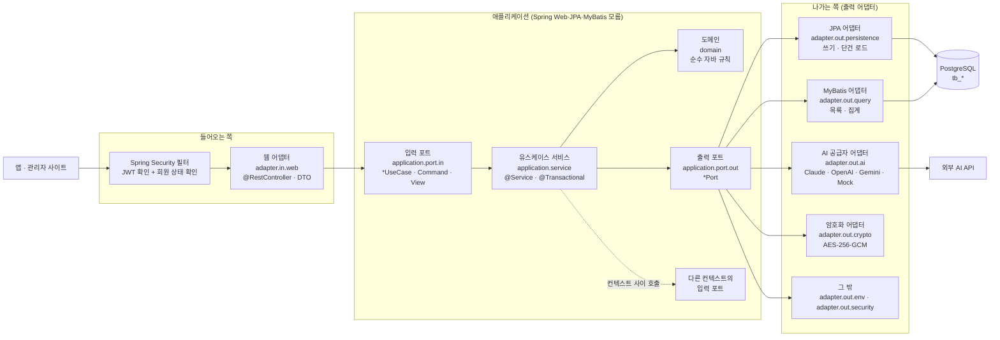
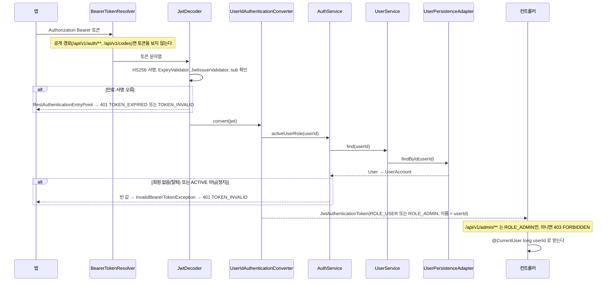
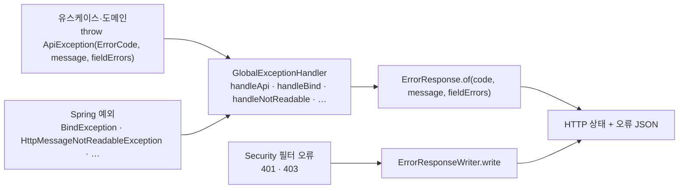
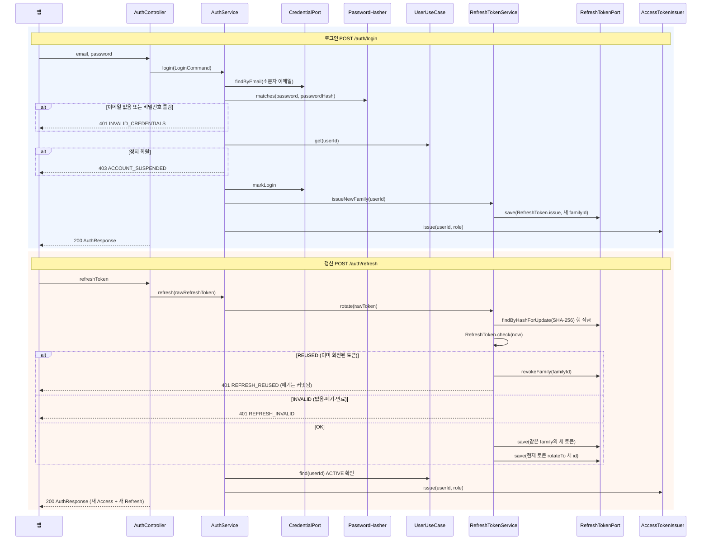
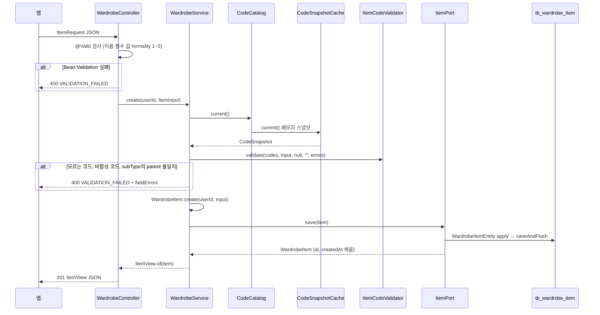
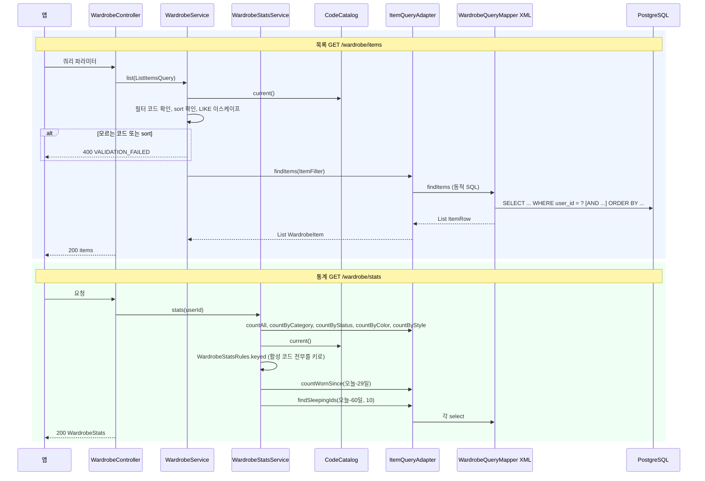
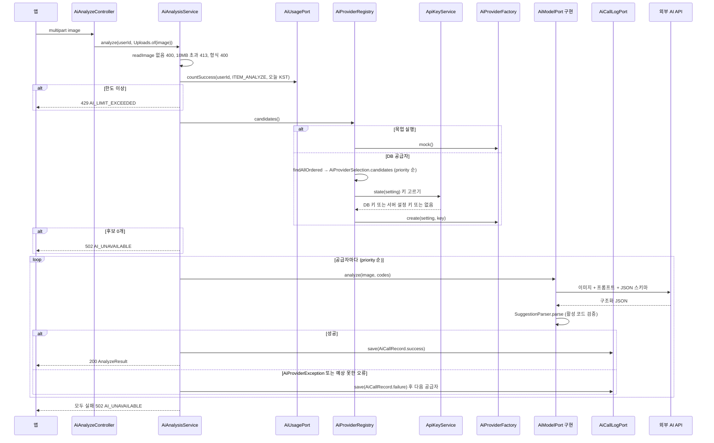
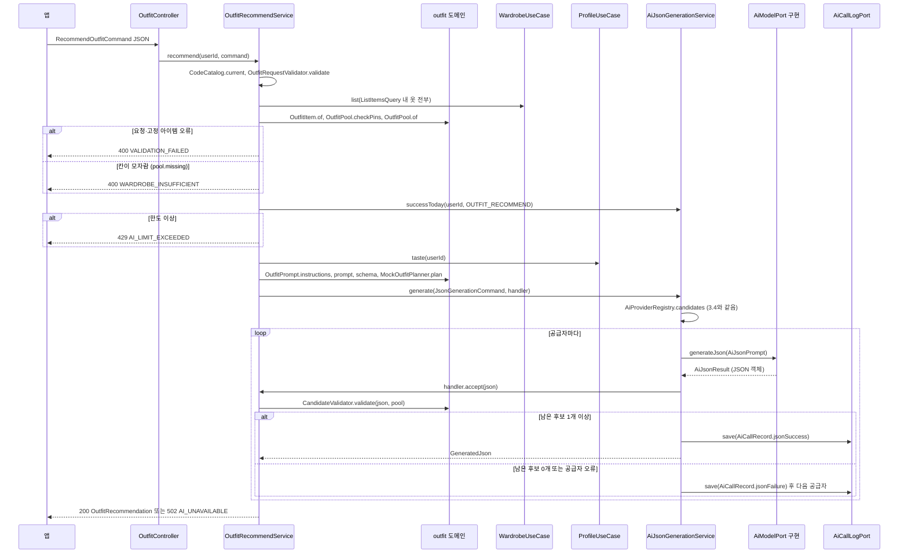
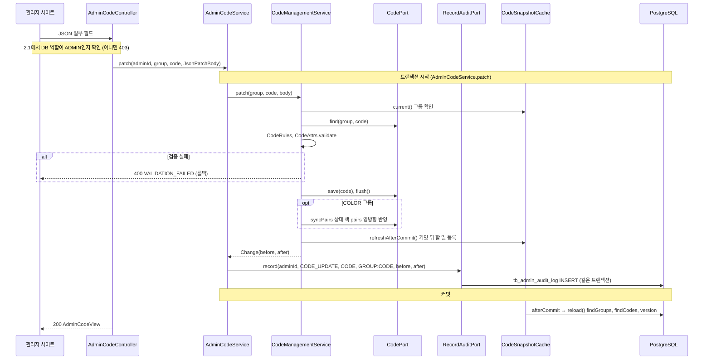
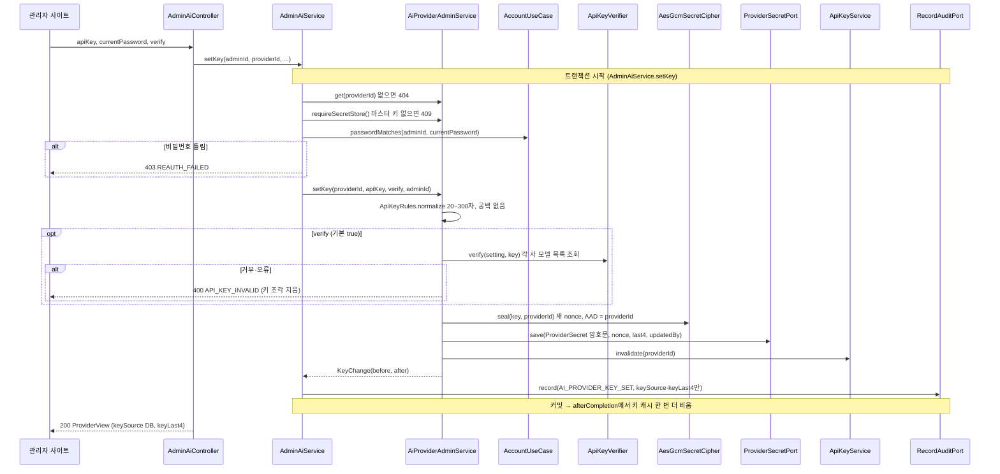

# 10. 백엔드 요청 흐름

> **대상 독자**: `backend/` 코드를 처음 보는 백엔드 개발자. 요청 하나가 어떤 클래스를 어떤 순서로 지나가는지 이해하려는 사람.
> **기준 커밋**: `3630f65` (`dev`, 2026-10-17, "클라우드 백엔드 4차 병합: Google Java Style + AI 코디 추천 API"). 클래스·메서드 이름은 이 커밋의 코드에서 확인했다. 코드가 바뀌면 이 문서도 고친다.
>
> 구조 규칙(왜 이렇게 나눴는지)은 [08_백엔드_구조.md](08_백엔드_구조.md), API 계약은 [05](05_백엔드_API.md)·[06](06_코드_관리.md)·[07](07_관리자_사이트.md)·[09](09_AI_코디_추천.md)를 본다. 이 문서는 **실행 순서**만 다룬다.

## 1. 한눈에 보기

### 1.1 계층 그림

요청은 바깥(웹 어댑터)에서 안쪽(유스케이스·도메인)으로 들어갔다가 출력 포트를 거쳐 다시 바깥(DB·외부 API)으로 나간다. 화살표는 **실행 중 호출 방향**이다. 컴파일 의존은 언제나 안쪽을 향한다(출력 어댑터가 출력 포트를 구현한다).

### 1.2 컨텍스트

패키지 `app.wearly.<컨텍스트>` 하나가 바운디드 컨텍스트 하나다. 컨텍스트 사이 호출은 상대의 **입력 포트**로만 한다(ArchUnit [`HexagonalArchitectureTest`][HexagonalArchitectureTest]가 검사).

| 컨텍스트 | 책임 (한 줄) | 대표 입력 포트 | 대표 경로 |
|---|---|---|---|
| `auth` | 가입·로그인·토큰 발급·갱신·로그아웃, 매 요청 회원 상태 확인 | [`AuthUseCase`][AuthUseCase], [`AuthenticationUseCase`][AuthenticationUseCase], [`AccountUseCase`][AccountUseCase] | `/api/v1/auth/**` |
| `user` | 회원 계정과 프로필(취향·근무 패턴) | [`UserUseCase`][UserUseCase], [`ProfileUseCase`][ProfileUseCase] | `/api/v1/users/me/**` |
| `wardrobe` | 옷장 아이템 등록·수정·삭제·목록·통계 | [`WardrobeUseCase`][WardrobeUseCase], [`WardrobeStatsUseCase`][WardrobeStatsUseCase] | `/api/v1/wardrobe/**` |
| `code` | 옷 속성 코드 테이블, 메모리 캐시, 코드 변경 | [`CodeCatalog`][CodeCatalog], [`CodeManagementUseCase`][CodeManagementUseCase] | `GET /api/v1/codes` |
| `ai` | AI 공급자 고르기·호출·기록·한도, 공급자 설정과 웹 입력 키 | [`AnalyzeImageUseCase`][AnalyzeImageUseCase], [`JsonGenerationUseCase`][JsonGenerationUseCase], [`AiProviderAdminUseCase`][AiProviderAdminUseCase] | `POST /api/v1/wardrobe/items/analyze` |
| `admin` | 관리자 API(대시보드·코드·공급자·회원·변경 이력), 감사 로그, 시작 시 관리자 계정 | [`AdminCodeUseCase`][AdminCodeUseCase], [`AdminAiProviderUseCase`][AdminAiProviderUseCase], [`EnsureAdminUseCase`][EnsureAdminUseCase] | `/api/v1/admin/**` |
| `outfit` | AI 코디 추천: 프롬프트·스키마·후보 검증 (출력 포트 없음) | [`RecommendOutfitUseCase`][RecommendOutfitUseCase] | `POST /api/v1/outfits/recommendations` |
| `common` | 컨텍스트가 아니다. 설정(`config`), 오류(`error`), 웹 도우미(`web`), 공용 값(`domain`), MyBatis TypeHandler(`mybatis`) | — | — |

### 1.3 패키지 이름 규칙

| 패키지 | 들어가는 것 | 이름 규칙 | 예 |
|---|---|---|---|
| `<ctx>.domain` | 도메인 모델·값 객체·규칙. Spring·JPA·Jackson 없음 | 명사, 규칙 모음은 `*Rules`·`*Validator` | [`WardrobeItem`][WardrobeItem], [`ApiKeyRules`][ApiKeyRules], [`CandidateValidator`][CandidateValidator] |
| `<ctx>.application.port.in` | 유스케이스 인터페이스, 명령·조회 조건·결과 | `*UseCase`, `*Command`, `*Query`, `*View`·`*Result` | [`WardrobeUseCase`][WardrobeUseCase], [`LoginCommand`][LoginCommand], [`ListItemsQuery`][ListItemsQuery], [`ItemView`][ItemView] |
| `<ctx>.application.port.out` | 출력 포트 | `*Port` (쓰기·단건은 `ItemPort`, 조회는 `ItemQueryPort`처럼 `Query`를 붙인다) | [`ItemPort`][ItemPort], [`ItemQueryPort`][ItemQueryPort], [`AiModelPort`][AiModelPort] |
| `<ctx>.application.service` | 유스케이스 구현 | `*Service` | [`WardrobeService`][WardrobeService], [`AiProviderRegistry`][AiProviderRegistry] |
| `<ctx>.adapter.in.web` | 컨트롤러, 요청·응답 DTO | `*Controller`, `*Dtos`(DTO 묶음) | [`WardrobeController`][WardrobeController], [`WardrobeDtos`][WardrobeDtos] |
| `<ctx>.adapter.in.startup` | 서버 시작 때 도는 것 | — | [`AdminBootstrap`][AdminBootstrap], [`AiStartupLogger`][AiStartupLogger] |
| `<ctx>.adapter.out.persistence` | JPA 엔티티·Spring Data 리포지토리·쓰기 포트 구현 | `*Entity`, `*Repository`, `*PersistenceAdapter` | [`WardrobeItemEntity`][WardrobeItemEntity], [`WardrobeItemRepository`][WardrobeItemRepository], [`ItemPersistenceAdapter`][ItemPersistenceAdapter] |
| `<ctx>.adapter.out.query` | MyBatis 매퍼·행 객체·조회 포트 구현. SQL은 `resources/mapper/<ctx>/*.xml` | `*Mapper`, `*Row`, `*QueryAdapter` | [`WardrobeQueryMapper`][WardrobeQueryMapper], [`ItemRow`][ItemRow], [`ItemQueryAdapter`][ItemQueryAdapter] |
| `<ctx>.adapter.out.<기술>` | 그 밖의 기술 (`ai`, `crypto`, `env`, `security`) | 기술 이름 + 역할 | [`ClaudeAiProvider`][ClaudeAiProvider], [`AesGcmSecretCipher`][AesGcmSecretCipher], [`EnvApiKeyAdapter`][EnvApiKeyAdapter], [`JwtAccessTokenIssuer`][JwtAccessTokenIssuer] |

- 예외로 이름에 `UseCase`·`Port`가 없는 포트가 있다: [`CodeCatalog`][CodeCatalog](입력), [`AccessTokenIssuer`][AccessTokenIssuer]·[`PasswordHasher`][PasswordHasher](출력).
- 08 문서 2장의 예시 `SaveItemPort`·`LoadItemPort`는 실제 코드에 없다. 쓰기·단건 로드는 [`ItemPort`][ItemPort] 하나로 합쳐져 있다.

## 2. 공통 흐름

### 2.1 인증: JWT 필터 → 매 요청 회원 상태 확인

모든 요청은 컨트롤러에 닿기 전에 [`SecurityConfig`][SecurityConfig]의 필터 체인을 지난다. 세션은 쓰지 않는다(`STATELESS`).

| 단계 | 클래스 | 하는 일 |
|---|---|---|
| 1 | [`SecurityConfig`][SecurityConfig] `bearerTokenResolver()` | `Authorization: Bearer` 헤더를 읽는다. `/api/v1/auth/` 아래와 `/api/v1/codes`에서는 `null`을 돌려 만료된 토큰이 같이 와도 무시한다 |
| 2 | `SecurityConfig.jwtDecoder` (NimbusJwtDecoder) | HS256 서명, [`ExpiryValidator`][ExpiryValidator](시계 오차 허용 없음, 만료는 `wearly_token_expired`), `iss = wearly`, `sub`가 비지 않음 |
| 3 | [`UserIdAuthenticationConverter`][UserIdAuthenticationConverter] `convert` | `sub`를 userId로 바꾸고 [`AuthenticationUseCase`][AuthenticationUseCase]`.activeUserRole`을 부른다. **권한은 토큰의 `role` 클레임이 아니라 DB의 현재 역할**로 준다 |
| 4 | [`AuthService`][AuthService] `activeUserRole` → [`UserService`][UserService] `find` → [`UserPersistenceAdapter`][UserPersistenceAdapter] | 회원을 읽어 `ACTIVE`일 때만 역할을 돌려준다. 탈퇴·정지 회원의 남은 Access 토큰은 여기서 401 `TOKEN_INVALID`가 된다 |
| 5 | `SecurityConfig.securityFilterChain` `authorizeHttpRequests` | 공개: `OPTIONS /**`, `/api/v1/auth/**`, `GET /api/v1/codes`, `/actuator/health`, `/error`. 관리자: `/api/v1/admin/**` → `hasRole("ADMIN")`. 그 밖은 로그인 필요 |
| 6 | [`RestAuthenticationEntryPoint`][RestAuthenticationEntryPoint] `classify` | 인증 실패를 분류: 토큰 없음 `UNAUTHORIZED`, 만료 `TOKEN_EXPIRED`(앱이 이 코드로 자동 갱신), 그 밖 `TOKEN_INVALID` |
| 7 | [`ErrorResponseWriter`][ErrorResponseWriter] `write` | 필터 단계 오류(401·403)를 오류 JSON으로 쓴다. 컨트롤러 밖이라 전역 처리기를 거치지 않는다 |
| 8 | [`CurrentUser`][CurrentUser] | `@AuthenticationPrincipal(expression = "T(java.lang.Long).parseLong(subject)")`. 컨트롤러가 `@CurrentUser long userId`로 받는다 |

### 2.2 오류 처리: 예외 → 전역 처리기 → 오류 JSON

모든 오류 응답은 `{ status, code, message, fieldErrors }` 하나의 모양이다(05 문서 4장).

| 상황 | 던지는 곳 | 받는 곳 | 결과 |
|---|---|---|---|
| 업무 규칙 위반 | 서비스·도메인이 [`ApiException`][ApiException] | [`GlobalExceptionHandler`][GlobalExceptionHandler] `handleApi` | [`ErrorCode`][ErrorCode]의 상태 번호, 메시지, `fieldErrors` |
| 입력 검증 여러 개 | `List<FieldError>`에 모은 뒤 `ApiException.throwIfAny(errors)` | `handleApi` | 400 `VALIDATION_FAILED` + 필드별 오류 |
| `@Valid` 본문 검증 실패 | Spring (`BindException`) | `handleBind` | 400 `VALIDATION_FAILED` |
| JSON 형식 오류·타입 불일치 | Spring (`HttpMessageNotReadableException`) | `handleNotReadable` | 400, 필드 이름은 [`JsonPaths`][JsonPaths]가 `items[3].subType` 모양으로 |
| 업로드 10MB 초과 | Spring (`MaxUploadSizeExceededException`·`MultipartException`) | `handleTooLarge`·`handleMultipart` | 413 `IMAGE_TOO_LARGE` |
| 없는 경로·메서드·미디어 타입 | Spring | `handleNoResource`·`handleMethod`·`handleMediaType` | 404·405·415 |
| 그 밖의 모든 예외 | — | `handleUnknown` | 500 `INTERNAL_ERROR`, ERROR 로그 |
| 인증·권한 실패 | Spring Security | [`RestAuthenticationEntryPoint`][RestAuthenticationEntryPoint]·`accessDeniedHandler` → [`ErrorResponseWriter`][ErrorResponseWriter] | 401·403 |

- [`ErrorCode`][ErrorCode]는 HTTP 상태 번호와 기본 메시지를 함께 가진 enum이다. Spring Web 타입을 쓰지 않으므로 유스케이스가 직접 쓴다.
- AI 공급자 오류는 [`AiProviderException`][AiProviderException]이다. `ApiException`이 아니다. 서비스가 잡아서 기록하고 다음 공급자로 넘어가며, 모두 실패해야 `ApiException(AI_UNAVAILABLE)` → 502가 된다(3.4·3.5).

### 2.3 트랜잭션 경계

| 규칙 | 내용 |
|---|---|
| 경계는 서비스 | `@Transactional`은 `application.service`에 둔다. 컨트롤러에는 없다. `spring.jpa.open-in-view: false` |
| 조회는 읽기 전용 | 목록·통계·단건 조회는 `@Transactional(readOnly = true)` (예: `WardrobeService.list`, `WardrobeStatsService.stats`) |
| JPA + MyBatis 한 트랜잭션 | 둘 다 같은 DataSource·트랜잭션 매니저를 쓴다. 한 서비스 메서드 안에서 섞어도 된다 |
| AI 호출은 트랜잭션 밖 | [`AiAnalysisService`][AiAnalysisService] `analyze`, [`AiJsonGenerationService`][AiJsonGenerationService] `generate`, [`OutfitRecommendService`][OutfitRecommendService] `recommend`에는 `@Transactional`이 없다. 외부 호출(수 초~수십 초) 동안 DB 연결을 잡지 않는다. 호출 기록(`AiCallLogPort.save`)은 한 건씩 바로 커밋되므로, 마지막에 502가 나도 실패 기록은 남는다 |
| 회전 실패도 커밋 | [`AuthService`][AuthService] `refresh`와 [`RefreshTokenService`][RefreshTokenService] `rotate`는 `noRollbackFor = ApiException.class`. 재사용 감지로 family 전체를 폐기한 결과를 401을 던지면서도 커밋한다 |
| 반드시 바깥 트랜잭션 안 | `RefreshTokenService.issueNewFamily`와 [`AuditLogPersistenceAdapter`][AuditLogPersistenceAdapter] `record`는 `Propagation.MANDATORY`. 감사 로그는 변경과 같은 트랜잭션이라 변경이 롤백되면 이력도 남지 않는다 |
| 커밋 뒤에 할 일 | 코드 캐시는 [`CodeSnapshotPort`][CodeSnapshotPort] `refreshAfterCommit`(커밋 뒤 다시 읽기), AI 키 캐시는 [`ApiKeyService`][ApiKeyService] `invalidate` → [`TransactionHooksPort`][TransactionHooksPort] `afterCompletion`(끝난 뒤 한 번 더 비우기) |
| 예외 하나 | [`AdminAiService`][AdminAiService] `setKey`는 키 확인(각 사 모델 목록 조회)을 트랜잭션 안에서 한다. 관리자만 드물게 쓰므로 그대로 둔다(코드 주석) |

### 2.4 설정

| 무엇 | 어디 | 비고 |
|---|---|---|
| 공통 설정 | `backend/src/main/resources/application.yml` | git 포함, 비밀 값 없음. `${이름:기본값}`은 OS 환경변수로 덮어쓸 수 있다 |
| 로컬 비밀 설정 | `backend/config/application-local.yml` | git·docker 이미지 제외. `spring.config.import: optional:file:${WEARLY_LOCAL_CONFIG:./config/application-local.yml}`로 읽으므로 `backend/`에서 실행한다. 견본 `application-local.example.yml` |
| 프로필 | `application-docker.yml`(compose의 DB 주소), `application-prod.yml`(JWT 키 필수) | 테스트·하네스는 `WEARLY_LOCAL_CONFIG`를 없는 경로로 줘서 로컬 비밀 설정을 읽지 않는다 |
| 바인딩 | [`WearlyProperties`][WearlyProperties] (`@ConfigurationProperties("wearly")`) | `jwt`·`ai`·`admin`·`cors`·`secret-key` |
| 유스케이스용 설정 값 | [`ApplicationSettingsConfig`][ApplicationSettingsConfig] | `WearlyProperties`를 도메인 값 [`TokenPolicy`][TokenPolicy]·[`AiSettings`][AiSettings]·[`OutfitSettings`][OutfitSettings] 빈으로 바꾼다. 유스케이스는 Spring 설정 클래스를 보지 않는다. 어댑터(`JwtAccessTokenIssuer`·`AiProviderFactory`·`ApiKeyVerifier`·`AesGcmSecretCipher`)는 `WearlyProperties`를 직접 읽는다 |
| 시각 | [`ClockConfig`][ClockConfig] `Clock.systemUTC()` + [`Zones`][Zones] | 일일 한도·최근 착용 같은 "오늘"은 `Zones.today(clock)`(Asia/Seoul) |
| AI 공급자 키 | [`EnvApiKeyAdapter`][EnvApiKeyAdapter] | `wearly.ai.keys.<키 이름>` → 같은 이름 속성·OS 환경변수 (3.4) |

서버가 뜰 때 도는 것: Flyway(`V1`~`V5`) → [`AdminBootstrap`][AdminBootstrap](`ApplicationRunner`, `wearly.admin.*`가 있으면 `EnsureAdminUseCase.ensureAdmin`) → `ApplicationReadyEvent`에서 [`CodeSnapshotCache`][CodeSnapshotCache] `warmUp`(코드 캐시 채우기)과 [`AiStartupLogger`][AiStartupLogger] → `AiStatusUseCase.logStartupStatus`(쓸 수 있는 공급자 INFO, 없으면 WARN).

## 3. 대표 흐름

각 흐름은 2.1의 인증을 이미 통과했다고 본다. 표의 `포트 (구현)`은 "서비스가 부르는 인터페이스 (실제로 도는 클래스)"다.

### 3.1 로그인과 토큰 갱신 (Refresh 회전·재사용 감지)

`POST /api/v1/auth/login` → `POST /api/v1/auth/refresh`. 둘 다 공개 경로다.

**로그인**

| 단계 | 클래스 | 하는 일 |
|---|---|---|
| 1 | [`AuthController`][AuthController] `login` | `@Valid LoginRequest`([`AuthDtos`][AuthDtos]) → `toCommand()` → [`LoginCommand`][LoginCommand] |
| 2 | [`AuthService`][AuthService] `login` (`@Transactional`) | `LocalCredential.normalizeEmail`로 소문자 이메일을 만들어 [`CredentialPort`][CredentialPort] `findByEmail` ([`CredentialPersistenceAdapter`][CredentialPersistenceAdapter]) |
| 3 | [`PasswordHasher`][PasswordHasher] `matches` ([`BcryptPasswordHasher`][BcryptPasswordHasher]) | 이메일이 없어도 더미 해시와 비교해 응답 시간을 맞춘다. 틀리면 401 `INVALID_CREDENTIALS`(어느 쪽이 틀렸는지 알리지 않음) |
| 4 | [`UserUseCase`][UserUseCase] `get` ([`UserService`][UserService]) | 비밀번호가 맞을 때만 정지 여부를 본다. `isActive()`가 아니면 403 `ACCOUNT_SUSPENDED` |
| 5 | `CredentialPort.markLogin` | 마지막 로그인 시각 |
| 6 | [`RefreshTokenService`][RefreshTokenService] `issueNewFamily` (`MANDATORY`) | [`RefreshTokens`][RefreshTokens] `newRawToken`(32바이트 base64url) → `hash`(SHA-256 hex) → [`RefreshToken`][RefreshToken] `issue` → [`RefreshTokenPort`][RefreshTokenPort] `save` ([`RefreshTokenPersistenceAdapter`][RefreshTokenPersistenceAdapter]). DB에는 해시만 저장 |
| 7 | [`AccessTokenIssuer`][AccessTokenIssuer] `issue` ([`JwtAccessTokenIssuer`][JwtAccessTokenIssuer]) | JWT HS256: `iss`, `sub = userId`, `role`, `iat`, `exp = 지금 + accessTtl` |
| 8 | `AuthResponse.from(AuthResult)` | `accessToken`, `accessTokenExpiresIn`, `refreshToken`(원문은 이때 한 번만 나감), `refreshTokenExpiresIn`, `user` |

**갱신**

| 단계 | 클래스 | 하는 일 |
|---|---|---|
| 1 | [`AuthController`][AuthController] `refresh` | 본문이 없어도 `null`로 넘긴다 |
| 2 | [`AuthService`][AuthService] `refresh` (`noRollbackFor = ApiException`) | 회전을 맡기고, 끝나면 회원 상태를 확인한다 |
| 3 | [`RefreshTokenService`][RefreshTokenService] `rotate` | 비었으면 401 `REFRESH_INVALID`. `RefreshTokenPort.findByHashForUpdate` → [`RefreshTokenRepository`][RefreshTokenRepository] `findByTokenHashForUpdate`(`PESSIMISTIC_WRITE`). 동시에 같은 토큰으로 갱신해도 하나만 회전한다 |
| 4 | [`RefreshToken`][RefreshToken] `check(now)` (도메인) | 폐기됐고 `replacedById`가 있으면 `REUSED`, 폐기됐지만 회전이 아니거나(로그아웃·정지) 만료면 `INVALID`, 그 밖 `OK` |
| 5 | `RefreshTokenPort.revokeFamily` | `REUSED`면 같은 `family_id` 전체 폐기 후 401 `REFRESH_REUSED`. `noRollbackFor` 덕분에 폐기는 커밋된다 |
| 6 | `RefreshTokenService.issue` → `RefreshToken.rotateTo` → `RefreshTokenPort.save` | `OK`면 같은 family로 새 토큰을 만들고, 현재 토큰에 `revoked_at`·`replaced_by_id`를 채운다 |
| 7 | `UserUseCase.find` | 회원이 없거나 정지면 401 `REFRESH_INVALID` |
| 8 | `AccessTokenIssuer.issue` | 새 Access 토큰. 응답 모양은 로그인과 같다 |

로그아웃(`POST /auth/logout`)은 `AuthService.logout` → `RefreshTokenService.revoke`: 토큰이 있으면 `revoke` 후 저장, 없거나 틀려도 204.

### 3.2 옷 등록 (JPA 쓰기 경로, 코드 검증)

`POST /api/v1/wardrobe/items`.

| 단계 | 클래스 | 하는 일 |
|---|---|---|
| 1 | [`WardrobeController`][WardrobeController] `create` | `@Valid ItemRequest`([`WardrobeDtos`][WardrobeDtos]): 형식 검사만 한다(코드 값 검사는 유스케이스). `toInput()` → [`ItemInput`][ItemInput](도메인 값) |
| 2 | [`WardrobeService`][WardrobeService] `create` (`@Transactional`) | 쓰기 유스케이스 시작 |
| 3 | [`CodeCatalog`][CodeCatalog] `current` ([`CodeCatalogService`][CodeCatalogService] → [`CodeSnapshotCache`][CodeSnapshotCache]) | 메모리의 `volatile` [`CodeSnapshot`][CodeSnapshot]. DB를 다시 읽지 않는다 |
| 4 | [`ItemCodeValidator`][ItemCodeValidator] `validate` (도메인) | [`CodeChecks`][CodeChecks] `one`·`many`로 category·subType·color·pattern·status·seasons·styles가 그룹에 있는지, **새 값은 활성인지** 확인. subType의 parent가 category인지(`CodeSnapshot.belongsTo`) |
| 5 | `ApiException.throwIfAny(errors)` | 모은 오류를 한 번에 400 |
| 6 | [`WardrobeItem`][WardrobeItem] `create` | 새 도메인 모델에 `apply(input)`: 이름·브랜드 앞뒤 공백 제거, 빈 브랜드는 null, 계절·스타일 중복 제거, 착용 수 기본 0 |
| 7 | [`ItemPort`][ItemPort] `save` ([`ItemPersistenceAdapter`][ItemPersistenceAdapter]) | 새 [`WardrobeItemEntity`][WardrobeItemEntity] → `apply(...)` → [`WardrobeItemRepository`][WardrobeItemRepository] `saveAndFlush` → `toDomain`. 엔티티는 어댑터 밖으로 나가지 않는다 |
| 8 | [`ItemView`][ItemView] `of` | 응답 모양(ID는 문자열). 201 |

같은 경로의 다른 쓰기:

| 요청 | 다른 점 |
|---|---|
| `POST /items/bulk` | `WardrobeService.bulkCreate`: 전부 검증(필드 이름 앞에 `items[i].`)한 뒤 하나도 틀리지 않았을 때만 차례로 저장. 한 트랜잭션 |
| `PATCH /items/{id}` | `PathIds.parse(id)` → `WardrobeService.patch`: `ItemPort.find(userId, itemId)`(남의 것은 404, `findByIdAndUserId`) → [`JsonItemPatch`][JsonItemPatch] `applyTo`(보낸 필드만 덮어쓰기) → 이전 값을 넘겨 검증(안 바꾼 비활성 코드는 통과) → `WardrobeItem.apply` → `save` |
| `DELETE /items/{id}` | `ItemPort.find` 후 `ItemPort.delete`. 204 |

### 3.3 옷 목록·통계 (MyBatis 조회 경로)

`GET /api/v1/wardrobe/items?category=&status=&color=&q=&sort=` 와 `GET /api/v1/wardrobe/stats`.

**목록**

| 단계 | 클래스 | 하는 일 |
|---|---|---|
| 1 | [`WardrobeController`][WardrobeController] `list` | 쿼리 파라미터 → [`ListItemsQuery`][ListItemsQuery] |
| 2 | [`WardrobeService`][WardrobeService] `list` (`readOnly`) | `filterCode`: category·status·color가 **알려진 코드인지만** 본다(저장된 값을 찾는 것이라 비활성도 허용). `sort`는 `recent`·`worn`·`name`. `escapeLike`로 `%`·`_`를 이스케이프한 뒤 `%q%` |
| 3 | [`ItemQueryPort`][ItemQueryPort] `findItems` ([`ItemQueryAdapter`][ItemQueryAdapter]) | [`ItemFilter`][ItemFilter]를 매퍼에 그대로 넘긴다 |
| 4 | [`WardrobeQueryMapper`][WardrobeQueryMapper] `findItems` + [`WardrobeQueryMapper.xml`](../backend/src/main/resources/mapper/wardrobe/WardrobeQueryMapper.xml) | `<if>`로 조건을 붙이고 `<choose>`로 정렬. `TEXT[]` 칸은 [`StringListArrayTypeHandler`][StringListArrayTypeHandler]가 `List<String>`으로 |
| 5 | `ItemQueryAdapter.toDomain` → `ItemView.of` | [`ItemRow`][ItemRow] → [`WardrobeItem`][WardrobeItem] → 응답 `{ items }` |

**통계**

| 단계 | 클래스 | 하는 일 |
|---|---|---|
| 1 | [`WardrobeStatsService`][WardrobeStatsService] `stats` (`readOnly`) | `Zones.today(clock)`로 한국 날짜 기준 |
| 2 | `ItemQueryPort.countAll`·`countByCategory`·`countByStatus` | 집계 SQL ([`CountRow`][CountRow] → [`KeyCount`][KeyCount]) |
| 3 | [`WardrobeStatsRules`][WardrobeStatsRules] `keyed` | 활성 코드 전부(0 포함) + 아이템이 있는 비활성 코드를 키로 |
| 4 | `ItemQueryPort.countByColor`·`countByStyle` | 많은 순 |
| 5 | `ItemQueryPort.countWornSince(today - 29)` → `WardrobeStatsRules.utilization` | 최근 30일 착용 수, 활용률(소수 둘째 자리) |
| 6 | `ItemQueryPort.findSleepingIds(today - 60, 10)` → `Ids.format` | 잠자는 옷 id 문자열 최대 10개 |

### 3.4 사진 AI 분석

`POST /api/v1/wardrobe/items/analyze` (multipart `image`). 경로는 옷장 아래지만 `ai` 컨텍스트의 컨트롤러가 받는다.

| 단계 | 클래스 | 하는 일 |
|---|---|---|
| 1 | [`AiAnalyzeController`][AiAnalyzeController] `analyze` | `MultipartFile` → [`Uploads`][Uploads] `of` → [`ImageUpload`][ImageUpload](바이트·MIME). `MultipartFile`은 웹 어댑터 밖으로 나가지 않는다 |
| 2 | [`AiAnalysisService`][AiAnalysisService] `analyze` (트랜잭션 없음) → `readImage` | 파트 없음·빈 파일 400 → 10MB 초과 413 `IMAGE_TOO_LARGE` → 읽기 실패 400 → [`ImageTypes`][ImageTypes] `resolve`(jpeg·png·webp·heic) → [`AiImage`][AiImage](바이트·MIME·SHA-256) |
| 3 | `usedToday` → [`AiUsagePort`][AiUsagePort] `countSuccess` ([`AiUsageQueryAdapter`][AiUsageQueryAdapter] → [`AiUsageMapper`][AiUsageMapper]) | 오늘(한국 시간) 성공한 `ITEM_ANALYZE` 수(MyBatis). `AiSettings.dailyLimit()` 이상이면 429 |
| 4 | [`AiProviderRegistry`][AiProviderRegistry] `candidates` (`readOnly`) | 목업 실행이면 `AiModelFactoryPort.mock()` 하나. 아니면 [`AiProviderPort`][AiProviderPort] `findAllOrdered` → [`AiProviderSelection`][AiProviderSelection] `candidates`: `enabled`·모델·키를 모두 갖춘 행만 `priority` 오름차순 |
| 5 | [`ApiKeyService`][ApiKeyService] `state` → [`ApiKeyRules`][ApiKeyRules] `choose` | **키 고르기**: ① 마스터 키가 있고 DB 행이 있으면 DB 키([`ProviderSecretPort`][ProviderSecretPort] `find` → [`SecretCipherPort`][SecretCipherPort] `open`, 메모리 캐시). 복호화에 실패하면 환경변수로 몰래 바꾸지 않고 "없음". ② 없으면 [`ApiKeyEnvPort`][ApiKeyEnvPort] `resolve` ([`EnvApiKeyAdapter`][EnvApiKeyAdapter]): 설정 `wearly.ai.keys.<api_key_env>` → 같은 이름 속성·OS 환경변수. ③ 둘 다 없으면 쓸 수 없음 |
| 6 | [`AiModelFactoryPort`][AiModelFactoryPort] `create` ([`AiProviderFactory`][AiProviderFactory]) | 공급자 행 + 키로 [`ClaudeAiProvider`][ClaudeAiProvider]·[`OpenAiProvider`][OpenAiProvider]·[`GeminiAiProvider`][GeminiAiProvider]를 만든다. 설정·`updatedAt`·키 해시가 같으면 만든 것을 다시 쓴다. 만들 수 없는 공급자(모델·키 없음)는 `AiProviderRegistry`가 WARN을 남기고 건너뛴다 |
| 7 | 후보가 비면 | 502 `AI_UNAVAILABLE`. **목업으로 대신하지 않는다** |
| 8 | [`AiModelPort`][AiModelPort] `analyze(image, codes)` | 활성 코드로 [`AnalysisPrompt`][AnalysisPrompt] `prompt`·`schema`(허용 값 enum)를 만들어 각 사 구조화 출력으로 호출 → [`SuggestionParser`][SuggestionParser] `parse`가 허용 목록·parent 짝을 검증. 틀리면 [`AiProviderException`][AiProviderException] |
| 9 | 성공: [`AiCallLogPort`][AiCallLogPort] `save(AiCallRecord.success(...))` ([`AiCallLogPersistenceAdapter`][AiCallLogPersistenceAdapter]) | `tb_ai_analysis_log`에 공급자·모델·지연·토큰·결과 JSON. 응답 [`AnalyzeResult`][AnalyzeResult](`suggestion`, `provider`, `model`, `remainingToday`) |
| 10 | 실패: `AiCallRecord.failure(...)` 저장 → 다음 공급자 | `AiProviderException`이면 그 `reason`(`API_500`·`TIMEOUT` …), 그 밖 `RuntimeException`은 `UNEXPECTED` |
| 11 | 모두 실패 | 502 `AI_UNAVAILABLE`. 실패 기록은 이미 커밋돼 남는다(2.3) |

관리자 시험 분석(`POST /admin/ai/providers/{id}/test`)은 같은 서비스의 `test`다: `AiProviderRegistry.forTest`로 그 공급자 하나만, 한도 없이, `ADMIN_TEST`로 기록.

### 3.5 AI 코디 추천

`POST /api/v1/outfits/recommendations`. `outfit`은 출력 포트가 없다. 필요한 것은 모두 다른 컨텍스트의 **입력 포트**로 얻는다: 옷장(`wardrobe`), 취향(`user`), 코드(`code`), 공급자 호출·기록·한도(`ai`).

| 단계 | 클래스 | 하는 일 |
|---|---|---|
| 1 | [`OutfitController`][OutfitController] `recommend` | 본문을 입력 포트의 [`RecommendOutfitCommand`][RecommendOutfitCommand]로 그대로 받는다(Bean Validation 없음, 검증은 유스케이스) |
| 2 | [`OutfitRecommendService`][OutfitRecommendService] `recommend` (트랜잭션 없음) | `CodeCatalog.current()` → [`OutfitRequestValidator`][OutfitRequestValidator] `validate` → [`OutfitRequest`][OutfitRequest]. 날짜·상황·분위기·격식·날씨·count 등이 틀리면 400 `VALIDATION_FAILED`(`context.date` 같은 필드 이름) |
| 3 | [`WardrobeUseCase`][WardrobeUseCase] `list` (wardrobe) | 필터 없는 `ListItemsQuery`로 내 옷 전부(3.3 목록 경로, MyBatis) → [`OutfitItem`][OutfitItem] `of(..., codes)`: 칸(CATEGORY `slot`)·보온·색 속성을 코드에서 붙인다 |
| 4 | [`OutfitPool`][OutfitPool] `checkPins` → `of` → `missing` (도메인) | 고정·중심 아이템이 내 옷이고 칸이 맞는지(아니면 400). 추천 가능한 상태·제외 목록·피하고 싶은 색을 걸러 칸별 후보 풀을 만든다. 상의+하의 또는 원피스, 신발이 없으면 400 `WARDROBE_INSUFFICIENT`(`message`에 모자란 칸) |
| 5 | [`JsonGenerationUseCase`][JsonGenerationUseCase] `successToday` (ai) | 오늘 성공한 `OUTFIT_RECOMMEND` 수. `OutfitSettings.dailyLimit()` 이상이면 429. 사진 분석 한도와 따로 센다 |
| 6 | [`ProfileUseCase`][ProfileUseCase] `taste` (user) | [`ProfileTaste`][ProfileTaste](드레스 코드·선호 스타일·선호 색) → [`OutfitTaste`][OutfitTaste] |
| 7 | [`OutfitPrompt`][OutfitPrompt] `instructions`·`prompt`·`schema`, [`MockOutfitPlanner`][MockOutfitPlanner] `plan` (도메인) | 시스템 지시(점수 기준 포함), 사용자 메시지(조건·취향·최근 코디·색 짝·칸별 옷 목록), 칸 값이 **그 칸의 내 옷 id enum**인 JSON 스키마, 목업 실행용 결정적 후보. 공급자와 무관한 순수 자바 |
| 8 | [`JsonGenerationCommand`][JsonGenerationCommand] → [`AiJsonGenerationService`][AiJsonGenerationService] `generate` | `AiProviderRegistry.candidates()`(3.4의 4~6단계와 같은 공급자·우선순위·키 고르기). 후보가 없으면 502 |
| 9 | [`AiModelPort`][AiModelPort] `generateJson` | [`AiJsonPrompt`][AiJsonPrompt](이미지 없음)로 각 사 구조화 출력 호출 → `SuggestionParser.parseObject`로 JSON 객체(Map)까지만 만든다 → [`AiJsonResult`][AiJsonResult]. 목업 공급자는 `mockOutput`을 그대로 돌려준다 |
| 10 | [`JsonOutputHandler`][JsonOutputHandler] `accept` = `OutfitRecommendService.accept` → [`CandidateValidator`][CandidateValidator] `validate` | 후보마다 내 옷인지, 칸이 맞는지, `TOP+BOTTOM` xor `DRESS`, `SHOES`, 고정·중심 포함, 제외·색, 중복, `reason`·`aiScores` 형식. 틀린 후보만 버린다. 남은 후보가 0개면 [`RejectedOutputException`][RejectedOutputException] |
| 11 | `AiCallLogPort.save` | 성공은 `AiCallRecord.jsonSuccess`(결과 `{ candidates, dropped }`), 실패는 `AiCallRecord.jsonFailure`(`error_code` = 공급자 `reason` 또는 `REJECTED_OUTPUT`) 후 다음 공급자 |
| 12 | 응답 | [`GeneratedJson`][GeneratedJson] → [`OutfitRecommendation`][OutfitRecommendation](`candidates`, `provider`, `model`, `remainingToday`). 모두 실패하면 `OutfitRecommendService`가 메시지를 "AI 코디 추천을 지금 받을 수 없어요…"로 바꿔 502 |

AI를 부르기 전(1~5단계)에 끝나면 기록을 남기지 않는다.

### 3.6 관리자 코드 변경 (감사 로그, 코드 캐시 다시 읽기)

`PATCH /api/v1/admin/codes/{group}/{code}` (ADMIN만).

| 단계 | 클래스 | 하는 일 |
|---|---|---|
| 1 | `SecurityConfig` + [`UserIdAuthenticationConverter`][UserIdAuthenticationConverter] | `/api/v1/admin/**`는 `ROLE_ADMIN`만. 역할은 매 요청 DB에서 읽는다 |
| 2 | [`AdminCodeController`][AdminCodeController] `patch` | 본문을 [`JsonPatchBody`][JsonPatchBody]([`PatchBody`][PatchBody] 구현)로 감싼다. "안 보냄"과 "`null`을 보냄"을 구분하기 위해서다 |
| 3 | [`AdminCodeService`][AdminCodeService] `patch` (`@Transactional`) | 트랜잭션 경계. 실제 변경은 `code` 컨텍스트의 [`CodeManagementUseCase`][CodeManagementUseCase]에 맡긴다 |
| 4 | [`CodeManagementService`][CodeManagementService] `patch` | `requireGroup`(없는 그룹 404) → [`CodePort`][CodePort] `find`(404) → [`CodeRules`][CodeRules] `label`·`parent`, [`CodeAttrs`][CodeAttrs] `validate`(그룹별 attrs) → `throwIfAny` → [`Code`][Code] `update` → `CodePort.save`·`flush` ([`CodePersistenceAdapter`][CodePersistenceAdapter]) |
| 5 | `CodeManagementService.syncPairs` | COLOR면 상대 색의 `attrs.pairs`에도 이 색을 넣거나 뺀다(양방향) |
| 6 | [`CodeSnapshotPort`][CodeSnapshotPort] `refreshAfterCommit` ([`CodeSnapshotCache`][CodeSnapshotCache]) | 트랜잭션 동기화에 `afterCommit` → `reload()`를 등록만 한다 |
| 7 | [`RecordAuditPort`][RecordAuditPort] `record` ([`AuditLogPersistenceAdapter`][AuditLogPersistenceAdapter], `MANDATORY`) | `tb_admin_audit_log`에 `CODE_UPDATE`, 대상 `GROUP:CODE`, before·after JSON. 변경과 같은 트랜잭션 |
| 8 | 커밋 후 `CodeSnapshotCache.reload` | [`CodeQueryMapper`][CodeQueryMapper] `findGroups`·`findCodes`·`version`(MyBatis)으로 새 스냅샷을 만들어 `volatile` 필드를 바꾼다. 이후 `GET /api/v1/codes`의 `version`·`ETag`가 바뀌고, 옷장 검증·AI 프롬프트도 새 코드를 쓴다. 롤백되면 이력도 캐시 갱신도 없다 |

같은 모양의 다른 코드 API: `create`(`CODE_CREATE`), `reorder`(`CODE_REORDER`, `PUT /{group}/order`), `delete`(`CODE_DELETE`, [`CodeUsagePort`][CodeUsagePort]로 아이템·프로필 사용 수를 세어 쓰는 곳이 있으면 409 `CODE_IN_USE`).

### 3.7 AI 키 웹 입력 (비밀번호 재확인 → 유효성 확인 → AES-GCM 암호화 저장 → 캐시 무효화)

`PUT /api/v1/admin/ai/providers/{providerId}/api-key` 본문 `{ apiKey, currentPassword, verify? }`.

| 단계 | 클래스 | 하는 일 |
|---|---|---|
| 1 | [`AdminAiController`][AdminAiController] `setKey` | 본문 `ApiKeyRequest`([`AdminDtos`][AdminDtos]). 없으면 빈 요청으로 |
| 2 | [`AdminAiService`][AdminAiService] `setKey` (`@Transactional`) | [`AiProviderAdminUseCase`][AiProviderAdminUseCase] `get`(404) → `requireSecretStore`(마스터 키 `wearly.secret-key`가 없으면 409 `SECRET_KEY_MISSING`) |
| 3 | `AdminAiService.reauthenticate` → [`AccountUseCase`][AccountUseCase] `passwordMatches` ([`AuthService`][AuthService]) | `CredentialPort.findByUserId` + `PasswordHasher.matches`. 틀리면 403 `REAUTH_FAILED` |
| 4 | [`AiProviderAdminService`][AiProviderAdminService] `setKey` | `AiProviderPort.findById` → `requireSecretStore` → [`ApiKeyRules`][ApiKeyRules] `normalize`(앞뒤 공백 제거 후 20~300자, 공백·줄바꿈 없음. 틀리면 400 `VALIDATION_FAILED` `apiKey`) |
| 5 | [`ApiKeyVerifierPort`][ApiKeyVerifierPort] `verify` ([`ApiKeyVerifier`][ApiKeyVerifier]) | `verify`가 `false`가 아니면: CLAUDE는 Anthropic SDK로 모델 목록, OPENAI `GET /models`, GEMINI `GET /v1beta/models?pageSize=1`. 실패하면 400 `API_KEY_INVALID`(메시지에서 키를 `***`로 지움) |
| 6 | [`SecretCipherPort`][SecretCipherPort] `seal` ([`AesGcmSecretCipher`][AesGcmSecretCipher]) | `AES/GCM/NoPadding`, 매번 새 12바이트 nonce, 태그 128비트, **AAD = providerId**(다른 공급자 행에 붙여 넣으면 복호화 실패) → [`SealedSecret`][SealedSecret] |
| 7 | [`ProviderSecretPort`][ProviderSecretPort] `save` ([`ProviderSecretPersistenceAdapter`][ProviderSecretPersistenceAdapter]) | [`ProviderSecret`][ProviderSecret](암호문·nonce·key_version·끝 4자·넣은 관리자)을 `tb_ai_provider_secret`에 넣거나 바꾼다. 키 원문은 저장하지 않는다 |
| 8 | [`ApiKeyService`][ApiKeyService] `invalidate` | 복호화 키 캐시에서 지금 지우고, [`TransactionHooksPort`][TransactionHooksPort] `afterCompletion`([`TransactionHooksAdapter`][TransactionHooksAdapter])으로 트랜잭션이 끝난 뒤 한 번 더 지운다(그 사이 다른 요청이 옛 값을 다시 캐시해도 비워지게) |
| 9 | `AiProviderAdminService.info` → `KeyChange` | 바뀐 뒤 상태(`ApiKeyService.state`가 DB 키를 다시 읽고 복호화) |
| 10 | [`RecordAuditPort`][RecordAuditPort] `record` | `AI_PROVIDER_KEY_SET`. before·after에는 `keySource`·`keyLast4`만 남긴다(키 값 없음) |
| 11 | 응답 `ProviderView` | `keySource: DB`, `keyLast4`, `keyUpdatedAt`, `keyUpdatedBy`, `secretStoreEnabled` |

다음 분석·추천부터는 3.4의 5단계가 DB 키를 고르고, [`AiProviderFactory`][AiProviderFactory]는 캐시 키에 들어 있는 키 해시가 달라져 클라이언트를 새로 만든다.
지우기(`DELETE .../api-key`, 본문 `{ currentPassword }`)는 `AdminAiService.deleteKey` → 재확인 → `AiProviderAdminService.deleteKey` → `ProviderSecretPort.delete` → `ApiKeyService.invalidate` → `AI_PROVIDER_KEY_DELETE` 기록. 마스터 키 확인은 하지 않는다. 지운 뒤에는 서버 설정 키로 돌아간다.

## 4. 새 기능을 추가할 때

### 4.1 새 엔드포인트 하나

안쪽에서 바깥쪽 순서로 만든다. 그래야 안쪽 코드가 바깥 기술에 끌려가지 않는다. 오른쪽 열은 본뜰 기존 코드다.

| 순서 | 패키지 | 만드는 것 | 본뜰 코드 |
|---|---|---|---|
| 1 | `<ctx>.domain` | 도메인 모델·값 객체·규칙 (순수 자바) | [`WardrobeItem`][WardrobeItem], [`ItemCodeValidator`][ItemCodeValidator] |
| 2 | `<ctx>.application.port.in` | `*UseCase` 인터페이스, `*Command`·`*Query`, 응답 `*View` | [`WardrobeUseCase`][WardrobeUseCase], [`ListItemsQuery`][ListItemsQuery], [`ItemView`][ItemView] |
| 3 | `<ctx>.application.port.out` | 쓰기·단건 `*Port`(JPA), 목록·집계 `*QueryPort`(MyBatis), 외부 기술 포트 | [`ItemPort`][ItemPort], [`ItemQueryPort`][ItemQueryPort] |
| 4 | `<ctx>.application.service` | `@Service` 구현, `@Transactional`(조회는 `readOnly`) | [`WardrobeService`][WardrobeService] |
| 5 | `resources/db/migration` | 테이블이 필요하면 `V6__<이름>.sql`. JPA는 `ddl-auto: validate`라 스키마는 Flyway만 바꾼다 | [`V5__outfit_recommend.sql`](../backend/src/main/resources/db/migration/V5__outfit_recommend.sql) |
| 6 | `<ctx>.adapter.out.persistence` | `*Entity`, `*Repository`, `*PersistenceAdapter`(엔티티 ↔ 도메인 변환) | [`ItemPersistenceAdapter`][ItemPersistenceAdapter] |
| 7 | `<ctx>.adapter.out.query` | `*Mapper` 인터페이스 + `resources/mapper/<ctx>/*.xml`, `*Row`, `*QueryAdapter` | [`ItemQueryAdapter`][ItemQueryAdapter], [`WardrobeQueryMapper`][WardrobeQueryMapper] |
| 8 | `<ctx>.adapter.in.web` | `*Controller`, `*Dtos`. `@CurrentUser long userId`, 경로 id는 `PathIds.parse`, 업로드는 `Uploads.of` | [`WardrobeController`][WardrobeController] |
| 9 | `common` | 새 오류면 [`ErrorCode`][ErrorCode]에 추가. 공개 경로면 [`SecurityConfig`][SecurityConfig]에 추가(관리자 API는 `/api/v1/admin/` 아래에 두면 자동으로 ADMIN 전용) | — |
| 10 | 테스트 | 도메인 단위 테스트(Spring 없이), 통합 테스트는 [`IntegrationTestBase`][IntegrationTestBase](Testcontainers PostgreSQL) + [`TestApi`][TestApi] | [`CandidateValidatorTest`][CandidateValidatorTest], [`WardrobeIntegrationTest`][WardrobeIntegrationTest] |
| 11 | 문서 | API 계약(05 등)과 이 문서 | — |

체크리스트:

- [ ] `domain`이 Spring·JPA·MyBatis·Jackson을 import하지 않는다.
- [ ] 서비스가 어댑터·JPA 엔티티·MyBatis 매퍼·Web 타입(`ResponseEntity`, `MultipartFile`)을 import하지 않는다.
- [ ] 다른 컨텍스트는 그 컨텍스트의 `port.in`으로만 부른다(리포지토리·매퍼 직접 사용 금지). 새 컨텍스트면 `HexagonalArchitectureTest.CONTEXTS`에 이름을 더한다.
- [ ] 회원 소유 데이터는 `userId`로 함께 찾는다(남의 것은 404, 예: `findByIdAndUserId`).
- [ ] 코드 값(종류·색 등)은 [`CodeCatalog`][CodeCatalog]로 검증한다. 새로 고르는 값은 활성 코드만.
- [ ] 입력 오류는 `List<FieldError>`에 모아 `ApiException.throwIfAny`. JSON의 ID는 문자열(`Ids.format`).
- [ ] 외부 API 호출은 트랜잭션 밖에서 한다.
- [ ] 관리자 변경이면 같은 트랜잭션에서 [`RecordAuditPort`][RecordAuditPort] `record`.
- [ ] 메모리 캐시가 있는 데이터를 바꾸면 커밋 뒤 갱신(`refreshAfterCommit`·`afterCompletion`).
- [ ] 키·비밀 값을 로그·응답·감사 로그에 남기지 않는다.
- [ ] `cd backend && ./gradlew check` (Spotless·Checkstyle·테스트·ArchUnit) 통과.

### 4.2 새 AI 공급자 붙이기

공급자 고르기·키 고르기·기록·한도([`AiProviderRegistry`][AiProviderRegistry], [`ApiKeyService`][ApiKeyService], [`AiAnalysisService`][AiAnalysisService], [`AiJsonGenerationService`][AiJsonGenerationService])와 코디 추천([`OutfitRecommendService`][OutfitRecommendService])은 **바꾸지 않는다**. 바꾸는 곳은 아래뿐이다.

| 순서 | 파일 | 할 일 |
|---|---|---|
| 1 | [`AiProviderType`][AiProviderType] (도메인 enum) | 새 상수 + 설명 + `OptionSpec` 목록(`maxTokens`, `timeoutSeconds`, `baseUrl` …). 관리자 화면 폼은 `GET /admin/ai/types`로 이 목록을 받아 그린다 |
| 2 | [`ProviderDefaults`][ProviderDefaults] | 기본 API 주소, 기본 최대 토큰 |
| 3 | Flyway `V6__*.sql` | `tb_ai_provider`의 `ck_ai_provider_type` CHECK(지금 `'CLAUDE', 'OPENAI', 'GEMINI'`, [`V3__admin_ai.sql`](../backend/src/main/resources/db/migration/V3__admin_ai.sql))에 새 값. 초기 행이 필요하면 함께(키 이름은 `*_API_KEY` 형식, [`AiProviderRules`][AiProviderRules]) |
| 4 | `ai/adapter/out/ai/<이름>/<이름>AiProvider.java` | [`AiModelPort`][AiModelPort] 구현: `name`, `model`, `analyze`(이미지 + `AnalysisPrompt.prompt`·`schema` → `SuggestionParser.parse`), `generateJson`(`AiJsonPrompt` → `SuggestionParser.parseObject`). 실패는 모두 [`AiProviderException`][AiProviderException](reason 코드), 메시지에서 키를 지운다([`Secrets`][Secrets]). REST면 [`HttpCall`][HttpCall]을 쓴다. 본뜰 코드: [`OpenAiProvider`][OpenAiProvider] |
| 5 | [`AiProviderFactory`][AiProviderFactory] `build` | `switch (s.type())`에 새 `case`. default가 없는 switch 식이라 1을 하면 여기서 컴파일 오류가 나서 빠뜨릴 수 없다 |
| 6 | [`ApiKeyVerifier`][ApiKeyVerifier] `verify` | 새 `case`: 그 회사의 가장 싼 확인 호출(모델 목록). 여기는 `default`가 있어 빠뜨리면 실행 중 오류다 |
| 7 | 테스트 | 공급자 단위 테스트는 [`FakeHttpServer`][FakeHttpServer]로 요청 모양·응답 파싱·오류를 확인([`OpenAiProviderTest`][OpenAiProviderTest]). 다음 공급자로 넘어가는지는 [`AiProviderFallbackIntegrationTest`][AiProviderFallbackIntegrationTest]·[`OutfitProviderFallbackIntegrationTest`][OutfitProviderFallbackIntegrationTest]에 더한다 |
| 8 | 문서 | 07 문서 3장(공급자 표), `backend/README.md`(키 설정 예) |

## 5. 관련 문서

| 문서 | 내용 |
|---|---|
| [05_백엔드_API.md](05_백엔드_API.md) | API 계약: 인증·옷장·AI 분석, 오류 코드 표, 토큰 규칙 |
| [06_코드_관리.md](06_코드_관리.md) | 코드 테이블, `GET /codes`, 코드 검증 규칙, 캐시 |
| [07_관리자_사이트.md](07_관리자_사이트.md) | 관리자 역할·API, AI 공급자 고르기, AI 키 웹 입력 |
| [08_백엔드_구조.md](08_백엔드_구조.md) | 헥사고날 원칙·패키지·의존 규칙, 코드 스타일, yml 설정 |
| [09_AI_코디_추천.md](09_AI_코디_추천.md) | AI 코디 추천 계약: 점수 기준, 요청·응답, 검증 |
| [backend/README.md](../backend/README.md) | 실행 방법, 설정 표, 테스트 |
| [backend/WORK_REPORT.md](../backend/WORK_REPORT.md) | 4차 작업 보고: 코디 추천 설계 결정, 계약과 다르게 정한 점 |

<!-- 클래스 링크 (저장소 기준 상대 경로) -->

[AccessTokenIssuer]: ../backend/src/main/java/app/wearly/auth/application/port/out/AccessTokenIssuer.java
[AccountUseCase]: ../backend/src/main/java/app/wearly/auth/application/port/in/AccountUseCase.java
[AdminAiController]: ../backend/src/main/java/app/wearly/admin/adapter/in/web/AdminAiController.java
[AdminAiProviderUseCase]: ../backend/src/main/java/app/wearly/admin/application/port/in/AdminAiProviderUseCase.java
[AdminAiService]: ../backend/src/main/java/app/wearly/admin/application/service/AdminAiService.java
[AdminBootstrap]: ../backend/src/main/java/app/wearly/admin/adapter/in/startup/AdminBootstrap.java
[AdminCodeController]: ../backend/src/main/java/app/wearly/admin/adapter/in/web/AdminCodeController.java
[AdminCodeService]: ../backend/src/main/java/app/wearly/admin/application/service/AdminCodeService.java
[AdminCodeUseCase]: ../backend/src/main/java/app/wearly/admin/application/port/in/AdminCodeUseCase.java
[AdminDtos]: ../backend/src/main/java/app/wearly/admin/adapter/in/web/AdminDtos.java
[AesGcmSecretCipher]: ../backend/src/main/java/app/wearly/ai/adapter/out/crypto/AesGcmSecretCipher.java
[AiAnalysisService]: ../backend/src/main/java/app/wearly/ai/application/service/AiAnalysisService.java
[AiAnalyzeController]: ../backend/src/main/java/app/wearly/ai/adapter/in/web/AiAnalyzeController.java
[AiCallLogPersistenceAdapter]: ../backend/src/main/java/app/wearly/ai/adapter/out/persistence/AiCallLogPersistenceAdapter.java
[AiCallLogPort]: ../backend/src/main/java/app/wearly/ai/application/port/out/AiCallLogPort.java
[AiImage]: ../backend/src/main/java/app/wearly/ai/domain/AiImage.java
[AiJsonGenerationService]: ../backend/src/main/java/app/wearly/ai/application/service/AiJsonGenerationService.java
[AiJsonPrompt]: ../backend/src/main/java/app/wearly/ai/domain/AiJsonPrompt.java
[AiJsonResult]: ../backend/src/main/java/app/wearly/ai/domain/AiJsonResult.java
[AiModelFactoryPort]: ../backend/src/main/java/app/wearly/ai/application/port/out/AiModelFactoryPort.java
[AiModelPort]: ../backend/src/main/java/app/wearly/ai/application/port/out/AiModelPort.java
[AiProviderAdminService]: ../backend/src/main/java/app/wearly/ai/application/service/AiProviderAdminService.java
[AiProviderAdminUseCase]: ../backend/src/main/java/app/wearly/ai/application/port/in/AiProviderAdminUseCase.java
[AiProviderException]: ../backend/src/main/java/app/wearly/ai/domain/AiProviderException.java
[AiProviderFactory]: ../backend/src/main/java/app/wearly/ai/adapter/out/ai/AiProviderFactory.java
[AiProviderFallbackIntegrationTest]: ../backend/src/test/java/app/wearly/ai/AiProviderFallbackIntegrationTest.java
[AiProviderPort]: ../backend/src/main/java/app/wearly/ai/application/port/out/AiProviderPort.java
[AiProviderRegistry]: ../backend/src/main/java/app/wearly/ai/application/service/AiProviderRegistry.java
[AiProviderRules]: ../backend/src/main/java/app/wearly/ai/domain/AiProviderRules.java
[AiProviderSelection]: ../backend/src/main/java/app/wearly/ai/domain/AiProviderSelection.java
[AiProviderType]: ../backend/src/main/java/app/wearly/ai/domain/AiProviderType.java
[AiSettings]: ../backend/src/main/java/app/wearly/ai/domain/AiSettings.java
[AiStartupLogger]: ../backend/src/main/java/app/wearly/ai/adapter/in/startup/AiStartupLogger.java
[AiUsageMapper]: ../backend/src/main/java/app/wearly/ai/adapter/out/query/AiUsageMapper.java
[AiUsagePort]: ../backend/src/main/java/app/wearly/ai/application/port/out/AiUsagePort.java
[AiUsageQueryAdapter]: ../backend/src/main/java/app/wearly/ai/adapter/out/query/AiUsageQueryAdapter.java
[AnalysisPrompt]: ../backend/src/main/java/app/wearly/ai/domain/AnalysisPrompt.java
[AnalyzeImageUseCase]: ../backend/src/main/java/app/wearly/ai/application/port/in/AnalyzeImageUseCase.java
[AnalyzeResult]: ../backend/src/main/java/app/wearly/ai/application/port/in/AnalyzeResult.java
[ApiException]: ../backend/src/main/java/app/wearly/common/error/ApiException.java
[ApiKeyEnvPort]: ../backend/src/main/java/app/wearly/ai/application/port/out/ApiKeyEnvPort.java
[ApiKeyRules]: ../backend/src/main/java/app/wearly/ai/domain/ApiKeyRules.java
[ApiKeyService]: ../backend/src/main/java/app/wearly/ai/application/service/ApiKeyService.java
[ApiKeyVerifier]: ../backend/src/main/java/app/wearly/ai/adapter/out/ai/ApiKeyVerifier.java
[ApiKeyVerifierPort]: ../backend/src/main/java/app/wearly/ai/application/port/out/ApiKeyVerifierPort.java
[ApplicationSettingsConfig]: ../backend/src/main/java/app/wearly/common/config/ApplicationSettingsConfig.java
[AuditLogPersistenceAdapter]: ../backend/src/main/java/app/wearly/admin/adapter/out/persistence/AuditLogPersistenceAdapter.java
[AuthController]: ../backend/src/main/java/app/wearly/auth/adapter/in/web/AuthController.java
[AuthDtos]: ../backend/src/main/java/app/wearly/auth/adapter/in/web/AuthDtos.java
[AuthService]: ../backend/src/main/java/app/wearly/auth/application/service/AuthService.java
[AuthUseCase]: ../backend/src/main/java/app/wearly/auth/application/port/in/AuthUseCase.java
[AuthenticationUseCase]: ../backend/src/main/java/app/wearly/auth/application/port/in/AuthenticationUseCase.java
[BcryptPasswordHasher]: ../backend/src/main/java/app/wearly/auth/adapter/out/security/BcryptPasswordHasher.java
[CandidateValidator]: ../backend/src/main/java/app/wearly/outfit/domain/CandidateValidator.java
[CandidateValidatorTest]: ../backend/src/test/java/app/wearly/outfit/domain/CandidateValidatorTest.java
[ClaudeAiProvider]: ../backend/src/main/java/app/wearly/ai/adapter/out/ai/claude/ClaudeAiProvider.java
[ClockConfig]: ../backend/src/main/java/app/wearly/common/config/ClockConfig.java
[Code]: ../backend/src/main/java/app/wearly/code/domain/Code.java
[CodeAttrs]: ../backend/src/main/java/app/wearly/code/domain/CodeAttrs.java
[CodeCatalog]: ../backend/src/main/java/app/wearly/code/application/port/in/CodeCatalog.java
[CodeCatalogService]: ../backend/src/main/java/app/wearly/code/application/service/CodeCatalogService.java
[CodeChecks]: ../backend/src/main/java/app/wearly/common/domain/code/CodeChecks.java
[CodeManagementService]: ../backend/src/main/java/app/wearly/code/application/service/CodeManagementService.java
[CodeManagementUseCase]: ../backend/src/main/java/app/wearly/code/application/port/in/CodeManagementUseCase.java
[CodePersistenceAdapter]: ../backend/src/main/java/app/wearly/code/adapter/out/persistence/CodePersistenceAdapter.java
[CodePort]: ../backend/src/main/java/app/wearly/code/application/port/out/CodePort.java
[CodeQueryMapper]: ../backend/src/main/java/app/wearly/code/adapter/out/query/CodeQueryMapper.java
[CodeRules]: ../backend/src/main/java/app/wearly/code/domain/CodeRules.java
[CodeSnapshot]: ../backend/src/main/java/app/wearly/common/domain/code/CodeSnapshot.java
[CodeSnapshotCache]: ../backend/src/main/java/app/wearly/code/adapter/out/query/CodeSnapshotCache.java
[CodeSnapshotPort]: ../backend/src/main/java/app/wearly/code/application/port/out/CodeSnapshotPort.java
[CodeUsagePort]: ../backend/src/main/java/app/wearly/code/application/port/out/CodeUsagePort.java
[CountRow]: ../backend/src/main/java/app/wearly/wardrobe/adapter/out/query/CountRow.java
[CredentialPersistenceAdapter]: ../backend/src/main/java/app/wearly/auth/adapter/out/persistence/CredentialPersistenceAdapter.java
[CredentialPort]: ../backend/src/main/java/app/wearly/auth/application/port/out/CredentialPort.java
[CurrentUser]: ../backend/src/main/java/app/wearly/common/web/CurrentUser.java
[EnsureAdminUseCase]: ../backend/src/main/java/app/wearly/admin/application/port/in/EnsureAdminUseCase.java
[EnvApiKeyAdapter]: ../backend/src/main/java/app/wearly/ai/adapter/out/env/EnvApiKeyAdapter.java
[ErrorCode]: ../backend/src/main/java/app/wearly/common/error/ErrorCode.java
[ErrorResponseWriter]: ../backend/src/main/java/app/wearly/common/error/ErrorResponseWriter.java
[ExpiryValidator]: ../backend/src/main/java/app/wearly/auth/adapter/in/web/ExpiryValidator.java
[FakeHttpServer]: ../backend/src/test/java/app/wearly/support/FakeHttpServer.java
[GeminiAiProvider]: ../backend/src/main/java/app/wearly/ai/adapter/out/ai/gemini/GeminiAiProvider.java
[GeneratedJson]: ../backend/src/main/java/app/wearly/ai/application/port/in/GeneratedJson.java
[GlobalExceptionHandler]: ../backend/src/main/java/app/wearly/common/error/GlobalExceptionHandler.java
[HexagonalArchitectureTest]: ../backend/src/test/java/app/wearly/architecture/HexagonalArchitectureTest.java
[HttpCall]: ../backend/src/main/java/app/wearly/ai/adapter/out/ai/HttpCall.java
[ImageTypes]: ../backend/src/main/java/app/wearly/ai/domain/ImageTypes.java
[ImageUpload]: ../backend/src/main/java/app/wearly/common/domain/ImageUpload.java
[IntegrationTestBase]: ../backend/src/test/java/app/wearly/support/IntegrationTestBase.java
[ItemCodeValidator]: ../backend/src/main/java/app/wearly/wardrobe/domain/ItemCodeValidator.java
[ItemFilter]: ../backend/src/main/java/app/wearly/wardrobe/application/port/out/ItemFilter.java
[ItemInput]: ../backend/src/main/java/app/wearly/wardrobe/domain/ItemInput.java
[ItemPersistenceAdapter]: ../backend/src/main/java/app/wearly/wardrobe/adapter/out/persistence/ItemPersistenceAdapter.java
[ItemPort]: ../backend/src/main/java/app/wearly/wardrobe/application/port/out/ItemPort.java
[ItemQueryAdapter]: ../backend/src/main/java/app/wearly/wardrobe/adapter/out/query/ItemQueryAdapter.java
[ItemQueryPort]: ../backend/src/main/java/app/wearly/wardrobe/application/port/out/ItemQueryPort.java
[ItemRow]: ../backend/src/main/java/app/wearly/wardrobe/adapter/out/query/ItemRow.java
[ItemView]: ../backend/src/main/java/app/wearly/wardrobe/application/port/in/ItemView.java
[JsonGenerationCommand]: ../backend/src/main/java/app/wearly/ai/application/port/in/JsonGenerationCommand.java
[JsonGenerationUseCase]: ../backend/src/main/java/app/wearly/ai/application/port/in/JsonGenerationUseCase.java
[JsonItemPatch]: ../backend/src/main/java/app/wearly/wardrobe/adapter/in/web/JsonItemPatch.java
[JsonOutputHandler]: ../backend/src/main/java/app/wearly/ai/application/port/in/JsonOutputHandler.java
[JsonPatchBody]: ../backend/src/main/java/app/wearly/common/web/JsonPatchBody.java
[JsonPaths]: ../backend/src/main/java/app/wearly/common/error/JsonPaths.java
[JwtAccessTokenIssuer]: ../backend/src/main/java/app/wearly/auth/adapter/out/security/JwtAccessTokenIssuer.java
[KeyCount]: ../backend/src/main/java/app/wearly/wardrobe/domain/KeyCount.java
[ListItemsQuery]: ../backend/src/main/java/app/wearly/wardrobe/application/port/in/ListItemsQuery.java
[LoginCommand]: ../backend/src/main/java/app/wearly/auth/application/port/in/LoginCommand.java
[MockOutfitPlanner]: ../backend/src/main/java/app/wearly/outfit/domain/MockOutfitPlanner.java
[OpenAiProvider]: ../backend/src/main/java/app/wearly/ai/adapter/out/ai/openai/OpenAiProvider.java
[OpenAiProviderTest]: ../backend/src/test/java/app/wearly/ai/OpenAiProviderTest.java
[OutfitController]: ../backend/src/main/java/app/wearly/outfit/adapter/in/web/OutfitController.java
[OutfitItem]: ../backend/src/main/java/app/wearly/outfit/domain/OutfitItem.java
[OutfitPool]: ../backend/src/main/java/app/wearly/outfit/domain/OutfitPool.java
[OutfitPrompt]: ../backend/src/main/java/app/wearly/outfit/domain/OutfitPrompt.java
[OutfitProviderFallbackIntegrationTest]: ../backend/src/test/java/app/wearly/outfit/OutfitProviderFallbackIntegrationTest.java
[OutfitRecommendService]: ../backend/src/main/java/app/wearly/outfit/application/service/OutfitRecommendService.java
[OutfitRecommendation]: ../backend/src/main/java/app/wearly/outfit/application/port/in/OutfitRecommendation.java
[OutfitRequest]: ../backend/src/main/java/app/wearly/outfit/domain/OutfitRequest.java
[OutfitRequestValidator]: ../backend/src/main/java/app/wearly/outfit/application/service/OutfitRequestValidator.java
[OutfitSettings]: ../backend/src/main/java/app/wearly/outfit/domain/OutfitSettings.java
[OutfitTaste]: ../backend/src/main/java/app/wearly/outfit/domain/OutfitTaste.java
[PasswordHasher]: ../backend/src/main/java/app/wearly/auth/application/port/out/PasswordHasher.java
[PatchBody]: ../backend/src/main/java/app/wearly/common/domain/PatchBody.java
[ProfileTaste]: ../backend/src/main/java/app/wearly/user/application/port/in/ProfileTaste.java
[ProfileUseCase]: ../backend/src/main/java/app/wearly/user/application/port/in/ProfileUseCase.java
[ProviderDefaults]: ../backend/src/main/java/app/wearly/ai/domain/ProviderDefaults.java
[ProviderSecret]: ../backend/src/main/java/app/wearly/ai/domain/ProviderSecret.java
[ProviderSecretPersistenceAdapter]: ../backend/src/main/java/app/wearly/ai/adapter/out/persistence/ProviderSecretPersistenceAdapter.java
[ProviderSecretPort]: ../backend/src/main/java/app/wearly/ai/application/port/out/ProviderSecretPort.java
[RecommendOutfitCommand]: ../backend/src/main/java/app/wearly/outfit/application/port/in/RecommendOutfitCommand.java
[RecommendOutfitUseCase]: ../backend/src/main/java/app/wearly/outfit/application/port/in/RecommendOutfitUseCase.java
[RecordAuditPort]: ../backend/src/main/java/app/wearly/admin/application/port/out/RecordAuditPort.java
[RefreshToken]: ../backend/src/main/java/app/wearly/auth/domain/RefreshToken.java
[RefreshTokenPersistenceAdapter]: ../backend/src/main/java/app/wearly/auth/adapter/out/persistence/RefreshTokenPersistenceAdapter.java
[RefreshTokenPort]: ../backend/src/main/java/app/wearly/auth/application/port/out/RefreshTokenPort.java
[RefreshTokenRepository]: ../backend/src/main/java/app/wearly/auth/adapter/out/persistence/RefreshTokenRepository.java
[RefreshTokenService]: ../backend/src/main/java/app/wearly/auth/application/service/RefreshTokenService.java
[RefreshTokens]: ../backend/src/main/java/app/wearly/auth/domain/RefreshTokens.java
[RejectedOutputException]: ../backend/src/main/java/app/wearly/ai/application/port/in/RejectedOutputException.java
[RestAuthenticationEntryPoint]: ../backend/src/main/java/app/wearly/auth/adapter/in/web/RestAuthenticationEntryPoint.java
[SealedSecret]: ../backend/src/main/java/app/wearly/ai/domain/SealedSecret.java
[SecretCipherPort]: ../backend/src/main/java/app/wearly/ai/application/port/out/SecretCipherPort.java
[Secrets]: ../backend/src/main/java/app/wearly/ai/adapter/out/ai/Secrets.java
[SecurityConfig]: ../backend/src/main/java/app/wearly/common/config/SecurityConfig.java
[StringListArrayTypeHandler]: ../backend/src/main/java/app/wearly/common/mybatis/StringListArrayTypeHandler.java
[SuggestionParser]: ../backend/src/main/java/app/wearly/ai/adapter/out/ai/SuggestionParser.java
[TestApi]: ../backend/src/test/java/app/wearly/support/TestApi.java
[TokenPolicy]: ../backend/src/main/java/app/wearly/auth/domain/TokenPolicy.java
[TransactionHooksAdapter]: ../backend/src/main/java/app/wearly/ai/adapter/out/persistence/TransactionHooksAdapter.java
[TransactionHooksPort]: ../backend/src/main/java/app/wearly/ai/application/port/out/TransactionHooksPort.java
[Uploads]: ../backend/src/main/java/app/wearly/common/web/Uploads.java
[UserIdAuthenticationConverter]: ../backend/src/main/java/app/wearly/auth/adapter/in/web/UserIdAuthenticationConverter.java
[UserPersistenceAdapter]: ../backend/src/main/java/app/wearly/user/adapter/out/persistence/UserPersistenceAdapter.java
[UserService]: ../backend/src/main/java/app/wearly/user/application/service/UserService.java
[UserUseCase]: ../backend/src/main/java/app/wearly/user/application/port/in/UserUseCase.java
[WardrobeController]: ../backend/src/main/java/app/wearly/wardrobe/adapter/in/web/WardrobeController.java
[WardrobeDtos]: ../backend/src/main/java/app/wearly/wardrobe/adapter/in/web/WardrobeDtos.java
[WardrobeIntegrationTest]: ../backend/src/test/java/app/wearly/wardrobe/WardrobeIntegrationTest.java
[WardrobeItem]: ../backend/src/main/java/app/wearly/wardrobe/domain/WardrobeItem.java
[WardrobeItemEntity]: ../backend/src/main/java/app/wearly/wardrobe/adapter/out/persistence/WardrobeItemEntity.java
[WardrobeItemRepository]: ../backend/src/main/java/app/wearly/wardrobe/adapter/out/persistence/WardrobeItemRepository.java
[WardrobeQueryMapper]: ../backend/src/main/java/app/wearly/wardrobe/adapter/out/query/WardrobeQueryMapper.java
[WardrobeService]: ../backend/src/main/java/app/wearly/wardrobe/application/service/WardrobeService.java
[WardrobeStatsRules]: ../backend/src/main/java/app/wearly/wardrobe/domain/WardrobeStatsRules.java
[WardrobeStatsService]: ../backend/src/main/java/app/wearly/wardrobe/application/service/WardrobeStatsService.java
[WardrobeStatsUseCase]: ../backend/src/main/java/app/wearly/wardrobe/application/port/in/WardrobeStatsUseCase.java
[WardrobeUseCase]: ../backend/src/main/java/app/wearly/wardrobe/application/port/in/WardrobeUseCase.java
[WearlyProperties]: ../backend/src/main/java/app/wearly/common/config/WearlyProperties.java
[Zones]: ../backend/src/main/java/app/wearly/common/domain/Zones.java
