# 10. 백엔드 요청 흐름

> **대상 독자**: `backend/` 코드를 처음 보는 백엔드 개발자. 요청 하나가 어떤 클래스를 어떤 순서로 지나가는지 이해하려는 사람.
> **기준**: 5차 작업 브랜치 `feat/backend-structure` (2026-10-17, 패키지·입출력 모델 정리와 점검 항목 H1~L10 수정). 6차(같은 날): 옷 사용 중지(3.8)·앱 설정 테마(3.9)와 `appsetting` 컨텍스트를 더했다. 사진 저장(2026-10-18): `image` 컨텍스트와 옷 사진 올리기 흐름(3.11)을 더했다. 같은 날 오류 응답을 코드값만 보내는 방식으로 바꾸고(2.2, 20 문서), `plan` 컨텍스트와 예정 코디 흐름(3.12, 21 문서)을 더했다. 같은 날 뒤에: `notify` 컨텍스트와 D-1 알림 흐름(3.13, 23 문서), 관리자 로그인 2단계 인증 흐름(3.14, 22 문서), AI 프롬프트 캐싱(3.4·3.5의 "프롬프트 캐싱" 줄), 앱 설정의 계절 모드(3.9). 클래스·메서드 이름은 이 브랜치의 코드에서 확인했다(문서의 클래스 링크가 모두 실제 파일을 가리키는지 스크립트로 확인). 코드가 바뀌면 이 문서도 고친다.
>
> 구조 규칙(왜 이렇게 나눴는지)은 [08_백엔드_구조.md](08_백엔드_구조.md), API 계약은 [05](05_백엔드_API.md)·[06](06_코드_관리.md)·[07](07_관리자_사이트.md)·[09](09_AI_코디_추천.md)·[18](18_사진_저장.md)·[20](20_오류_응답.md)·[21](21_예정_코디_저장.md)·[22](22_관리자_계정_관리.md)·[23](23_D-1_알림.md)을 본다. 이 문서는 **실행 순서**만 다룬다.

## 1. 한눈에 보기

### 1.1 계층 그림

요청은 바깥(웹 어댑터)에서 안쪽(유스케이스·도메인)으로 들어갔다가 출력 포트를 거쳐 다시 바깥(DB·외부 API)으로 나간다. 화살표는 **실행 중 호출 방향**이다. 컴파일 의존은 언제나 안쪽을 향한다(출력 어댑터가 출력 포트를 구현한다).

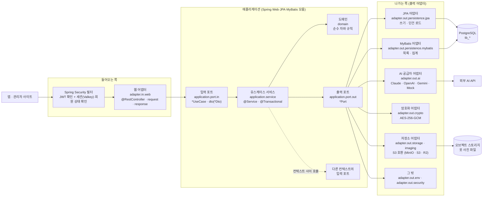

### 1.2 컨텍스트

패키지 `app.wearly.<컨텍스트>` 하나가 바운디드 컨텍스트 하나다. 컨텍스트 사이 호출은 상대의 **입력 포트**로만 한다(ArchUnit [`HexagonalArchitectureTest`][HexagonalArchitectureTest]가 검사).

| 컨텍스트 | 책임 (한 줄) | 대표 입력 포트 | 대표 경로 |
|---|---|---|---|
| `auth` | 가입·로그인·토큰 발급·갱신·로그아웃, 로그인 세션(Valkey)·로그인 이력, 매 요청 세션·회원 상태 확인, **관리자 2단계 인증(TOTP)**: MFA 대기 토큰·등록·확인·복구 코드·잠금 (22 문서) | [`AuthUseCase`][AuthUseCase], [`AuthenticationUseCase`][AuthenticationUseCase], [`AccountUseCase`][AccountUseCase], [`SessionUseCase`][SessionUseCase] | `/api/v1/auth/**` |
| `user` | 회원 계정과 프로필(취향·근무 패턴, 나의 정보 연령대·체형·키·핏), D-1 알림을 켠 회원 목록(`NotifySettingUseCase`) | [`UserUseCase`][UserUseCase], [`ProfileUseCase`][ProfileUseCase] | `/api/v1/users/me/**` |
| `wardrobe` | 옷장 아이템 등록·수정·삭제·목록·통계 | [`WardrobeUseCase`][WardrobeUseCase], [`WardrobeStatsUseCase`][WardrobeStatsUseCase] | `/api/v1/wardrobe/**` |
| `code` | 옷 속성 코드 테이블, 메모리 캐시, 코드 변경 | [`CodeCatalog`][CodeCatalog], [`CodeManagementUseCase`][CodeManagementUseCase] | `GET /api/v1/codes` |
| `ai` | AI 공급자 고르기·호출·기록·한도, 공급자 설정과 웹 입력 키 | [`AnalyzeImageUseCase`][AnalyzeImageUseCase], [`JsonGenerationUseCase`][JsonGenerationUseCase], [`AiProviderAdminUseCase`][AiProviderAdminUseCase] | `POST /api/v1/wardrobe/items/analyze` |
| `admin` | 관리자 API(대시보드·코드·공급자·회원·변경 이력·로그인 세션·내 계정·관리자 로그인 기록), 감사 로그, 시작 시 관리자 계정(관리자가 없을 때만 만든다) | [`AdminCodeUseCase`][AdminCodeUseCase], [`AdminAiProviderUseCase`][AdminAiProviderUseCase], [`AdminSessionUseCase`][AdminSessionUseCase], [`EnsureAdminUseCase`][EnsureAdminUseCase] | `/api/v1/admin/**` |
| `outfit` | AI 코디 추천: 프롬프트·스키마·후보 검증 (출력 포트 없음) | [`RecommendOutfitUseCase`][RecommendOutfitUseCase] | `POST /api/v1/outfits/recommendations` |
| `appsetting` | 앱 전체 설정(디자인 테마 `themeId`와 계절 모드 `seasonMode`, 한 행). 관리자 변경은 `admin`이 이 컨텍스트의 입력 포트로 부른다 (6차, 12 문서 7장) | [`AppSettingUseCase`][AppSettingUseCase] | `GET /api/v1/app/config` |
| `weather` | 지역별 날씨를 공급자에게서 주기적으로 받아 저장하고 앱에는 저장값만 준다 (17 문서) | [`WeatherQueryUseCase`][WeatherQueryUseCase] | `GET /api/v1/weather` |
| `image` | 옷 사진: 서명 URL 발급, 올린 사진 검증·EXIF 제거·축소, 아이템에 붙이기·빼기, 정리, 탈퇴 시 삭제 (18 문서) | [`ImageUploadUseCase`][ImageUploadUseCase], [`ItemImageUseCase`][ItemImageUseCase], [`ImageContentUseCase`][ImageContentUseCase], [`ImageCleanupUseCase`][ImageCleanupUseCase] | `/api/v1/images/**` |
| `plan` | 예정 코디: 날짜·시간대·장소·날씨·코디를 서버에 저장·목록·수정·삭제, 앱 기기 예정을 `clientId`로 올리기(bulk), 회원당 500개, 지운 옷 표시(`missingItemIds`), 코드 사용처(STYLE·REGION) (21 문서) | [`PlanUseCase`][PlanUseCase], [`PlanCodeUsageUseCase`][PlanCodeUsageUseCase] | `/api/v1/plans/**` |
| `notify` | 예정 코디 D-1 알림 서버 푸시: 푸시 토큰 등록·삭제, 매일 19:30 KST D-1 작업(내일 예정 → 날씨 다시 확인 → Expo Push), 발송 기록 (23 문서). 기본 꺼짐 | [`PushTokenUseCase`](../backend/src/main/java/app/wearly/notify/application/port/in/PushTokenUseCase.java), [`DayBeforeNotifyUseCase`](../backend/src/main/java/app/wearly/notify/application/port/in/DayBeforeNotifyUseCase.java) | `/api/v1/me/push-token` |
| `common` | 컨텍스트가 아니다. 컨텍스트를 모르는 설정(`config`: `WearlyProperties`·`ClockConfig`·`CorsConfig`), 오류(`error`: `BusinessException`·`ErrorCode`·`GlobalExceptionHandler`·`TraceIds`), 웹 도우미(`web`: `Ids`·`Times`·`JsonPatches`·`Uploads`·`TraceIdFilter`), 사진 읽기·줄이기·쓰기 도구(`imaging`: `ImageCodec`, 저장용·AI 전송용 어댑터가 같이 쓴다), 유스케이스 공용 값(`application`: `Patch`·`ImageUpload`), 도메인 공용 값(`domain`), MyBatis 도우미(`mybatis`), 엔티티 시각(`persistence`), 커밋 뒤 실행(`transaction`). 컨텍스트 패키지를 import하지 않는다(ArchUnit) | — | — |
| `sharedkernel` | 공유 커널(소유자 `code`): 코드 스냅샷·코드 검증 정책([`CodeSnapshot`][CodeSnapshot], [`CodeChecks`][CodeChecks]), 코디 칸 `Slots`, 드레스 코드 `DressCode`, 계절 `Seasons`. 도메인이 볼 수 있다 | — | — |

### 1.3 패키지 이름 규칙

| 패키지 | 들어가는 것 | 이름 규칙 | 예 |
|---|---|---|---|
| `<ctx>.domain` | 도메인 모델·값 객체·규칙. Spring·JPA·Jackson 없음 | 명사, 규칙 모음은 `*Rules`·`*Validator` | [`WardrobeItem`][WardrobeItem], [`ApiKeyRules`][ApiKeyRules], [`CandidateValidator`][CandidateValidator] |
| `<ctx>.application.port.in` | 유스케이스 인터페이스 | `*UseCase` | [`WardrobeUseCase`][WardrobeUseCase] |
| `<ctx>.application.port.in.dto` | 유스케이스 입력·출력 (자바 타입 그대로: `Long` id, `Instant` 시각) | 입력 `<동작><대상>Dto`, 출력 `<대상>Dto` | [`LoginDto`][LoginDto], [`ItemSearchDto`][ItemSearchDto], [`ItemDto`][ItemDto] |
| `<ctx>.application.port.out` | 출력 포트 | `*Port` (쓰기·단건은 `ItemPort`, 조회는 `ItemQueryPort`처럼 `Query`를 붙인다) | [`ItemPort`][ItemPort], [`ItemQueryPort`][ItemQueryPort], [`AiModelPort`][AiModelPort], [`AiModelCatalogPort`][AiModelCatalogPort] |
| `<ctx>.application.port.out.dto` | 조회 포트가 돌려주는 도메인이 아닌 모양 (필요한 곳만) | `<대상><용도>Dto` | [`KeyCountDto`][KeyCountDto], [`UserListRowDto`][UserListRowDto] |
| `<ctx>.application.service` | 유스케이스 구현 | `*Service` (트랜잭션을 나눠야 하면 `*Writer`) | [`WardrobeService`][WardrobeService], [`AiProviderRegistry`][AiProviderRegistry], [`AiModelListService`][AiModelListService], [`AdminAiKeyWriter`][AdminAiKeyWriter] |
| `<ctx>.adapter.in.web` | 컨트롤러 | `*Controller` | [`WardrobeController`][WardrobeController] |
| `<ctx>.adapter.in.web.request` | 요청 본문·쿼리, Bean Validation·Jackson 어노테이션, `toDto()` | `*Request` | [`ItemRequest`][ItemRequest], [`PatchItemRequest`][PatchItemRequest] |
| `<ctx>.adapter.in.web.response` | 응답 JSON 모양, `static from(dto)` (문자열 ID, 밀리초 ISO 시각) | `*Response` | [`ItemResponse`][ItemResponse], [`ItemListResponse`][ItemListResponse] |
| `<ctx>.adapter.in.startup` | 서버 시작 때 도는 것 | — | [`AdminBootstrap`][AdminBootstrap], [`AiStartupLogger`][AiStartupLogger] |
| `<ctx>.adapter.in.code` | 다른 컨텍스트가 정한 입력 포트(SPI) 구현 | `*CodeUsageSource` | [`ItemCodeUsageSource`][ItemCodeUsageSource], [`ProfileCodeUsageSource`][ProfileCodeUsageSource] |
| `<ctx>.adapter.out.persistence.jpa` | JPA 엔티티·Spring Data 리포지토리·쓰기 포트 구현 | `*Entity`, `*JpaRepository`, `*JpaAdapter` | [`WardrobeItemEntity`][WardrobeItemEntity], [`WardrobeItemJpaRepository`][WardrobeItemJpaRepository], [`WardrobeItemJpaAdapter`][WardrobeItemJpaAdapter] |
| `<ctx>.adapter.out.persistence.mybatis` | 조회 포트 구현. 매퍼는 `mapper/`, DB 모양을 손봐야 할 때만 `dto/*RowDto`. SQL은 `resources/mapper/<ctx>/*.xml` | `*MybatisAdapter`, `*Mapper`, `*RowDto` | [`WardrobeItemMybatisAdapter`][WardrobeItemMybatisAdapter], [`WardrobeItemMapper`][WardrobeItemMapper], [`ItemRowDto`][ItemRowDto] |
| `<ctx>.adapter.out.<기술>` | 그 밖의 기술 (`ai`, `crypto`, `env`, `security`, `transaction`) | 기술 이름 + 역할 | [`ClaudeAiProvider`][ClaudeAiProvider], [`AesGcmSecretCipher`][AesGcmSecretCipher], [`EnvApiKeyAdapter`][EnvApiKeyAdapter], [`JwtAccessTokenIssuer`][JwtAccessTokenIssuer] |
| `<ctx>.config` | 그 컨텍스트의 Spring 설정 빈 | `*Config` | [`SecurityConfig`][SecurityConfig](auth), [`AiConfig`][AiConfig], [`OutfitConfig`][OutfitConfig] |

- 예외로 이름에 `UseCase`·`Port`가 없는 포트가 있다: [`CodeCatalog`][CodeCatalog](입력), [`AccessTokenIssuer`][AccessTokenIssuer]·[`PasswordHasher`][PasswordHasher](출력).
- 08 문서 2장의 예시 `SaveItemPort`·`LoadItemPort`는 실제 코드에 없다. 쓰기·단건 로드는 [`ItemPort`][ItemPort] 하나로 합쳐져 있다.

## 2. 공통 흐름

### 2.1 인증: JWT 필터 → 매 요청 세션·회원 상태 확인

모든 요청은 컨트롤러에 닿기 전에 [`SecurityConfig`][SecurityConfig](`auth.config`)의 필터 체인을 지난다. Spring의 HTTP 세션은 쓰지 않는다(`STATELESS`). 대신 Access 토큰의 `sid`로 로그인 세션(Valkey, 16 문서)이 살아 있는지 매 요청 확인한다. CORS 설정만 컨텍스트를 모르는 `common.config.CorsConfig`에 있다(허용 헤더에 `X-Wearly-Client`).

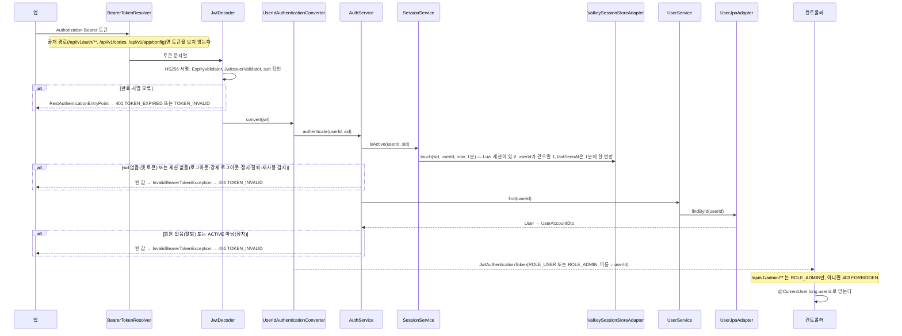

| 단계 | 클래스 | 하는 일 |
|---|---|---|
| 1 | [`SecurityConfig`][SecurityConfig] `bearerTokenResolver()` | `Authorization: Bearer` 헤더를 읽는다. `/api/v1/auth/` 아래와 `/api/v1/codes`·`/api/v1/app/config`에서는 `null`을 돌려 만료된 토큰이 같이 와도 무시한다 |
| 2 | `SecurityConfig.jwtDecoder` (NimbusJwtDecoder) | HS256 서명, [`ExpiryValidator`][ExpiryValidator](시계 오차 허용 없음, 만료는 `wearly_token_expired`), `iss = wearly`, `sub`가 비지 않음 |
| 3 | [`UserIdAuthenticationConverter`][UserIdAuthenticationConverter] `convert` | `sub`를 userId로, `sid` 클레임([`AccessTokenClaims`][AccessTokenClaims])을 세션 ID로 읽어 [`AuthenticationUseCase`][AuthenticationUseCase]`.authenticate`를 부른다. **권한은 토큰의 `role` 클레임이 아니라 DB의 현재 역할**로 준다 |
| 4 | [`AuthService`][AuthService] `authenticate` → [`SessionService`][SessionService] `isActive` → [`SessionStorePort`][SessionStorePort] `touch` ([`ValkeySessionStoreAdapter`][ValkeySessionStoreAdapter]) | `wearly:session:{sid}`가 있고 그 `userId`가 `sub`와 같은지 본다(Lua 한 번). `lastSeenAt`은 1분보다 오래됐을 때만 고친다. 없으면 401 `TOKEN_INVALID` — 세션을 끊으면 남은 Access 수명과 상관없이 바로 막힌다 |
| 4-1 | → [`UserService`][UserService] `find` → [`UserJpaAdapter`][UserJpaAdapter] | 회원을 읽어 `ACTIVE`일 때만 역할을 돌려준다. 탈퇴·정지 회원의 남은 Access 토큰도 여기서 401 `TOKEN_INVALID`가 된다 |
| 5 | `SecurityConfig.securityFilterChain` `authorizeHttpRequests` | 공개: `OPTIONS /**`, `/api/v1/auth/**`, `GET /api/v1/codes`, `GET /api/v1/app/config`, `/actuator/health`, `/error`. 관리자: `/api/v1/admin/**` → `hasRole("ADMIN")`. 그 밖은 로그인 필요 |
| 6 | [`RestAuthenticationEntryPoint`][RestAuthenticationEntryPoint] `classify` | 인증 실패를 분류: 토큰 없음 `UNAUTHORIZED`, 만료 `TOKEN_EXPIRED`(앱이 이 코드로 자동 갱신), 그 밖 `TOKEN_INVALID` |
| 7 | [`ErrorResponseWriter`][ErrorResponseWriter] `write` | 필터 단계 오류(401·403)를 오류 JSON으로 쓴다. 컨트롤러 밖이라 전역 처리기를 거치지 않는다 |
| 8 | [`CurrentUser`][CurrentUser], [`CurrentSession`][CurrentSession] | `@AuthenticationPrincipal(expression = "T(java.lang.Long).parseLong(subject)")`. 컨트롤러가 `@CurrentUser long userId`로 받는다. 관리자 세션 API는 `@CurrentSession String sessionId`(토큰 `sid`)로 "내 현재 세션"을 안다 |

### 2.2 오류 처리: 예외 → 전역 처리기 → 오류 JSON (코드값만, traceId)

모든 오류 응답은 `{ status, code, params?, fieldErrors: [{ field, code, params? }], traceId }` 하나의 모양이다. **문장(`message`)은 없다.** 화면 문구는 앱·관리자가 `code`·`params`로 정하고, 서버 내부 정보(예외 메시지·SQL·클래스 이름·스택)는 응답에 나가지 않고 같은 `traceId`로 서버 로그에서만 본다. 계약·분류·카탈로그는 [20_오류_응답.md](20_오류_응답.md).

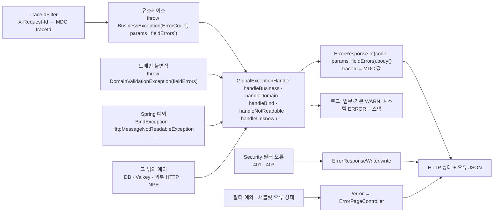

오류는 세 가지로 나눈다.

| 분류 | 상황 | 던지는 곳 | 받는 곳 | 결과 |
|---|---|---|---|---|
| **업무 오류** | 업무 규칙 위반 | 서비스가 [`BusinessException`][BusinessException] (`ErrorCode`, 선택 `params`·`fieldErrors`) | [`GlobalExceptionHandler`][GlobalExceptionHandler] `handleBusiness` | [`ErrorCode`][ErrorCode]의 상태 번호와 코드, `params`, `fieldErrors`. WARN 로그(스택 없음) |
| 업무 오류 | 도메인 불변식 위반 (서비스 검증을 건너뛴 경우의 안전망) | 도메인이 [`DomainValidationException`][DomainValidationException] (예: `WardrobeItem.apply`, `User.changeAccess`) | `handleDomain` | 400 `VALIDATION_FAILED` + `fieldErrors` |
| 업무 오류 | 입력 검증 여러 개 | `List<FieldError>`에 모은 뒤 `BusinessException.throwIfAny(errors)` | `handleBusiness` | 400 `VALIDATION_FAILED` + 필드별 `code`·`params` |
| 업무 오류 | `@Valid` 본문 검증 실패 | Spring (`BindException`) | `handleBind` ([`ConstraintCodes`][ConstraintCodes]가 애너테이션 → 필드 오류 코드) | 400 `VALIDATION_FAILED` |
| **기본 오류** | JSON 형식 오류·타입 불일치·빈 본문 | Spring (`HttpMessageNotReadableException`) | `handleNotReadable` | 400, 필드 이름은 [`JsonPaths`][JsonPaths]가 `items[3].subType` 모양으로. 본문 전체는 `body` |
| 기본 오류 | 업로드 10MB 초과 | Spring (`MaxUploadSizeExceededException`·`MultipartException`) | `handleTooLarge`·`handleMultipart` | 413 `IMAGE_TOO_LARGE` |
| 기본 오류 | 없는 경로·메서드·미디어 타입·Accept | Spring | `handleNoResource`·`handleMethod`·`handleMediaType`, 그 밖은 `handleUnknown`(`ErrorResponse` 예외는 상태로 코드 고르기) | 404·405·415·406. WARN 로그(Jackson·Spring 원문은 여기에만) |
| 기본 오류 | 인증·권한 실패 | Spring Security | [`RestAuthenticationEntryPoint`][RestAuthenticationEntryPoint]·`accessDeniedHandler` → [`ErrorResponseWriter`][ErrorResponseWriter] | 401·403. INFO 로그 |
| **시스템 오류** | 그 밖의 모든 예외 | — | `handleUnknown` → [`SystemErrors`][SystemErrors] `classify` | 500 `INTERNAL_ERROR`, 일시적 의존성 장애(DB 연결·Valkey 연결·시간 초과)는 503 `SERVICE_UNAVAILABLE`, 낙관적 잠금 실패·고유 제약 위반은 409 `CONFLICT`(WARN, 스택 없음). 500·503은 ERROR 로그 + 스택 |
| 필터 단계 예외 | 컨트롤러에 닿기 전에 난 예외, 서블릿이 정한 오류 상태 | — | `/error` → [`ErrorPageController`][ErrorPageController] | 위와 같은 모양. 상태 → 코드는 [`ErrorCodes`][ErrorCodes] `forStatus` |

**traceId와 로그** (요청 처음부터 끝까지):

1. [`TraceIdFilter`][TraceIdFilter]가 가장 먼저 돈다 (보안 필터보다 앞). 요청 헤더 `X-Request-Id`가 형식에 맞으면(영문·숫자·`.`·`_`·`-` 8~64자) 그 값을, 아니면 새 UUID(하이픈 없는 32자)를 MDC `traceId`에 넣고 응답 헤더 `X-Request-Id`로도 돌려준다 (성공 응답 포함).
2. 인증을 마치면 [`UserIdMdcFilter`][UserIdMdcFilter]가 MDC `userId`를 채운다 (Bearer 인증 바로 뒤).
3. 오류 응답을 만들 때 [`ErrorResponse`][ErrorResponse]가 `TraceIds.current()`를 `traceId`로 넣는다. 401·403(`ErrorResponseWriter`)과 `/error`도 같다.
4. 모든 로그 줄에 `[traceId=… userId=…]`가 붙는다 (`logging.pattern.level`). 그래서 화면의 "오류 번호"나 응답의 `traceId`로 `docker compose logs backend | grep <traceId>` 하면 그 요청의 로그가 나온다.

로그 형식: 업무 오류 WARN `업무 오류 code=… METHOD PATH userId=… detail=…`, 기본 오류 WARN `요청 오류 code=… cause=<예외 클래스>: <원문>`, 시스템 오류 ERROR `시스템 오류 code=… METHOD PATH query=… userId=…` + 스택, 인증·권한 INFO `인증·권한 오류 code=…`.

- [`ErrorCode`][ErrorCode]는 HTTP 상태 번호, 로그·문서용 설명 문장, 쓸 수 있는 `params` 이름을 가진 enum이다. Spring Web 타입을 쓰지 않으므로 유스케이스가 직접 쓴다. 설명 문장은 응답에 쓰지 않는다 (ArchUnit).
- `BusinessException`은 문장(`String`)을 받는 생성자가 없고, `params` 이름은 `ErrorCode`가 정한 것만 받는다. 상세 값(모자란 칸, 사용처, 사유 코드)은 `params`로 준다.
- AI 공급자 오류는 [`AiProviderException`][AiProviderException]이다. `BusinessException`이 아니다. [`AiCallRunner`][AiCallRunner]가 잡아서 기록하고 다음 공급자로 넘어가며, 모두 실패해야 502 `AI_UNAVAILABLE`(`params.feature`)이 된다(3.4·3.5). 공급자 응답 원문은 로그에만 남는다.
- 출력 어댑터는 `BusinessException`을 던지지 않는다(ArchUnit). 저장 실패는 도메인 예외로 던지고 서비스가 바꾼다(예: 동시 가입의 고유 제약 위반 → [`EmailTakenException`][EmailTakenException] → `AuthService`가 409 `EMAIL_TAKEN`).
- 새 오류 코드를 더하는 순서(`ErrorCode` → `error-codes.json` → 앱·관리자 문구 표 → 검사)는 20 문서 8장.

### 2.3 트랜잭션 경계

| 규칙 | 내용 |
|---|---|
| 경계는 서비스 | `@Transactional`은 `application.service`에 둔다. 컨트롤러에는 없다. `spring.jpa.open-in-view: false` |
| 조회는 읽기 전용 | 목록·통계·단건 조회는 `@Transactional(readOnly = true)` (예: `WardrobeService.list`, `WardrobeStatsService.stats`) |
| JPA + MyBatis 한 트랜잭션 | 둘 다 같은 DataSource·트랜잭션 매니저를 쓴다. 한 서비스 메서드 안에서 섞어도 된다 |
| AI 호출은 트랜잭션 밖 | [`AiAnalysisService`][AiAnalysisService] `analyze`, [`AiJsonGenerationService`][AiJsonGenerationService] `generate`, [`OutfitRecommendService`][OutfitRecommendService] `recommend`, [`AiCallRunner`][AiCallRunner]에는 `@Transactional`이 없다. 외부 호출(수 초~수십 초) 동안 DB 연결을 잡지 않는다. 호출 기록(`AiCallLogPort.save`)은 한 건씩 바로 커밋되므로, 마지막에 502가 나도 실패 기록은 남는다. 한도 예약·해제([`AiQuotaService`][AiQuotaService] `reserve`·`release`)는 각각 짧은 트랜잭션이다 |
| 모델 목록 조회는 트랜잭션 밖 | [`AdminAiService`][AdminAiService] `models`와 [`AiModelListService`][AiModelListService] `models`에는 `@Transactional`이 없다. 제공사 HTTP 호출(수 초) 동안 DB 연결을 잡지 않는다. 읽기라 감사 로그도 없다 (3.10) |
| 회전 실패도 커밋 | [`AuthService`][AuthService] `refresh`와 [`SessionService`][SessionService] `rotate`는 `noRollbackFor = BusinessException.class`. 재사용 감지 기록(`tb_auth_event` REFRESH_REUSED)을 401을 던지면서도 커밋한다. 세션 끊기 자체는 Valkey라 트랜잭션과 상관없이 바로 적용된다 |
| Valkey는 DB 트랜잭션 밖 | 세션 만들기·회전·끊기는 Lua 스크립트 하나로 원자적이고, DB 롤백과 함께 되돌려지지 않는다. 그래서 로그인은 세션을 **마지막에** 만든다(그 앞에서 실패하면 세션이 생기지 않는다) |
| 반드시 바깥 트랜잭션 안 | `SessionService.start`(로그인·가입의 세션 + LOGIN 이력)와 [`AuditLogJpaAdapter`][AuditLogJpaAdapter] `record`는 `Propagation.MANDATORY`. 감사 로그는 변경과 같은 트랜잭션이라 변경이 롤백되면 이력도 남지 않는다 |
| 커밋 뒤에 할 일 | 코드 캐시는 [`CodeSnapshotPort`][CodeSnapshotPort] `refreshAfterCommit`(커밋 뒤 다시 읽기), AI 키 캐시는 [`ApiKeyService`][ApiKeyService] `invalidate` → [`TransactionHooksPort`][TransactionHooksPort] `afterCompletion`(끝난 뒤 한 번 더 비우기). 둘 다 [`AfterTransaction`][AfterTransaction]을 쓴다 |
| 외부 호출이 끼는 관리자 변경 | 트랜잭션을 나눈다. [`AdminAiService`][AdminAiService] `setKey`는 트랜잭션 없이 확인·외부 키 검증을 하고, 저장·감사만 [`AdminAiKeyWriter`][AdminAiKeyWriter] `save`(`@Transactional`)로 묶는다(3.7). 코드 순서 바꾸기도 쓰기는 [`AdminCodeOrderWriter`][AdminCodeOrderWriter], 응답 목록은 커밋·캐시 재적재 뒤에 만든다 |

### 2.4 설정

| 무엇 | 어디 | 비고 |
|---|---|---|
| 공통 설정 | `backend/src/main/resources/application.yml` | git 포함, 비밀 값 없음. `${이름:기본값}`은 OS 환경변수로 덮어쓸 수 있다. Valkey는 `spring.data.redis.host/port/database`(기본 `localhost:6380`, DB 0) |
| 로컬 비밀 설정 | `backend/config/application-local.yml` | git·docker 이미지 제외. `spring.config.import: optional:file:${WEARLY_LOCAL_CONFIG:./config/application-local.yml}`로 읽으므로 `backend/`에서 실행한다. 견본 `application-local.example.yml` |
| 프로필 | `application-docker.yml`(compose의 DB·Valkey 주소), `application-prod.yml`(JWT 키 필수) | 테스트·하네스는 `WEARLY_LOCAL_CONFIG`를 없는 경로로 줘서 로컬 비밀 설정을 읽지 않는다 |
| 바인딩 | [`WearlyProperties`][WearlyProperties] (`@ConfigurationProperties("wearly")`) | `jwt`·`ai`·`admin`·`cors`·`secret-key` |
| 유스케이스용 설정 값 | 각 컨텍스트의 `config`: [`SecurityConfig`][SecurityConfig](auth, [`TokenPolicy`][TokenPolicy]), [`AiConfig`][AiConfig]([`AiSettings`][AiSettings]), [`OutfitConfig`][OutfitConfig]([`OutfitSettings`][OutfitSettings]) | `WearlyProperties`를 도메인 값 빈으로 바꾼다. 유스케이스는 Spring 설정 클래스를 보지 않는다. 어댑터(`JwtAccessTokenIssuer`·`AiProviderFactory`·`ApiKeyVerifier`·`AesGcmSecretCipher`)는 `WearlyProperties`를 직접 읽는다 |
| 내장 모델 목록 | `application.yml`의 `wearly.ai.model-catalog.<종류>` → `WearlyProperties.Ai.modelCatalog` → [`AiConfig`][AiConfig] `builtInModels` → 도메인 [`BuiltInModels`][BuiltInModels] | 키가 없거나 제공사 목록을 받지 못했을 때 모델 드롭다운에 쓴다 (3.10). 종류 이름·모델 ID 형식이 틀리면 서버가 시작하지 않는다 |
| 시각 | [`ClockConfig`][ClockConfig] `Clock.systemUTC()` + [`Zones`][Zones] + [`PersistenceClock`][PersistenceClock] | 일일 한도·최근 착용 같은 "오늘"은 `Zones.today(clock)`(Asia/Seoul). 엔티티의 `created_at`·`updated_at`도 같은 `Clock`을 `PersistenceClock.now()`로 쓴다 |
| AI 공급자 키 | [`EnvApiKeyAdapter`][EnvApiKeyAdapter] | `wearly.ai.keys.<키 이름>` → 같은 이름 속성·OS 환경변수 (3.4) |

서버가 뜰 때 도는 것: Flyway(`V1`~`V10`) → [`AdminBootstrap`][AdminBootstrap](`ApplicationRunner`, `wearly.admin.*`가 있으면 `EnsureAdminUseCase.ensureAdmin`) → `ApplicationReadyEvent`에서 [`CodeSnapshotMybatisAdapter`][CodeSnapshotMybatisAdapter] `warmUp`(코드 캐시 채우기)과 [`AiStartupLogger`][AiStartupLogger] → `AiStatusUseCase.logStartupStatus`(쓸 수 있는 공급자 INFO, 없으면 WARN).

## 3. 대표 흐름

각 흐름은 2.1의 인증을 이미 통과했다고 본다. 표의 `포트 (구현)`은 "서비스가 부르는 인터페이스 (실제로 도는 클래스)"다.

### 3.1 로그인과 토큰 갱신 (세션 만들기·Refresh 회전·재사용 감지)

`POST /api/v1/auth/login` → `POST /api/v1/auth/refresh`. 둘 다 공개 경로다. Refresh 토큰과 로그인 세션은 Valkey에 있다(16 문서 3장).

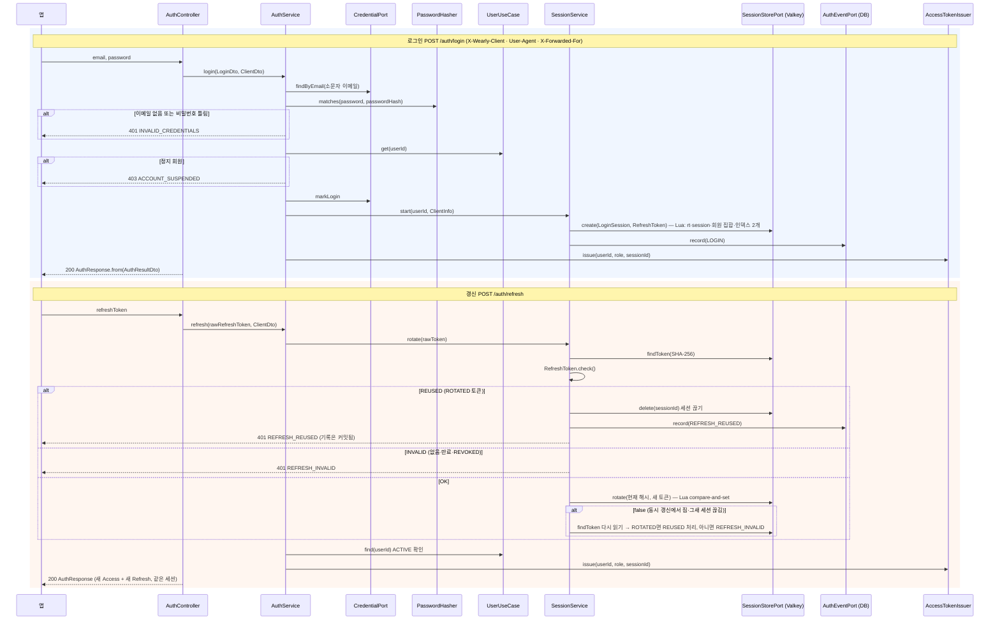

**로그인**

| 단계 | 클래스 | 하는 일 |
|---|---|---|
| 1 | [`AuthController`][AuthController] `login` | `@Valid` [`LoginRequest`][LoginRequest] → `toDto()` → [`LoginDto`][LoginDto]. 헤더 `X-Wearly-Client`·`User-Agent`·IP(`X-Forwarded-For` 첫 값 또는 원격 주소)를 `ClientHeaders`가 [`ClientDto`][ClientDto]로 |
| 2 | [`AuthService`][AuthService] `login` (`@Transactional`) | `LocalCredential.normalizeEmail`로 소문자 이메일을 만들어 [`CredentialPort`][CredentialPort] `findByEmail` ([`CredentialJpaAdapter`][CredentialJpaAdapter]) |
| 3 | [`PasswordHasher`][PasswordHasher] `matches` ([`BcryptPasswordHasher`][BcryptPasswordHasher]) | 이메일이 없어도 더미 해시와 비교해 응답 시간을 맞춘다. 틀리면 401 `INVALID_CREDENTIALS`(어느 쪽이 틀렸는지 알리지 않음) |
| 4 | [`UserUseCase`][UserUseCase] `get` ([`UserService`][UserService]) | 비밀번호가 맞을 때만 정지 여부를 본다. `isActive()`가 아니면 403 `ACCOUNT_SUSPENDED` |
| 5 | `CredentialPort.markLogin` | 마지막 로그인 시각 |
| 6 | [`SessionService`][SessionService] `start` (`MANDATORY`) | [`ClientInfo`][ClientInfo] `of`(기기 종류 [`ClientKind`][ClientKind]: 헤더 → 없으면 User-Agent로 추정, UA·IP 길이 자르기) → [`LoginSession`][LoginSession] `start`(UUID 세션 ID) → [`RefreshTokens`][RefreshTokens] `newRawToken`·`hash` → [`SessionStorePort`][SessionStorePort] `create` ([`ValkeySessionStoreAdapter`][ValkeySessionStoreAdapter], Lua `CREATE`) → [`AuthEventPort`][AuthEventPort] `record(LOGIN)` ([`AuthEventJpaAdapter`][AuthEventJpaAdapter]). Valkey에는 해시만 |
| 7 | [`AccessTokenIssuer`][AccessTokenIssuer] `issue` ([`JwtAccessTokenIssuer`][JwtAccessTokenIssuer]) | JWT HS256: `iss`, `sub = userId`, `role`, `sid = 세션 ID`, `iat`(초 버림), `exp = 지금 + accessTtl`(초 올림) |
| 8 | [`AuthResponse`][AuthResponse] `from(AuthResultDto)` | `accessToken`, `accessTokenExpiresIn`, `refreshToken`(원문은 이때 한 번만 나감), `refreshTokenExpiresIn`, `user`([`AuthUserResponse`][AuthUserResponse], ID 문자열) |

**갱신**

| 단계 | 클래스 | 하는 일 |
|---|---|---|
| 1 | [`AuthController`][AuthController] `refresh` | 본문이 없어도 `null`로 넘긴다 |
| 2 | [`AuthService`][AuthService] `refresh` (`noRollbackFor = BusinessException`) | 회전을 맡기고, 끝나면 회원 상태를 확인한다 |
| 3 | [`SessionService`][SessionService] `rotate` | 비었으면 401 `REFRESH_INVALID`. `SessionStorePort.findToken`(`wearly:rt:{hash}`) |
| 4 | [`RefreshToken`][RefreshToken] `check()` (도메인) | ACTIVE → `OK`, ROTATED → `REUSED`, REVOKED → `INVALID`. 없거나 만료(TTL)면 `findToken`이 빈 값 → `INVALID` |
| 5 | `SessionStorePort.delete` + `AuthEventPort.record(REFRESH_REUSED)` | `REUSED`면 그 세션을 끊고 401 `REFRESH_REUSED`. 그 세션의 Access 토큰도 바로 401 |
| 6 | `SessionStorePort.rotate` (Lua `ROTATE`) | `OK`면 "토큰이 아직 ACTIVE이고 세션의 `currentHash`"일 때만 ROTATED(+`replacedBy`)로 바꾸고 새 토큰을 현재 토큰으로, 세션 TTL 연장, `lastRefreshAt`·`lastSeenAt` = 지금. 동시에 같은 토큰으로 갱신하면 한쪽만 true이고, 진 쪽은 다시 읽어 ROTATED → 5단계(재사용) |
| 7 | `UserUseCase.find` | 회원이 없거나 정지면 401 `REFRESH_INVALID` |
| 8 | `AccessTokenIssuer.issue` | 새 Access 토큰(같은 `sid`). 응답 모양은 로그인과 같다 |

로그아웃(`POST /auth/logout`)은 `AuthService.logout` → `SessionService.logout`: 토큰이 ACTIVE면 그 세션을 끊고(`SessionStorePort.delete`, Lua `DELETE`: 세션 삭제 + 현재 토큰 REVOKED + 회원 집합·인덱스에서 빼기) LOGOUT을 남긴다. 없거나 이미 바뀐 토큰이어도 204.
가입(`POST /auth/signup`)은 `existsByEmail`로 먼저 막고, 동시에 같은 이메일로 가입해 저장에서 고유 제약에 걸리면 `CredentialJpaAdapter`가 [`EmailTakenException`][EmailTakenException]을 던지고 `AuthService`가 409 `EMAIL_TAKEN`으로 바꾼다(트랜잭션 롤백으로 회원도 남지 않는다). 세션은 그 뒤 마지막에 만든다.
탈퇴(`DELETE /users/me`)는 `UserService.delete`가 회원 행을 지운 뒤 [`UserDeletedListener`][UserDeletedListener]들을 부르고, auth의 [`SessionCleanupOnUserDeleted`][SessionCleanupOnUserDeleted](`adapter.in.user`)가 `SessionUseCase.dropUserSessions`로 Valkey 세션을 지운다(이력 없음 — 회원과 함께 지워지므로). 의존은 auth → user 한 방향.

### 3.1-2 관리자 강제 로그아웃 (16 문서 4장)

`DELETE /api/v1/admin/sessions/{sessionId}` · `DELETE /api/v1/admin/users/{id}/sessions` · 목록 `GET /api/v1/admin/sessions`.

| 단계 | 클래스 | 하는 일 |
|---|---|---|
| 1 | [`AdminSessionController`][AdminSessionController] | `@CurrentUser long adminId`, `@CurrentSession String currentSessionId`(토큰 `sid`) |
| 2 | [`AdminSessionService`][AdminSessionService] `revokeSession` (`@Transactional`) | 자기 현재 세션이면 400(`sessionId`). [`SessionUseCase`][SessionUseCase] `findSession`(없으면 404) → `endSession`(세션 끊기 + FORCED_LOGOUT 이력) → [`RecordAuditPort`][RecordAuditPort] `SESSION_REVOKE`(`SESSION`/세션 ID) |
| 2' | `AdminSessionService.revokeUserSessions` | 자기 자신이면 400(`id`), `UserUseCase.get`(없으면 404) → `SessionUseCase.endUserSessions`(세션마다 끊기 + FORCED_LOGOUT) → `USER_SESSIONS_REVOKE`(`USER`/회원 ID) |
| 3 | 그 회원의 다음 요청 | 2.1의 4단계에서 세션이 없어 401 `TOKEN_INVALID`, Refresh는 REVOKED라 401 `REFRESH_INVALID` |
| 목록 | `AdminSessionService.list` | 필터가 없으면 `SessionUseCase.recentSessions`(Valkey `wearly:sessions` ZREVRANGE + ZCARD), 있으면 `allSessions`로 전체를 읽어 거른다. 회원 이메일·이름·역할은 [`AdminQueryPort`][AdminQueryPort] `findUserBriefs`(MyBatis, `tb_user` IN 조회)로 붙이고, 회원 상세의 이력은 `findAuthEvents`(`tb_auth_event`) |

회원 정지(`PATCH /admin/users/{id}` `status: SUSPENDED`)도 [`AdminUserService`][AdminUserService]가 `SessionUseCase.endUserSessions`를 부른다. 대시보드의 `activeSessions`·`activeUsers24h`는 `SessionUseCase.stats`(만료 인덱스 정리 뒤 ZCARD, lastSeenAt 24시간 안 세션의 회원 수).

### 3.2 옷 등록 (JPA 쓰기 경로, 코드 검증)

`POST /api/v1/wardrobe/items`.

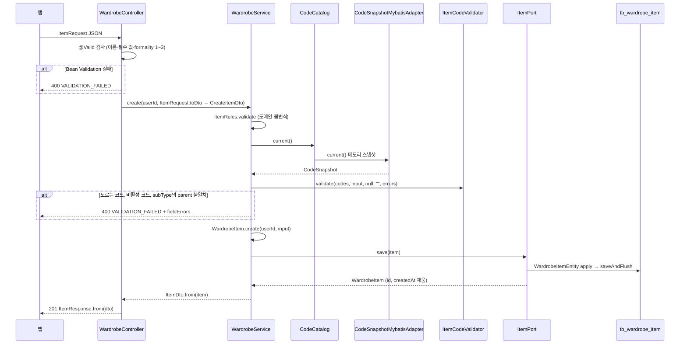

| 단계 | 클래스 | 하는 일 |
|---|---|---|
| 1 | [`WardrobeController`][WardrobeController] `create` | `@Valid` [`ItemRequest`][ItemRequest]: 형식 검사만 한다(코드 값 검사는 유스케이스). `toDto()` → [`CreateItemDto`][CreateItemDto] |
| 2 | [`WardrobeService`][WardrobeService] `create` (`@Transactional`) | `CreateItemDto.toInput()` → [`ItemInput`][ItemInput](도메인 값) → [`ItemRules`][ItemRules] `validate`(이름 길이·필수 값·formality·착용 수 등 불변식, Bean Validation과 같은 필드 오류 코드) |
| 3 | [`CodeCatalog`][CodeCatalog] `current` ([`CodeCatalogService`][CodeCatalogService] → [`CodeSnapshotMybatisAdapter`][CodeSnapshotMybatisAdapter]) | 메모리의 `volatile` [`CodeSnapshot`][CodeSnapshot](공유 커널). DB를 다시 읽지 않는다 |
| 4 | [`ItemCodeValidator`][ItemCodeValidator] `validate` (도메인) | [`CodeChecks`][CodeChecks] `one`·`many`로 category·subType·color·pattern·status·seasons·styles가 그룹에 있는지, **새 값은 활성인지** 확인. subType의 parent가 category인지(`CodeSnapshot.belongsTo`) |
| 5 | `BusinessException.throwIfAny(errors)` | 모은 오류를 한 번에 400 |
| 6 | [`WardrobeItem`][WardrobeItem] `create` | 새 도메인 모델에 `apply(input)`: 불변식을 다시 확인하고(어기면 `DomainValidationException`), 이름·브랜드 앞뒤 공백 제거, 빈 브랜드는 null, 계절·스타일 중복 제거, 착용 수 기본 0 |
| 7 | [`ItemPort`][ItemPort] `save` ([`WardrobeItemJpaAdapter`][WardrobeItemJpaAdapter]) | 새 [`WardrobeItemEntity`][WardrobeItemEntity] → `apply(...)` → [`WardrobeItemJpaRepository`][WardrobeItemJpaRepository] `saveAndFlush` → `toDomain`. 엔티티는 어댑터 밖으로 나가지 않는다 |
| 8 | [`ItemDto`][ItemDto] `from` → [`ItemResponse`][ItemResponse] `from` | 유스케이스 출력(`Long` id, `Instant`) → 응답 모양(ID는 문자열, 시각은 밀리초 ISO). 201 |

같은 경로의 다른 쓰기:

| 요청 | 다른 점 |
|---|---|
| `POST /items/bulk` | `WardrobeService.bulkCreate`: 전부 검증(필드 이름 앞에 `items[i].`)한 뒤 하나도 틀리지 않았을 때만 차례로 저장. 한 트랜잭션 |
| `PATCH /items/{id}` | 본문은 `JsonNode`로 받아 [`PatchItemRequest`][PatchItemRequest] `read`가 필드마다 [`Patch`][Patch](안 보냄·값·형식 오류)로 바꾸고 Bean Validation을 값마다 돌려 [`PatchItemDto`][PatchItemDto](`inputErrors` 포함)를 만든다 → `PathIds.parse(id)` → `WardrobeService.patch`: `ItemPort.find(userId, itemId)`(남의 것은 404, `findByIdAndUserId`) → `inputErrors`가 있으면 400 → 보낸 필드만 이전 값에 덮어써 `ItemInput` → `ItemRules.validate` → 이전 값을 넘겨 코드 검증(안 바꾼 비활성 코드는 통과) → `WardrobeItem.apply` → `save` |
| `DELETE /items/{id}` | `ItemPort.find` 후 `ItemPort.delete`. 204 |

### 3.3 옷 목록·통계 (MyBatis 조회 경로)

`GET /api/v1/wardrobe/items?category=&status=&color=&q=&sort=&retired=` 와 `GET /api/v1/wardrobe/stats`. 사용 중지(6차)에 따른 차이는 3.8에 모았다.

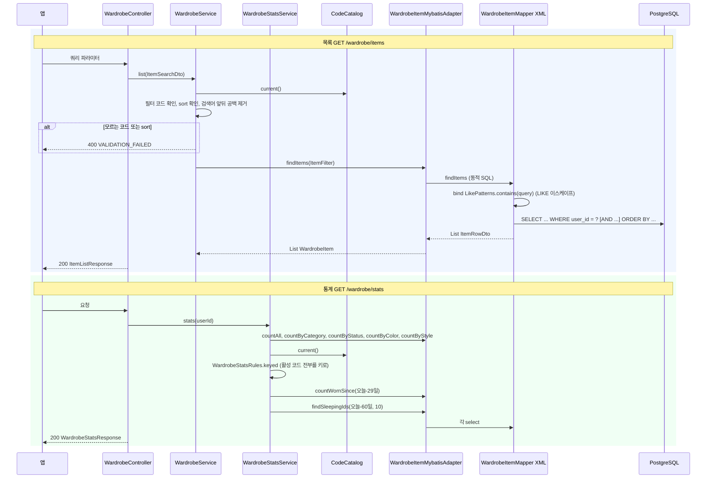

**목록**

| 단계 | 클래스 | 하는 일 |
|---|---|---|
| 1 | [`WardrobeController`][WardrobeController] `list` | 쿼리 파라미터 → [`ItemSearchDto`][ItemSearchDto] |
| 2 | [`WardrobeService`][WardrobeService] `list` (`readOnly`) | `filterCode`: category·status·color가 **알려진 코드인지만** 본다(저장된 값을 찾는 것이라 비활성도 허용). `sort`는 `recent`·`worn`·`name`. 검색어는 앞뒤 공백만 지워 원래 값으로 넘긴다 |
| 3 | [`ItemQueryPort`][ItemQueryPort] `findItems` ([`WardrobeItemMybatisAdapter`][WardrobeItemMybatisAdapter]) | [`ItemFilter`][ItemFilter](`query`는 원래 검색어)를 매퍼에 그대로 넘긴다 |
| 4 | [`WardrobeItemMapper`][WardrobeItemMapper] `findItems` + [`WardrobeItemMapper.xml`](../backend/src/main/resources/mapper/wardrobe/WardrobeItemMapper.xml) | `<bind>`로 [`LikePatterns`][LikePatterns] `contains`(`\`·`%`·`_` 이스케이프 후 `%q%`)를 부르고 `ILIKE ... ESCAPE '\'`. `<if>`로 조건을 붙이고 `<choose>`로 정렬. `TEXT[]` 칸은 [`StringListArrayTypeHandler`][StringListArrayTypeHandler]가 `List<String>`으로 |
| 5 | `WardrobeItemMybatisAdapter.toDomain` → `ItemDto.from` → `ItemListResponse.from` | [`ItemRowDto`][ItemRowDto] → [`WardrobeItem`][WardrobeItem] → 응답 `{ items }` |

**통계**

| 단계 | 클래스 | 하는 일 |
|---|---|---|
| 1 | [`WardrobeStatsService`][WardrobeStatsService] `stats` (`readOnly`) | `Zones.today(clock)`로 한국 날짜 기준 |
| 2 | `ItemQueryPort.countAll`·`countByCategory`·`countByStatus` | 집계 SQL (매퍼가 [`KeyCountDto`][KeyCountDto]를 바로 돌려주고 서비스가 도메인 [`KeyCount`][KeyCount]로) |
| 3 | [`WardrobeStatsRules`][WardrobeStatsRules] `keyed` | 활성 코드 전부(0 포함) + 아이템이 있는 비활성 코드를 키로 |
| 4 | `ItemQueryPort.countByColor`·`countByStyle` | 많은 순 |
| 5 | `ItemQueryPort.countWornSince(today - 29)` → `WardrobeStatsRules.utilization` | 최근 30일 착용 수, 활용률(소수 둘째 자리) |
| 6 | `ItemQueryPort.findSleepingIds(today - 60, 10)` | 잠자는 옷 id 최대 10개(`Long`). 문자열로는 `WardrobeStatsResponse.from`이 `Ids.format`으로 바꾼다 |

### 3.4 사진 AI 분석

`POST /api/v1/wardrobe/items/analyze` (multipart `image`). 경로는 옷장 아래지만 `ai` 컨텍스트의 컨트롤러가 받는다. 서버에 올린 사진은 JSON `{ imageId }`로도 분석한다(`AiAnalyzeController.analyzeStored` → `AiAnalysisService.analyzeStored`: image 컨텍스트의 [`ImageContentUseCase`][ImageContentUseCase] `readOriginal`로 `original.jpg`를 읽어 아래 2단계부터 같다, 3.11).

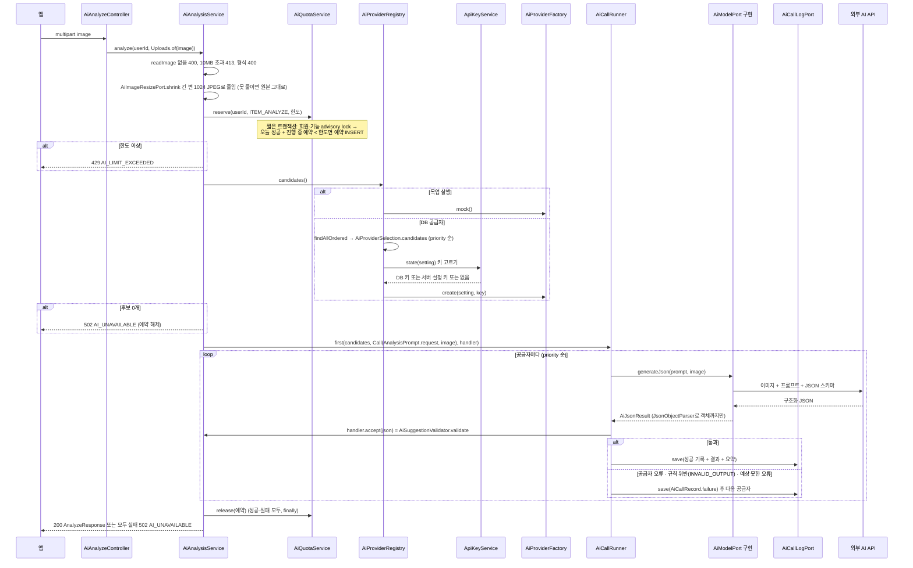

| 단계 | 클래스 | 하는 일 |
|---|---|---|
| 1 | [`AiAnalyzeController`][AiAnalyzeController] `analyze` | `MultipartFile` → [`Uploads`][Uploads] `of` → [`ImageUpload`][ImageUpload](바이트·MIME, `common.application`). `MultipartFile`은 웹 어댑터 밖으로 나가지 않는다 |
| 2 | [`AiAnalysisService`][AiAnalysisService] `analyze` (트랜잭션 없음) → `readImage` | 파트 없음·빈 파일 400 → 10MB 초과 413 `IMAGE_TOO_LARGE` → 읽기 실패 400 → [`ImageTypes`][ImageTypes] `resolve`(jpeg·png·webp·heic) → **[`AiImageResizePort`][AiImageResizePort] `shrink`**([`ImageIoAiImageResizer`][ImageIoAiImageResizer], 공용 `ImageCodec`): JPEG·PNG를 긴 변 `wearly.ai.image-max-side`(1024) 이하 JPEG(`image-quality` 0.8)로 줄인다. 이미 작거나 webp·heic이거나 읽을 수 없으면 원본 그대로 → [`AiImage`][AiImage](**보낼** 바이트·MIME·SHA-256, 호출 기록의 `image_bytes`도 이 크기, 18 문서 7.4) |
| 3 | [`AiQuotaService`][AiQuotaService] `reserve` (`@Transactional`) | [`AiUsagePort`][AiUsagePort] `lockQuota`([`AiUsageMybatisAdapter`][AiUsageMybatisAdapter] → [`AiQuotaMapper`][AiQuotaMapper], `pg_advisory_xact_lock`)로 같은 회원·기능의 확인을 한 줄로 세운다 → 30분 넘은 예약 삭제 → 오늘(한국 시간) 성공한 `ITEM_ANALYZE` 수 + 진행 중 예약 수가 `AiSettings.dailyLimit()` 이상이면 429 → 아니면 [`AiReservationPort`][AiReservationPort] `reserve`([`AiReservationJpaAdapter`][AiReservationJpaAdapter], `tb_ai_usage_reservation`). 동시에 여러 번 불러도 한도를 넘지 않는다 |
| 4 | [`AiProviderRegistry`][AiProviderRegistry] `candidates` (`readOnly`) | 목업 실행이면 `AiModelFactoryPort.mock()` 하나. 아니면 [`AiProviderPort`][AiProviderPort] `findAllOrdered` → [`AiProviderSelection`][AiProviderSelection] `candidates`: `enabled`·모델·키를 모두 갖춘 행만 `priority` 오름차순 |
| 5 | [`ApiKeyService`][ApiKeyService] `state` → [`ApiKeyRules`][ApiKeyRules] `choose` | **키 고르기**: ① 마스터 키가 있고 DB 행이 있으면 DB 키([`ProviderSecretPort`][ProviderSecretPort] `find` → [`SecretCipherPort`][SecretCipherPort] `open`, 메모리 캐시). 복호화에 실패하면 환경변수로 몰래 바꾸지 않고 "없음". ② 없으면 [`ApiKeyEnvPort`][ApiKeyEnvPort] `resolve` ([`EnvApiKeyAdapter`][EnvApiKeyAdapter]): 설정 `wearly.ai.keys.<api_key_env>` → 같은 이름 속성·OS 환경변수. ③ 둘 다 없으면 쓸 수 없음 |
| 6 | [`AiModelFactoryPort`][AiModelFactoryPort] `create` ([`AiProviderFactory`][AiProviderFactory]) | 공급자 종류별 [`AiProviderModule`][AiProviderModule]([`AiProviderModules`][AiProviderModules]가 종류 → 모듈)이 [`ClaudeAiProvider`][ClaudeAiProvider]·[`OpenAiProvider`][OpenAiProvider]·[`GeminiAiProvider`][GeminiAiProvider]를 만든다. 설정·`updatedAt`·키 해시가 같으면 만든 것을 다시 쓴다. 만들 수 없는 공급자(모델·키 없음)는 `AiProviderRegistry`가 WARN을 남기고 건너뛴다 |
| 7 | 후보가 비면 | 502 `AI_UNAVAILABLE`. **목업으로 대신하지 않는다** |
| 8 | [`AiCallRunner`][AiCallRunner] `first` → `attempt` | 공급자마다: [`AiModelPort`][AiModelPort] `generateJson`([`AnalysisPrompt`][AnalysisPrompt] `request`가 활성 코드로 만든 [`AiJsonPrompt`][AiJsonPrompt] + 사진) → 각 사 구조화 출력 → [`JsonObjectParser`][JsonObjectParser]로 JSON 객체까지만 → [`AiJsonResult`][AiJsonResult]. 업무 검증은 어댑터가 아니라 handler가 한다 |
| 9 | handler = [`AiSuggestionValidator`][AiSuggestionValidator] `validate` (도메인) | 허용 목록·parent 짝·값 범위. 틀리면 [`RejectedSuggestionException`][RejectedSuggestionException](`INVALID_OUTPUT`) → 실패로 기록하고 다음 공급자 |
| 10 | 성공: [`AiCallLogPort`][AiCallLogPort] `save` ([`AiCallLogJpaAdapter`][AiCallLogJpaAdapter]) | `tb_ai_analysis_log`에 공급자·모델·지연·토큰·결과 JSON·요약(`result_summary`, "이름 · 종류/세부 종류 · 색"). 응답 [`AnalyzeResultDto`][AnalyzeResultDto] → [`AnalyzeResponse`][AnalyzeResponse](`suggestion`, `provider`, `model`, `remainingToday` = 한도 − 예약 때 센 수) |
| 11 | 실패: `AiCallRecord.failure(...)` 저장 → 다음 공급자 | `AiProviderException`이면 그 `reason`(`API_500`·`TIMEOUT` …), 규칙 위반은 `INVALID_OUTPUT`, 그 밖 `RuntimeException`은 `UNEXPECTED` |
| 12 | 끝 (`finally`) | [`AiQuotaService`][AiQuotaService] `release`로 예약을 지운다. 모두 실패하면 502 `AI_UNAVAILABLE`. 실패 기록은 이미 커밋돼 남는다(2.3) |

**프롬프트 캐싱** (18 문서 13장): 위 8단계의 [`AnalysisPrompt`][AnalysisPrompt]는 프롬프트를 **고정 부분**(지시·허용 값 목록 → Claude `system`, OpenAI `instructions`, Gemini `systemInstruction`)과 **요청마다 바뀌는 부분**(사진 + 짧은 요청 문장)으로 나눠 만든다. Claude 어댑터([`ClaudeAiProvider`][ClaudeAiProvider])는 고정 부분 끝에 `cache_control`(ephemeral, 5분)을 붙이고(`wearly.ai.prompt-cache.enabled`), 응답의 캐시 토큰을 읽어 [`AiJsonResult`][AiJsonResult]에 담는다. `AiCallRunner.attempt`는 성공하면 입력(캐시 읽기·쓰기 포함)·출력·`cacheRead`·`cacheWrite`를 INFO 한 줄로 남긴다. 스키마 객체는 순서가 고정된 맵이라 같은 요청이면 고정 부분 바이트가 같다.

관리자 시험 분석(`POST /admin/ai/providers/{id}/test`)은 같은 서비스의 `test`다: `AiProviderRegistry.forTest`로 그 공급자 하나만 `AiCallRunner.attempt`, 한도 없이, `ADMIN_TEST`로 기록.

### 3.5 AI 코디 추천

`POST /api/v1/outfits/recommendations`. `outfit`은 출력 포트가 없다. 필요한 것은 모두 다른 컨텍스트의 **입력 포트**로 얻는다: 옷장(`wardrobe`), 취향(`user`), 코드(`code`), 공급자 호출·기록·한도(`ai`). 기능 이름 `OUTFIT_RECOMMEND`는 outfit이 소유한다([`OutfitFeatures`][OutfitFeatures]).

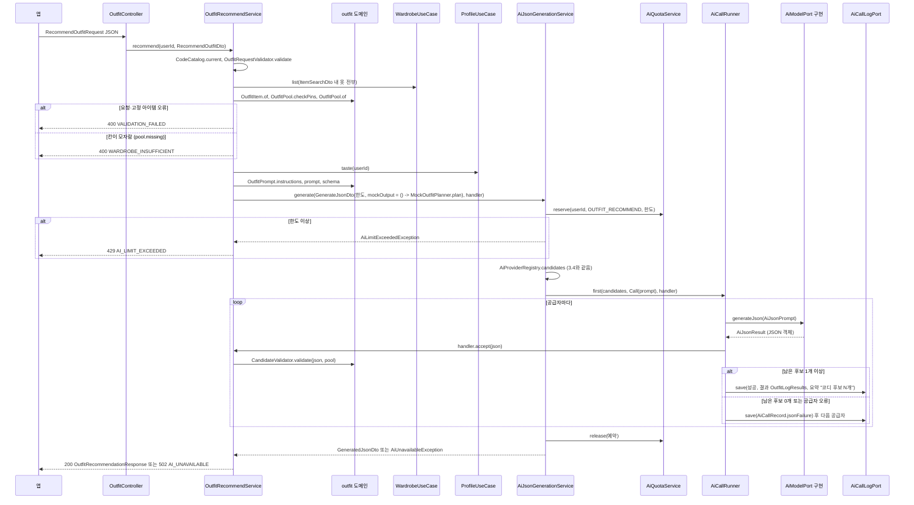

| 단계 | 클래스 | 하는 일 |
|---|---|---|
| 1 | [`OutfitController`][OutfitController] `recommend` | 본문을 웹 요청 [`RecommendOutfitRequest`][RecommendOutfitRequest]로 받아 `toDto()` → [`RecommendOutfitDto`][RecommendOutfitDto](Bean Validation 없음, 검증은 유스케이스) |
| 2 | [`OutfitRecommendService`][OutfitRecommendService] `recommend` (트랜잭션 없음) | `CodeCatalog.current()` → [`OutfitRequestValidator`][OutfitRequestValidator] `validate` → [`OutfitRequest`][OutfitRequest]. 날짜·상황·분위기·격식(공유 커널 `DressCode`)·날씨·count 등이 틀리면 400 `VALIDATION_FAILED`(`context.date` 같은 필드 이름) |
| 3 | [`WardrobeUseCase`][WardrobeUseCase] `list` (wardrobe) | 필터 없는 [`ItemSearchDto`][ItemSearchDto]로 내 옷 전부(3.3 목록 경로, MyBatis) → [`OutfitItem`][OutfitItem] `of(..., codes)`: 칸(CATEGORY `slot`)·보온·색 속성을 코드에서 붙인다 |
| 4 | [`OutfitPool`][OutfitPool] `checkPins` → `of` → `missing` (도메인) | 고정·중심 아이템이 내 옷이고 칸이 맞는지(아니면 400). 추천 가능한 상태·제외 목록·피하고 싶은 색을 걸러 칸별 후보 풀을 만든다. 상의+하의 또는 원피스, 신발이 없으면 400 `WARDROBE_INSUFFICIENT`(`params.missing`에 모자란 칸, `params.alternatives`에 대신할 칸) |
| 5 | [`ProfileUseCase`][ProfileUseCase] `taste` (user) | [`ProfileTasteDto`][ProfileTasteDto](드레스 코드·선호 스타일·선호 색) → [`OutfitTaste`][OutfitTaste] |
| 6 | [`OutfitPrompt`][OutfitPrompt] `instructions`·`prompt`·`schema` (도메인) | 시스템 지시(점수 기준 포함), 사용자 메시지(조건·취향·최근 코디·색 짝·칸별 옷 목록), 칸 값이 **그 칸의 내 옷 id enum**인 JSON 스키마. 목업용 [`MockOutfitPlanner`][MockOutfitPlanner] `plan`은 `Supplier`로 넘겨 목업 실행일 때만 계산한다 |
| 7 | [`GenerateJsonDto`][GenerateJsonDto] → [`AiJsonGenerationService`][AiJsonGenerationService] `generate` | 기능 이름 형식 확인(`AiFeatures.isValidName`) → [`AiQuotaService`][AiQuotaService] `reserve`(3.4의 3단계와 같다. 한도 `OutfitSettings.dailyLimit()`, 사진 분석과 따로 센다. 넘으면 [`AiLimitExceededException`][AiLimitExceededException]) → `AiProviderRegistry.candidates()`(3.4의 4~6단계). 후보가 없으면 [`AiUnavailableException`][AiUnavailableException] |
| 8 | [`AiCallRunner`][AiCallRunner] `first` → [`AiModelPort`][AiModelPort] `generateJson` | [`AiJsonPrompt`][AiJsonPrompt](이미지 없음)로 각 사 구조화 출력 호출 → `JsonObjectParser`로 JSON 객체(Map)까지만 → [`AiJsonResult`][AiJsonResult]. 목업 공급자는 `mockOutput.get()`을 돌려준다 |
| 9 | [`JsonOutputHandler`][JsonOutputHandler] `accept` = `OutfitRecommendService.accept` → [`CandidateValidator`][CandidateValidator] `validate` | 후보마다 내 옷인지, 칸이 맞는지, `TOP+BOTTOM` xor `DRESS`, `SHOES`, 고정·중심 포함, 제외·색, 중복, `reason`·`aiScores` 형식. 틀린 후보만 버린다. 남은 후보가 0개면 [`RejectedOutputException`][RejectedOutputException]. 통과하면 `Accepted(후보, 기록용 결과, 요약)`: 기록 JSON 모양은 [`OutfitLogResults`][OutfitLogResults]가 만든다(`{ candidates, dropped }`) |
| 10 | `AiCallLogPort.save` | 성공은 결과·요약(`코디 후보 N개`)과 함께, 실패는 `AiCallRecord.jsonFailure`(`error_code` = 공급자 `reason` 또는 `REJECTED_OUTPUT`) 후 다음 공급자. 끝나면 예약 해제(`finally`) |
| 11 | 응답 | [`GeneratedJsonDto`][GeneratedJsonDto](`usedToday` = 예약 때 센 수) → [`OutfitRecommendationDto`][OutfitRecommendationDto] → [`OutfitRecommendationResponse`][OutfitRecommendationResponse](`candidates`, `provider`, `model`, `remainingToday`). `OutfitRecommendService`가 `AiLimitExceededException`은 429, `AiUnavailableException`은 "AI 코디 추천을 지금 받을 수 없어요…" 502로 바꾼다 |

AI를 부르기 전(1~6단계)에 끝나면 기록도 예약도 남기지 않는다.

### 3.6 관리자 코드 변경 (감사 로그, 코드 캐시 다시 읽기)

`PATCH /api/v1/admin/codes/{group}/{code}` (ADMIN만).

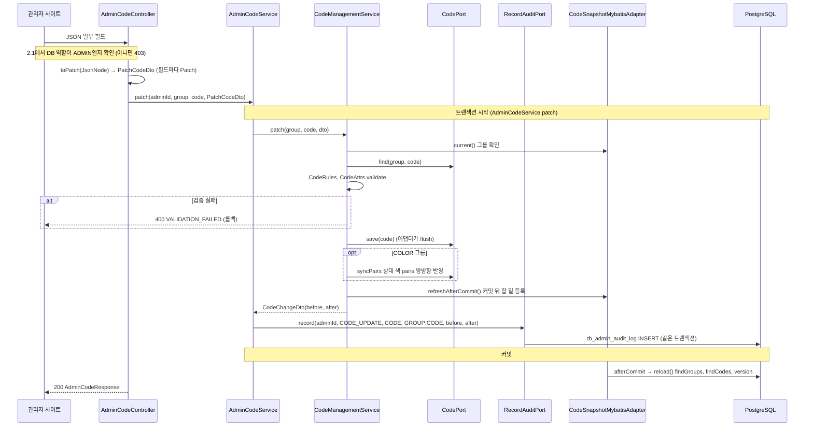

| 단계 | 클래스 | 하는 일 |
|---|---|---|
| 1 | `SecurityConfig` + [`UserIdAuthenticationConverter`][UserIdAuthenticationConverter] | `/api/v1/admin/**`는 `ROLE_ADMIN`만. 역할은 매 요청 DB에서 읽는다 |
| 2 | [`AdminCodeController`][AdminCodeController] `patch` | 본문을 `JsonNode`로 받아 [`JsonPatches`][JsonPatches]로 필드마다 [`Patch`][Patch](안 보냄·값·형식 오류)를 만들어 [`PatchCodeDto`][PatchCodeDto]로 넘긴다. "안 보냄"과 "`null`을 보냄"을 구분하기 위해서다 |
| 3 | [`AdminCodeService`][AdminCodeService] `patch` (`@Transactional`) | 트랜잭션 경계. 실제 변경은 `code` 컨텍스트의 [`CodeManagementUseCase`][CodeManagementUseCase]에 맡긴다 |
| 4 | [`CodeManagementService`][CodeManagementService] `patch` | `requireGroup`(없는 그룹 404) → [`CodePort`][CodePort] `find`(404) → [`CodeRules`][CodeRules] `label`·`parent`, [`CodeAttrs`][CodeAttrs] `validate`(그룹별 attrs) → `throwIfAny` → [`Code`][Code] `update` → `CodePort.save` ([`CodeJpaAdapter`][CodeJpaAdapter], 저장과 함께 flush) |
| 5 | `CodeManagementService.syncPairs` | COLOR면 상대 색의 `attrs.pairs`에도 이 색을 넣거나 뺀다(양방향) |
| 6 | [`CodeSnapshotPort`][CodeSnapshotPort] `refreshAfterCommit` ([`CodeSnapshotMybatisAdapter`][CodeSnapshotMybatisAdapter]) | [`AfterTransaction`][AfterTransaction] `commit`으로 `reload()`를 등록만 한다 |
| 7 | [`RecordAuditPort`][RecordAuditPort] `record` ([`AuditLogJpaAdapter`][AuditLogJpaAdapter], `MANDATORY`) | `tb_admin_audit_log`에 `CODE_UPDATE`, 대상 `GROUP:CODE`, before·after JSON(`AuditSnapshots`가 만든 Map, 시각은 밀리초 ISO 문자열로 저장). 변경과 같은 트랜잭션 |
| 8 | 커밋 후 `CodeSnapshotMybatisAdapter.reload` | [`CodeMapper`][CodeMapper] `findGroups`·`findCodes`·`version`(MyBatis)으로 새 스냅샷을 만들어 `volatile` 필드를 바꾼다. 이후 `GET /api/v1/codes`의 `version`·`ETag`가 바뀌고, 옷장 검증·AI 프롬프트도 새 코드를 쓴다. 롤백되면 이력도 캐시 갱신도 없다 |

같은 모양의 다른 코드 API:

- `create`(`CODE_CREATE`).
- `reorder`(`CODE_REORDER`, `PUT /{group}/order`): 컨트롤러는 유스케이스 하나(`AdminCodeUseCase.reorder`)만 부른다. 서비스는 트랜잭션 없이 [`AdminCodeOrderWriter`][AdminCodeOrderWriter] `reorder`(쓰기 + 감사, `@Transactional`)를 부르고, 커밋·캐시 재적재가 끝난 뒤 `list()`로 응답을 만든다(새 `version`).
- `delete`(`CODE_DELETE`): 사용 수는 code가 다른 컨텍스트의 테이블을 읽지 않고, 코드를 쓰는 컨텍스트가 구현한 입력 포트 [`CodeUsageSource`][CodeUsageSource]에 묻는다. wardrobe의 [`ItemCodeUsageSource`][ItemCodeUsageSource](→ `ItemCodeUsageUseCase` → MyBatis), user의 [`ProfileCodeUsageSource`][ProfileCodeUsageSource](→ `ProfileCodeUsageUseCase` → MyBatis). 의존은 wardrobe → code, user → code 한 방향이다. 쓰는 곳이 있으면 "아이템 N개, 프로필 M개에서 쓰고 있어…" 409 `CODE_IN_USE`.

### 3.7 AI 키 웹 입력 (확인 → 재인증 → 외부 검증(트랜잭션 밖) → 암호화 저장·감사(트랜잭션) → 캐시 무효화)

`PUT /api/v1/admin/ai/providers/{providerId}/api-key` 본문 `{ apiKey, currentPassword, verify? }`.

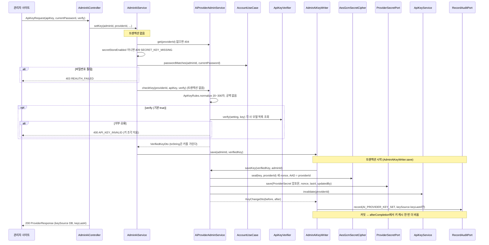

| 단계 | 클래스 | 하는 일 |
|---|---|---|
| 1 | [`AdminAiController`][AdminAiController] `setKey` | 본문 [`ApiKeyRequest`][ApiKeyRequest]. 없으면 빈 요청으로 |
| 2 | [`AdminAiService`][AdminAiService] `setKey` (**트랜잭션 없음**) | [`AiProviderAdminUseCase`][AiProviderAdminUseCase] `get`(404) → `secretStoreEnabled`(마스터 키 `wearly.secret-key`가 없으면 409 `SECRET_KEY_MISSING`). 오류 순서 404 → 409 → 403 → 400은 예전과 같다 |
| 3 | `AdminAiService.reauthenticate` → [`AccountUseCase`][AccountUseCase] `passwordMatches` ([`AuthService`][AuthService]) | `CredentialPort.findByUserId` + `PasswordHasher.matches`. 틀리면 403 `REAUTH_FAILED` |
| 4 | [`AiProviderKeyUseCase`][AiProviderKeyUseCase] `checkKey` ([`AiProviderAdminService`][AiProviderAdminService], 트랜잭션 없음) | `AiProviderPort.findById` → 마스터 키 확인 → [`ApiKeyRules`][ApiKeyRules] `normalize`(앞뒤 공백 제거 후 20~300자, 공백·줄바꿈 없음. 틀리면 400 `VALIDATION_FAILED` `apiKey`) |
| 5 | [`ApiKeyVerifierPort`][ApiKeyVerifierPort] `verify` ([`ApiKeyVerifier`][ApiKeyVerifier] → 종류별 `AiProviderModule.verify`) | `verify`가 `false`가 아니면: CLAUDE는 Anthropic SDK로 모델 목록, OPENAI `GET /models`, GEMINI `GET /v1beta/models?pageSize=1`. 실패하면 400 `API_KEY_INVALID`(메시지에서 키를 `***`로 지움). **외부 HTTP 동안 DB 연결·트랜잭션을 잡지 않는다** → [`VerifiedKeyDto`][VerifiedKeyDto] |
| 6 | [`AdminAiKeyWriter`][AdminAiKeyWriter] `save` (`@Transactional`) → `AiProviderKeyUseCase.saveKey` | 마스터 키 다시 확인 → [`SecretCipherPort`][SecretCipherPort] `seal` ([`AesGcmSecretCipher`][AesGcmSecretCipher]): `AES/GCM/NoPadding`, 매번 새 12바이트 nonce, 태그 128비트, **AAD = providerId**(다른 공급자 행에 붙여 넣으면 복호화 실패) → [`SealedSecret`][SealedSecret] |
| 7 | [`ProviderSecretPort`][ProviderSecretPort] `save` ([`ProviderSecretJpaAdapter`][ProviderSecretJpaAdapter]) | [`ProviderSecret`][ProviderSecret](암호문·nonce·key_version·끝 4자·넣은 관리자)을 `tb_ai_provider_secret`에 넣거나 바꾼다. 키 원문은 저장하지 않는다 |
| 8 | [`ApiKeyService`][ApiKeyService] `invalidate` | 복호화 키 캐시에서 지금 지우고, [`TransactionHooksPort`][TransactionHooksPort] `afterCompletion`([`TransactionHooksAdapter`][TransactionHooksAdapter] → `AfterTransaction.completion`)으로 트랜잭션이 끝난 뒤 한 번 더 지운다(그 사이 다른 요청이 옛 값을 다시 캐시해도 비워지게) |
| 9 | `AiProviderAdminService.info` → [`KeyChangeDto`][KeyChangeDto] | 바뀐 뒤 상태(`ApiKeyService.state`가 DB 키를 다시 읽고 복호화) |
| 10 | [`RecordAuditPort`][RecordAuditPort] `record` | `AI_PROVIDER_KEY_SET`. before·after에는 `keySource`·`keyLast4`만 남긴다(키 값 없음). 저장과 같은 트랜잭션 |
| 11 | 응답 [`ProviderResponse`][ProviderResponse] | `keySource: DB`, `keyLast4`, `keyUpdatedAt`, `keyUpdatedBy`, `secretStoreEnabled` |

다음 분석·추천부터는 3.4의 5단계가 DB 키를 고르고, [`AiProviderFactory`][AiProviderFactory]는 캐시 키에 들어 있는 키 해시가 달라져 클라이언트를 새로 만든다.
지우기(`DELETE .../api-key`, 본문 `{ currentPassword }`)는 `AdminAiService.deleteKey`(`@Transactional`, 외부 호출 없음) → 재확인 → `AiProviderKeyUseCase.deleteKey` → `ProviderSecretPort.delete` → `ApiKeyService.invalidate` → `AI_PROVIDER_KEY_DELETE` 기록. 마스터 키 확인은 하지 않는다. 지운 뒤에는 서버 설정 키로 돌아간다.

### 3.8 옷 사용 중지·다시 사용 (6차, 13 문서)

`POST /api/v1/wardrobe/items/{id}/retire` `{ reason, memo? }`, `POST /api/v1/wardrobe/items/{id}/restore`. 쓰기 경로는 3.2(옷 등록)와 같은 JPA 경로다.

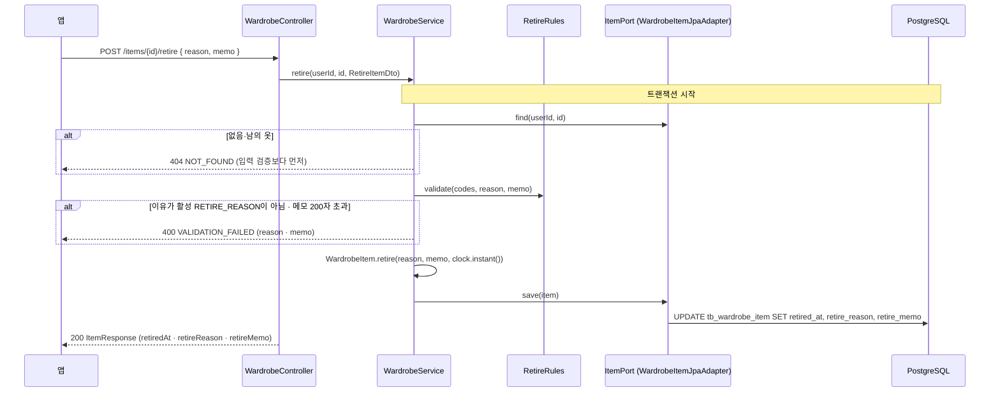

| 단계 | 클래스 | 하는 일 |
|---|---|---|
| 1 | [`WardrobeController`][WardrobeController] `retire`·`restore` | 본문 [`RetireItemRequest`][RetireItemRequest] → [`RetireItemDto`][RetireItemDto]. 본문이 없으면 이유 없음으로 넘긴다 |
| 2 | [`WardrobeService`][WardrobeService] `retire` (`@Transactional`) | 아이템을 먼저 찾고(404), [`RetireRules`][RetireRules] `validate(codes, …)`로 이유(활성 코드, `CodeChecks.one`)·메모(앞뒤 공백 제거 후 200자, 코드 포인트) 확인 |
| 3 | [`WardrobeItem`][WardrobeItem] `retire`·`restore` | 도메인 규칙: 처음이면 지금 시각, 이미 사용 중지면 시각을 두고 이유·메모만 바꾼다. 상태 값은 [`Retirement`][Retirement](없으면 사용 중). 보유 상태(`status`)는 건드리지 않는다 |
| 4 | [`WardrobeItemJpaAdapter`][WardrobeItemJpaAdapter] `save` | `Retirement` ↔ 엔티티의 `retired_at`·`retire_reason`·`retire_memo`. DB CHECK `ck_wardrobe_item_retired`가 "시각과 이유가 함께"를 한 번 더 막는다 |
| 5 | `restore` | 사용 중이면 저장하지 않고 그대로 돌려준다 |

사용 중지가 다른 흐름에 주는 영향:

| 흐름 | 바뀐 점 |
|---|---|
| 목록 (3.3) | `retired` 쿼리를 [`ItemFilter`][ItemFilter]`.retired`(`false`·`true`·`null`=전부)로 바꾸고, [`WardrobeItemMapper.xml`](../backend/src/main/resources/mapper/wardrobe/WardrobeItemMapper.xml) `findItems`가 `retired_at IS [NOT] NULL`을 붙인다. 기본은 사용 중인 옷만 |
| 통계 (3.3) | 기존 집계 SQL은 모두 `retired_at IS NULL`. [`WardrobeStatsService`][WardrobeStatsService]가 `countRetired`·`countRetiredByReason`(많은 순)을 더해 `retired`·`retiredByReason`을 만든다 |
| AI 코디 추천 (3.5) | [`OutfitRecommendService`][OutfitRecommendService]가 옷장을 `retired=all`로 읽어 사용 중인 옷만 후보로 쓰고, 사용 중지한 옷 id는 [`OutfitPool`][OutfitPool] `checkPins(request, items, retiredIds)`에 넘겨 고정·중심이면 400("사용하지 않는 옷이에요.") |
| 코드 삭제 가드 (3.6) | `countByCode`·`countUsing`이 `retire_reason`(RETIRE_REASON)까지 8개 컬럼을 보고, 사용 중지한 옷도 센다 |
| 관리자 회원 목록 | [`AdminQueryMapper.xml`](../backend/src/main/resources/mapper/admin/AdminQueryMapper.xml) `findUsers`가 `item_count`(사용 중)와 `retired_item_count`를 따로 센다 |

### 3.9 앱 설정·테마 (6차, 12 문서 3장)

공개 `GET /api/v1/app/config`와 관리자 `GET·PUT /api/v1/admin/app/theme`.

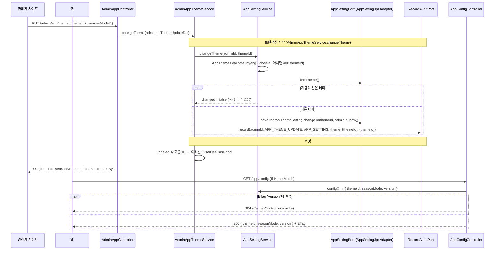

| 단계 | 클래스 | 하는 일 |
|---|---|---|
| 1 | [`AppConfigController`][AppConfigController] | 공개 경로. 코드 API(`CodeController`)와 같은 방식으로 `ETag: "<version>"`, `Cache-Control: no-cache`, `checkNotModified`면 304 |
| 2 | [`AppSettingService`][AppSettingService] | `config`·`theme`은 `readOnly`. 행이 없으면 [`ThemeSetting`][ThemeSetting] `defaults()`(nyang). 캐시하지 않는다(행 하나, PK 조회) |
| 3 | [`ThemeSetting`][ThemeSetting]·[`AppThemes`][AppThemes] (도메인) | 허용 테마 목록, `changeTo`(시각은 밀리초로 자름), `version()` = 바꾼 시각 ISO 또는 `"initial"` |
| 4 | [`AppSettingJpaAdapter`][AppSettingJpaAdapter] | `tb_app_setting`의 `theme` 행. `value JSONB` `{"themeId": ...}` ↔ `ThemeSetting` |
| 5 | [`AdminAppThemeService`][AdminAppThemeService] (admin) | 트랜잭션 경계. appsetting의 입력 포트로 바꾸고, 바뀐 경우에만 같은 트랜잭션에서 [`RecordAuditPort`][RecordAuditPort] `record`. `updatedBy` 이메일은 user의 [`UserUseCase`][UserUseCase]로 찾는다(탈퇴하면 null) |

> 계절 모드(이슈 #6, 12 문서 7장): 같은 `theme` 행 JSON에 `seasonMode`(`OFF`·`AUTO`·`SPRING`·`SUMMER`·`FALL`·`WINTER`, 기본 `OFF`)가 함께 있다. `changeTheme`은 보낸 필드(`themeId`·`seasonMode`)만 검증하고 바꾸며, 바뀐 필드만 이력 before·after에 남긴다. 서버는 지금 계절을 주지 않는다(AUTO의 계절 계산은 앱이 한다, ETag를 저장값 기준으로 두려고). 마이그레이션은 없다.

### 3.10 AI 공급자 모델 목록 (관리자 모델 드롭다운, 07 문서 4장)

`GET /api/v1/admin/ai/providers/{providerId}/models?refresh=true|false`. ADMIN 전용(`/api/v1/admin/**` 규칙, 2.1). 트랜잭션 없이 처리하고 감사 로그는 없다.

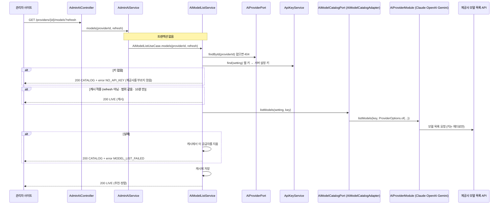

| 단계 | 클래스 | 하는 일 |
|---|---|---|
| 1 | [`AdminAiController`][AdminAiController] `models` | `refresh` 쿼리(기본 false)를 받아 [`ProviderModelsResponse`][ProviderModelsResponse] `from`으로 응답을 만든다. 요청 클래스는 없다 |
| 2 | [`AdminAiService`][AdminAiService] `models` (**트랜잭션 없음**) | [`AiModelListUseCase`][AiModelListUseCase] `models`에 그대로 넘긴다 |
| 3 | [`AiModelListService`][AiModelListService] `models` | [`AiProviderPort`][AiProviderPort] `findById`(없으면 404 `NOT_FOUND`) → [`BuiltInModels`][BuiltInModels] `of(종류)`(내장 목록) → [`ApiKeyService`][ApiKeyService] `find`(3.4의 5단계와 같은 키 고르기). 키가 없으면 내장 목록 + `NO_API_KEY` |
| 4 | 같은 클래스의 캐시 | 공급자 ID별 메모리 캐시. 범위 "종류\|`baseUrl`\|키 지문"([`ApiKeyRules`][ApiKeyRules] `fingerprint`)이 같고 10분 안이며 `refresh`가 아니면 캐시를 쓴다 |
| 5 | [`AiModelCatalogPort`][AiModelCatalogPort] `listModels` ([`AiModelCatalogAdapter`][AiModelCatalogAdapter]) | [`AiProviderModules`][AiProviderModules]`.of(종류)`가 고른 모듈의 `listModels(key, options)`를 부른다. 옵션은 [`ProviderOptions`][ProviderOptions] `of`(`timeoutSeconds`, `baseUrl`은 `WEARLY_AI_ALLOW_BASE_URL=true`일 때만) |
| 6 | [`ClaudeModule`][ClaudeModule]·[`OpenAiModule`][OpenAiModule]·[`GeminiModule`][GeminiModule] `listModels` | Claude는 SDK `models().list().autoPager()`(최대 500개, 종료된 모델 제외), OpenAI는 `GET /models`, Gemini는 `GET /v1beta/models`(최대 5쪽). 응답을 [`ModelListResponses`][ModelListResponses]로 읽고 [`ModelListRules`][ModelListRules]로 사진 분석에 쓸 수 있는 모델만 남긴다 → [`AiModelEntry`][AiModelEntry] 목록 |
| 7 | `AiModelListService` (실패) | 어댑터는 실패를 [`AiProviderException`][AiProviderException](reason `API_<상태>`·`TIMEOUT`·`API_CLIENT`·`BAD_RESPONSE`)로 던진다. 서비스가 잡아 `failureMessage(reason)`으로 화면 문구를 만들고(키·응답 원문 없음) 캐시에서 이 공급자를 지운 뒤 내장 목록 + `MODEL_LIST_FAILED`를 **200으로** 준다 |
| 8 | `AiModelListService` (성공) | 받은 목록을 캐시에 넣고(`fetchedAt` = 받은 시각) `ModelListRules.withCatalog`로 내장 목록의 추천·이름을 붙여 정렬한다 → [`AiModelListDto`][AiModelListDto] |

캐시는 [`AiProviderAdminService`][AiProviderAdminService]가 웹 키를 저장·삭제하거나 공급자를 수정·삭제할 때 `AiModelListService.invalidate`로 비운다(3.7의 키 캐시 비우기와 같은 자리).

### 3.11 옷 사진 올리기 (사진 저장, 18 문서)

세 단계로 나뉜다. 앱이 서명 URL로 저장소에 **바로** 올리므로 사진 바이트는 1단계·3단계 사이에서 백엔드를 지나지 않는다. 3단계 `complete`가 읽어 가서 처리한다. 사진은 **아이템이 만들어지기 전에** 올리고, 마지막 단계에서 `imageId`로 붙인다.

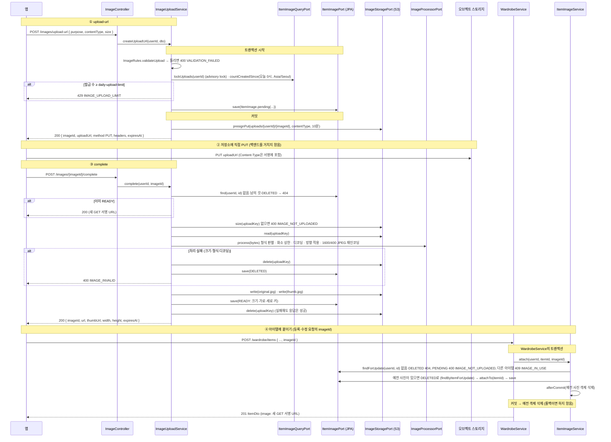

| 단계 | 클래스 | 하는 일 |
|---|---|---|
| 1 | [`ImageController`][ImageController] `uploadUrl` | `@CurrentUser`, [`UploadUrlRequest`][UploadUrlRequest] → `toDto()` → [`ImageUploadUseCase`][ImageUploadUseCase] → [`UploadUrlResponse`][UploadUrlResponse]. 정상은 200 |
| 2 | [`ImageUploadService`][ImageUploadService] `createUploadUrl` (`@Transactional`) | [`ImageRules`][ImageRules] `validateUpload`(`purpose` ITEM, `contentType` jpeg·png, `size` 1~`max-upload-bytes`)로 `FieldError`를 모아 400. [`ItemImageQueryPort`][ItemImageQueryPort] `lockUploads`([`ItemImageMybatisAdapter`][ItemImageMybatisAdapter] → [`ItemImageMapper`][ItemImageMapper], 회원별 `pg_advisory_xact_lock`)로 같은 회원의 발급을 한 줄로 세우고 오늘 발급 수(상태 무관)가 `daily-upload-limit` 이상이면 429. `ItemImage.pending`을 [`ItemImagePort`][ItemImagePort] `save`([`ItemImageJpaAdapter`][ItemImageJpaAdapter])로 저장 |
| 3 | [`ImageStoragePort`][ImageStoragePort] `presignPut` ([`S3ImageStorageAdapter`][S3ImageStorageAdapter]) | 서명 주소는 [`StoragePresigners`][StoragePresigners]가 정한다: `public-endpoint` → 없으면 요청 Host 이름 + `endpoint` 스킴·포트 (18 문서 2.3). 응답 `headers`는 서명에 들어간 `Content-Type` |
| 4 | 앱 → 저장소 | 서명 URL로 `PUT`. 백엔드는 모른다 |
| 5 | [`ImageUploadService`][ImageUploadService] `complete` (**트랜잭션 없음**) | 저장소 읽기·쓰기가 길어서 DB 트랜잭션을 잡지 않는다(2.3). `ImageStoragePort.size`로 크기 확인(없음 400 `IMAGE_NOT_UPLOADED`, 초과면 `IMAGE_INVALID`) → `read` → [`ImageFormats`][ImageFormats] `sniff`(실제 바이트로 JPEG·PNG만) |
| 6 | [`ImageProcessorPort`][ImageProcessorPort] `process` ([`ImageIoProcessorAdapter`][ImageIoProcessorAdapter]) | 헤더의 화소 수 상한 → 디코딩(서브샘플링) → EXIF 방향 적용 → 흰 배경 RGB로 긴 변 1600·400(설정 `original-max-side`·`thumb-max-side`) JPEG 재인코딩(원본의 EXIF·ICC·XMP는 옮기지 않는다). 동시 처리는 `processing-concurrency` 세마포어. 실패는 `InvalidImageException` |
| 7 | 실패: `reject` | 업로드 원본 삭제 → 행 `DELETED` → 400 `IMAGE_INVALID`. 그 `imageId`는 다시 쓸 수 없다 |
| 8 | 성공 | `original.jpg`·`thumb.jpg` 쓰기 → 행 READY 저장 → 업로드 원본 삭제(실패하면 WARN, 정리 작업이 지운다) → [`ImageUrls`][ImageUrls]가 GET 서명 URL 두 개를 만들어 [`ImageResponse`][ImageResponse]로 |
| 9 | [`WardrobeService`][WardrobeService] `create`·`update`·`bulkCreate` | `saveNew`/`update`가 같은 트랜잭션에서 [`ItemImageUseCase`][ItemImageUseCase] `attach`(`imageId`가 있을 때) · `detach`(PATCH `imageId: null`) · `find`/`findAll`(응답의 `image`, 목록은 한 번에)를 부른다 |
| 10 | [`ItemImageService`][ItemImageService] `attach` | `findForUpdate`로 행을 잠그고 검사(404·`IMAGE_NOT_UPLOADED`·`IMAGE_IN_USE`). 같은 아이템이면 그대로. 예전 사진은 먼저 `DELETED`로 바꿔 부분 유니크 인덱스(`item_id`)에 안 걸리게 하고 [`AfterCommitPort`][AfterCommitPort]로 **커밋 뒤** 객체를 지운다 ([`AfterCommitAdapter`][AfterCommitAdapter]). 붙이기가 실패하면 아이템 등록도 되돌아간다 |
| 11 | `WardrobeService.delete` | 사진을 먼저 `detach`한 뒤 아이템을 지운다 |

**정리와 탈퇴** (요청 흐름 밖):

| 클래스 | 하는 일 |
|---|---|
| [`ImageCleanupScheduler`][ImageCleanupScheduler] | 시작 5분 뒤, 이후 `cleanup-interval`(1시간)마다 [`ImageCleanupService`][ImageCleanupService] `cleanup`. `cleanup-enabled=false`면 만들지 않는다. 실패해도 다음 주기에 다시 |
| [`ImageCleanupService`][ImageCleanupService] `cleanup` | `findStale`(아이템에 안 붙고 `stale-after`가 지난 PENDING·READY·DELETED) → `claimForCleanup`(행을 DELETED로 바꿔 붙이기와 겹치지 않게) → 객체 3개 삭제 → 성공한 행만 삭제. 200개씩 최대 50번 |
| [`ImageCleanupOnUserDeleted`][ImageCleanupOnUserDeleted] | user의 `UserDeletedListener` 구현(탈퇴 때 호출). `ImageCleanupService.deleteAllOf`가 커밋 뒤 `users/{userId}/`·`uploads/{userId}/` 접두사를 지운다. 행은 FK CASCADE |

### 3.12 예정 코디 저장 (21 문서)

`POST /api/v1/plans` 한 건, 앱이 기기 예정을 한꺼번에 올리는 `POST /api/v1/plans/bulk`, `PATCH`·`DELETE /api/v1/plans/{id}`, `GET /api/v1/plans`. 쓰기는 JPA, 목록·개수·잠금은 MyBatis, 응답에 붙는 `missingItemIds`는 wardrobe 컨텍스트의 입력 포트에 묻는다.

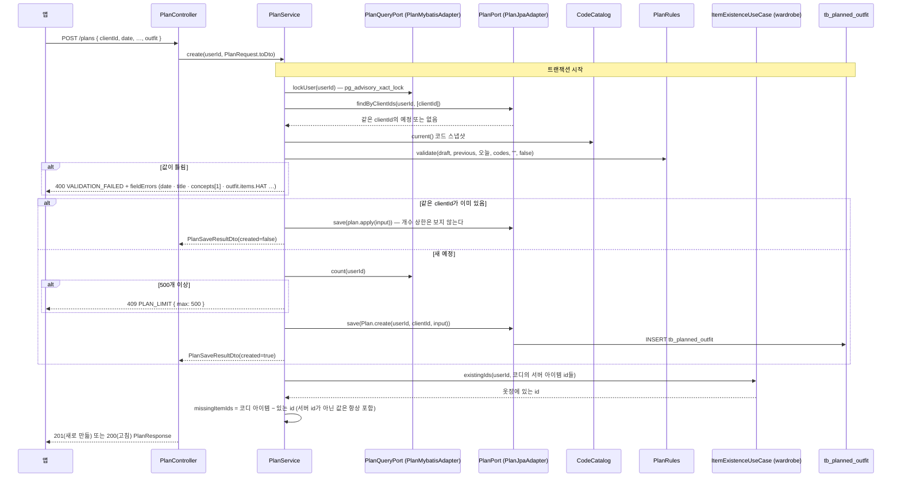

| 단계 | 클래스 | 하는 일 |
|---|---|---|
| 1 | [`PlanController`][PlanController] `create` | 본문 [`PlanRequest`][PlanRequest] → [`PlanInputDto`][PlanInputDto] (`toDto()`). 값 검증은 하지 않는다 (Bean Validation 애너테이션 없음). 새로 만들면 201, 같은 `clientId`를 고쳤으면 200 |
| 2 | [`PlanService`][PlanService] `create` (`@Transactional`) | `PlanQueryPort.lockUser`로 이 회원의 예정 쓰기를 한 줄로 세운다. 같은 `clientId`를 찾고(`findByClientIds`), 코드 스냅샷으로 검증 |
| 3 | [`PlanRules`][PlanRules] `validate`, [`PlanOutfits`][PlanOutfits] `validate` | 날짜(오늘 앞뒤 1년, 바꾸지 않은 날짜는 범위를 보지 않음)·시간대·제목·상황·스타일 코드(`CodeChecks`)·장소(지역 코드)·날씨·출처·확인 시각·코디(칸 이름·id 길이·크기)를 한 번에 검사해 `List<FieldError>`로 모은다. bulk는 필드 이름 앞에 `items[i].` |
| 4 | `BusinessException.throwIfAny` | 모은 오류를 한 번에 400 |
| 5 | [`Plan`][Plan] `create`·`apply`, [`PlanPort`][PlanPort] `save` ([`PlanJpaAdapter`][PlanJpaAdapter]) | 도메인 모델 ↔ [`PlanEntity`][PlanEntity] 변환 후 `saveAndFlush`. 장소 네 칸·`weather` JSONB([`PlanWeatherJson`][PlanWeatherJson])·`outfit` JSONB를 채운다 |
| 6 | `checkLimit` | 새로 만들 때만: `PlanQueryPort.count + 새로 만들 수 > 500`이면 409 `PLAN_LIMIT` (`params.max`). 잠금 안이라 동시 요청도 상한을 넘지 않는다 |
| 7 | [`ItemExistenceUseCase`][ItemExistenceUseCase] `existingIds` ([`ItemExistenceService`][ItemExistenceService]) | 코디 아이템 중 서버 id(양의 정수 문자열)를 모아 이 회원의 옷장에 아직 있는 id를 한 번에 묻는다. 목록·bulk도 모든 예정의 id를 한 번에 묻는다 |
| 8 | [`PlanDto`][PlanDto] `from` → [`PlanResponse`][PlanResponse] `from` | `missingItemIds`·시각(밀리초 ISO)·문자열 ID를 붙인다 |

같은 경로의 다른 요청:

| 요청 | 다른 점 |
|---|---|
| `POST /plans/bulk` | `PlanService.bulk`: 개수(100)·항목 null·요청 안 `clientId` 중복을 먼저 모으고, 잠금 안에서 이미 있는 `clientId`를 한 번에 찾아 항목마다 검증(`items[i].…`, `clientId` 필수). 틀린 항목이 하나라도 있으면 하나도 저장하지 않는다. `created`(새로 만든 수)만 상한에 센다. 응답은 요청 순서, 200 |
| `PATCH /plans/{id}` | 본문은 `JsonNode`로 받아 [`PatchPlanRequest`][PatchPlanRequest] `read`가 `PlanRequest`와 같은 타입으로 필드마다 [`Patch`][Patch](안 보냄·값·형식 오류)로 바꿔 [`PatchPlanDto`][PatchPlanDto]를 만든다. `PlanService.patch`가 남의·없는 예정 404를 먼저 확인하고 저장된 값에 보낸 필드를 합쳐(`PlanDraft`) 전체를 다시 검증한다. `null`은 비움, `weather`는 통째로 교체 |
| `DELETE /plans/{id}` | 찾아서(남의 것·없음 404) 지운다. 204 |
| `GET /plans` | `from`·`to` 형식 검사 후 `PlanQueryPort.findPlans`(MyBatis, 날짜 → 시간대 → id 순) + `missingItemIds` |
| 코드 삭제 가드 (3.6) | [`PlanCodeUsageSource`][PlanCodeUsageSource]가 STYLE(`concepts`)·REGION(`place_region_code`) 사용 수를 알려, 예정이 쓰는 코드는 삭제할 수 없다 (`usages`에 `kind: PLAN`) |

### 3.13 예정 코디 D-1 알림 (23 문서)

두 갈래다. (a) 앱이 푸시 토큰을 등록하는 `PUT·DELETE /api/v1/me/push-token`, (b) 서버가 매일 19:30(KST)에 도는 D-1 작업. 앱의 로컬 알림은 서버를 거치지 않는다(23 문서 3장).

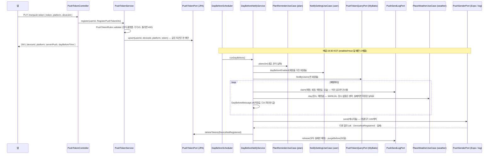

| 단계 | 클래스 | 하는 일 |
|---|---|---|
| 1 | [`PushTokenController`](../backend/src/main/java/app/wearly/notify/adapter/in/web/PushTokenController.java) | `PUT`은 [`PushTokenRequest`](../backend/src/main/java/app/wearly/notify/adapter/in/web/request/PushTokenRequest.java) → `RegisterPushTokenDto`, `DELETE`는 `deviceId` 쿼리(없으면 400). 응답은 [`PushTokenResponse`](../backend/src/main/java/app/wearly/notify/adapter/in/web/response/PushTokenResponse.java) |
| 2 | [`PushTokenService`](../backend/src/main/java/app/wearly/notify/application/service/PushTokenService.java) | [`PushTokenRules`](../backend/src/main/java/app/wearly/notify/domain/PushTokenRules.java)로 검증하고 [`PushTokenPort`](../backend/src/main/java/app/wearly/notify/application/port/out/PushTokenPort.java)(`PushTokenJpaAdapter`)에 저장. `serverPush` = [`PushSettings`](../backend/src/main/java/app/wearly/notify/domain/PushSettings.java) `deliversToDevices()`(`enabled` 이고 provider가 expo) |
| 3 | [`DayBeforeScheduler`](../backend/src/main/java/app/wearly/notify/adapter/in/schedule/DayBeforeScheduler.java) | `wearly.notify.push.enabled`와 `day-before.scheduler-enabled`가 둘 다 true일 때만 빈이 만들어진다. cron `0 {분} {시} * * *`(Asia/Seoul). 실패는 ERROR 로그만 남기고 삼킨다 |
| 4 | [`DayBeforeNotifyService`](../backend/src/main/java/app/wearly/notify/application/service/DayBeforeNotifyService.java) `runDayBefore` | 위 그림 순서. `@Transactional`이 **없다** — 날씨·푸시 외부 호출 동안 DB 연결을 잡지 않으려고, 각 포트·유스케이스가 자기 트랜잭션을 쓴다 |
| 5 | [`PlanReminderUseCase`](../backend/src/main/java/app/wearly/plan/application/port/in/PlanReminderUseCase.java) (plan) · [`NotifySettingUseCase`](../backend/src/main/java/app/wearly/user/application/port/in/NotifySettingUseCase.java) (user) · [`PlaceWeatherUseCase`](../backend/src/main/java/app/wearly/weather/application/port/in/PlaceWeatherUseCase.java) (weather) | 다른 컨텍스트는 입력 포트로만 부른다. 날씨는 `GET /weather/day`와 같은 유스케이스(한도·평년값 규칙 그대로) |
| 6 | [`PushSendLogPort`](../backend/src/main/java/app/wearly/notify/application/port/out/PushSendLogPort.java) | `claim`은 `tb_push_send_log`에 `ON CONFLICT DO NOTHING`으로 먼저 넣어 서버가 여러 대여도 한 번만 보낸다. 모두 실패하면 `release`. 30일 지난 기록 `purgeBefore` |
| 7 | [`DayBeforeMessage`](../backend/src/main/java/app/wearly/notify/domain/DayBeforeMessage.java)·[`DayBeforeWeather`](../backend/src/main/java/app/wearly/notify/domain/DayBeforeWeather.java) (도메인) | 문구와 "예보가 바뀜"(기온 3°C 이상 또는 비 여부) 판단. 앱 `planNotifyRules.ts`와 같은 규칙 |
| 8 | [`PushSenderPort`](../backend/src/main/java/app/wearly/notify/application/port/out/PushSenderPort.java) | `provider=expo`면 [`ExpoPushSenderAdapter`](../backend/src/main/java/app/wearly/notify/adapter/out/push/ExpoPushSenderAdapter.java)(Expo Push API, 100개씩, 티켓 해석), 기본 `log`면 [`LogPushSenderAdapter`](../backend/src/main/java/app/wearly/notify/adapter/out/push/LogPushSenderAdapter.java)(보내지 않고 건수만) — [`NotifyConfig`](../backend/src/main/java/app/wearly/notify/config/NotifyConfig.java)가 고른다 |

### 3.14 관리자 로그인과 2단계 인증 (22 문서 4.1)

관리자 사이트 로그인(`X-Wearly-Client: admin`)만 2단계 인증을 거친다. 앱·웹 로그인은 지금까지처럼 토큰을 주되 그 세션으로는 관리자 API를 쓸 수 없다(403 `MFA_REQUIRED`).

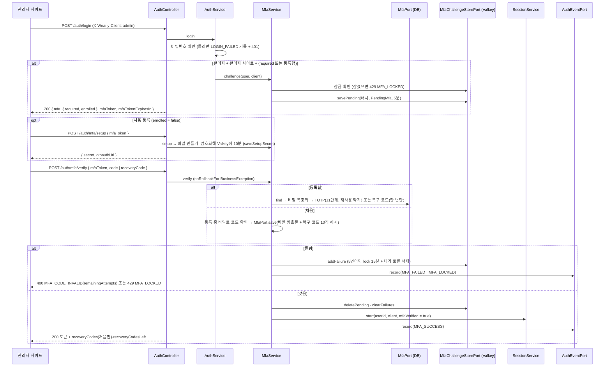

| 단계 | 클래스 | 하는 일 |
|---|---|---|
| 1 | [`AuthController`](../backend/src/main/java/app/wearly/auth/adapter/in/web/AuthController.java) `login` | 응답 타입이 `LoginResponse`(`AuthResponse` 또는 `MfaChallengeResponse`) |
| 2 | [`AuthService`](../backend/src/main/java/app/wearly/auth/application/service/AuthService.java) `login` | 관리자 + `ClientKind.ADMIN`일 때만 `MfaService.challenge`를 부른다. 비밀번호가 틀리면 가입한 이메일에 한해 `LOGIN_FAILED`를 남긴다(없는 이메일은 안 남김) |
| 3 | [`MfaService`](../backend/src/main/java/app/wearly/auth/application/service/MfaService.java) | `MfaPolicy.needed`(설정 required 또는 등록함), 대기 토큰은 원문을 응답으로만 주고 SHA-256 해시만 Valkey에 둔다([`MfaChallengeStorePort`](../backend/src/main/java/app/wearly/auth/application/port/out/MfaChallengeStorePort.java) → [`ValkeyMfaStoreAdapter`](../backend/src/main/java/app/wearly/auth/adapter/out/valkey/ValkeyMfaStoreAdapter.java)) |
| 4 | [`TotpAdapter`](../backend/src/main/java/app/wearly/auth/adapter/out/crypto/TotpAdapter.java)·`Totp`·`Base32` | RFC 6238 계산, 앞뒤 1단계 허용, `lastUsedStep`보다 크지 않은 단계는 거부 |
| 5 | [`AesGcmMfaSecretCipher`](../backend/src/main/java/app/wearly/auth/adapter/out/crypto/AesGcmMfaSecretCipher.java) | 비밀을 마스터 키(`wearly.secret-key`)로 암호화, AAD `mfa:{user_id}`. 키가 없으면 등록 시작이 409 `SECRET_KEY_MISSING` |
| 6 | [`MfaJpaAdapter`](../backend/src/main/java/app/wearly/auth/adapter/out/persistence/jpa/MfaJpaAdapter.java) | `tb_user_mfa`·`tb_user_mfa_recovery_code` 읽기·쓰기 |
| 7 | [`SessionService`](../backend/src/main/java/app/wearly/auth/application/service/SessionService.java) `start(…, mfaVerified)` | 코드를 확인한 세션만 "2단계 인증을 거친 세션"으로 표시한다 |
| 8 | [`AuthService`](../backend/src/main/java/app/wearly/auth/application/service/AuthService.java) `authenticate` → [`UserIdAuthenticationConverter`](../backend/src/main/java/app/wearly/auth/adapter/in/web/UserIdAuthenticationConverter.java) | 매 요청: 관리자인데 세션이 거치지 않았고 그 관리자에게 필요하면 `ROLE_ADMIN` 대신 `ROLE_USER` + `MFA_REQUIRED`를 준다 |
| 9 | [`RestAccessDeniedHandler`](../backend/src/main/java/app/wearly/auth/adapter/in/web/RestAccessDeniedHandler.java) | 위 권한이면 403 `MFA_REQUIRED`, 아니면 `FORBIDDEN` |

내 계정(`/admin/me/*`)은 [`AdminMeController`](../backend/src/main/java/app/wearly/admin/adapter/in/web/AdminMeController.java) → [`AdminMeService`](../backend/src/main/java/app/wearly/admin/application/service/AdminMeService.java)가 auth의 `AccountUseCase`(비밀번호 변경)·`MfaUseCase`(상태·setup·enable·reset)를 `port.in`으로 부르고 같은 트랜잭션에서 감사 기록(`ADMIN_PASSWORD_CHANGE`·`ADMIN_MFA_ENROLL`·`ADMIN_MFA_RESET`)을 남긴다. 다른 관리자의 2단계 인증 초기화(`DELETE /admin/users/{id}/mfa`)는 `AdminUserService.resetMfa`가 `MfaUseCase.remove` + 그 회원 세션 모두 끊기 + `USER_MFA_RESET`. 시작 때 관리자 만들기는 `AdminBootstrap` → `AdminAccountService.ensureAdmin`이 **관리자가 한 명도 없을 때만** 만든다.

## 4. 새 기능을 추가할 때

### 4.1 새 엔드포인트 하나

안쪽에서 바깥쪽 순서로 만든다. 그래야 안쪽 코드가 바깥 기술에 끌려가지 않는다. 오른쪽 열은 본뜰 기존 코드다.

| 순서 | 패키지 | 만드는 것 | 본뜰 코드 |
|---|---|---|---|
| 1 | `<ctx>.domain` | 도메인 모델·값 객체·규칙 (순수 자바) | [`WardrobeItem`][WardrobeItem], [`ItemCodeValidator`][ItemCodeValidator] |
| 2 | `<ctx>.application.port.in` (+ `dto`) | `*UseCase` 인터페이스, 입력 `<동작><대상>Dto`·출력 `<대상>Dto` | [`WardrobeUseCase`][WardrobeUseCase], [`ItemSearchDto`][ItemSearchDto], [`ItemDto`][ItemDto] |
| 3 | `<ctx>.application.port.out` (+ `dto`) | 쓰기·단건 `*Port`(JPA, 도메인 객체), 목록·집계 `*QueryPort`(MyBatis, 도메인이 아닌 모양은 `port.out.dto`), 외부 기술 포트 | [`ItemPort`][ItemPort], [`ItemQueryPort`][ItemQueryPort], [`KeyCountDto`][KeyCountDto] |
| 4 | `<ctx>.application.service` | `@Service` 구현, `@Transactional`(조회는 `readOnly`). `port.out.dto` → `port.in.dto` 변환 | [`WardrobeService`][WardrobeService] |
| 5 | `resources/db/migration` | 테이블이 필요하면 `V8__<이름>.sql`(기존 파일은 고치지 않는다). JPA는 `ddl-auto: validate`라 스키마는 Flyway만 바꾼다 | [`V7__ai_log_summary.sql`](../backend/src/main/resources/db/migration/V7__ai_log_summary.sql) |
| 6 | `<ctx>.adapter.out.persistence.jpa` | `*Entity`, `*JpaRepository`, `*JpaAdapter`(엔티티 ↔ 도메인 변환) | [`WardrobeItemJpaAdapter`][WardrobeItemJpaAdapter] |
| 7 | `<ctx>.adapter.out.persistence.mybatis` | `mapper/*Mapper` 인터페이스 + `resources/mapper/<ctx>/*.xml`, 필요할 때만 `dto/*RowDto`, `*MybatisAdapter` | [`WardrobeItemMybatisAdapter`][WardrobeItemMybatisAdapter], [`WardrobeItemMapper`][WardrobeItemMapper] |
| 8 | `<ctx>.adapter.in.web` (+ `request`·`response`) | `*Controller`, `*Request`(`toDto()`), `*Response`(`static from(dto)`). `@CurrentUser long userId`, 경로 id는 `PathIds.parse`, 업로드는 `Uploads.of`. 컨트롤러는 항상 `*Response`를 돌려준다(ArchUnit) | [`WardrobeController`][WardrobeController], [`ItemRequest`][ItemRequest], [`ItemResponse`][ItemResponse] |
| 9 | `common`·`<ctx>.config` | 새 오류면 [`ErrorCode`][ErrorCode]에 추가하고 `error-codes.json`·앱·관리자 문구 표도 맞춘다(20 문서 8장). 공개 경로면 [`SecurityConfig`][SecurityConfig](auth)에 추가(관리자 API는 `/api/v1/admin/` 아래에 두면 자동으로 ADMIN 전용) | — |
| 10 | 테스트 | 도메인 단위 테스트(Spring 없이), 서비스 단위 테스트(가짜 포트), 통합 테스트는 [`IntegrationTestBase`][IntegrationTestBase](Testcontainers PostgreSQL) + [`TestApi`][TestApi]. 응답 모양을 바꾸지 않았는지는 [`ApiResponseSnapshotTest`][ApiResponseSnapshotTest] | [`CandidateValidatorTest`][CandidateValidatorTest], [`WardrobeServiceTest`][WardrobeServiceTest], [`WardrobeIntegrationTest`][WardrobeIntegrationTest] |
| 11 | 문서 | API 계약(05 등)과 이 문서 | — |

체크리스트:

- [ ] `domain`이 Spring·JPA·MyBatis·Jackson을 import하지 않는다.
- [ ] 서비스가 어댑터·JPA 엔티티·MyBatis 매퍼·Web 타입(`ResponseEntity`, `MultipartFile`)을 import하지 않는다.
- [ ] 다른 컨텍스트는 그 컨텍스트의 `port.in`으로만 부른다(리포지토리·매퍼 직접 사용 금지). 새 컨텍스트면 `HexagonalArchitectureTest.CONTEXTS`에 이름을 더한다.
- [ ] 회원 소유 데이터는 `userId`로 함께 찾는다(남의 것은 404, 예: `findByIdAndUserId`).
- [ ] 코드 값(종류·색 등)은 [`CodeCatalog`][CodeCatalog]로 검증한다. 새로 고르는 값은 활성 코드만.
- [ ] 입력 오류는 `List<FieldError>`에 모아 `BusinessException.throwIfAny`. JSON의 ID는 문자열(`Ids.format`, 응답 클래스에서).
- [ ] Bean Validation·Jackson 어노테이션은 `adapter.in.web` 아래에만. 유스케이스 DTO를 응답으로 그대로 내보내지 않는다.
- [ ] 외부 API 호출은 트랜잭션 밖에서 한다. AI 호출은 `AiQuotaService` 예약 → `AiCallRunner` → 예약 해제.
- [ ] 관리자 변경이면 같은 트랜잭션에서 [`RecordAuditPort`][RecordAuditPort] `record`.
- [ ] 메모리 캐시가 있는 데이터를 바꾸면 커밋 뒤 갱신([`AfterTransaction`][AfterTransaction]).
- [ ] 키·비밀 값을 로그·응답·감사 로그에 남기지 않는다.
- [ ] `cd backend && ./gradlew check` (Spotless·Checkstyle·테스트·ArchUnit) 통과.

### 4.2 새 AI 공급자 붙이기

공급자 고르기·키 고르기·기록·한도([`AiProviderRegistry`][AiProviderRegistry], [`ApiKeyService`][ApiKeyService], [`AiAnalysisService`][AiAnalysisService], [`AiJsonGenerationService`][AiJsonGenerationService])와 코디 추천([`OutfitRecommendService`][OutfitRecommendService])은 **바꾸지 않는다**. 바꾸는 곳은 아래뿐이다.

| 순서 | 파일 | 할 일 |
|---|---|---|
| 1 | [`AiProviderType`][AiProviderType] (도메인 enum) | 새 상수 + 설명 + `OptionSpec` 목록(`maxTokens`, `timeoutSeconds`, `baseUrl` …). 관리자 화면 폼은 `GET /admin/ai/types`로 이 목록을 받아 그린다 |
| 2 | [`ProviderDefaults`][ProviderDefaults] | 기본 API 주소, 기본 최대 토큰 |
| 3 | Flyway `V8__*.sql` | `tb_ai_provider`의 `ck_ai_provider_type` CHECK(지금 `'CLAUDE', 'OPENAI', 'GEMINI'`, [`V3__admin_ai.sql`](../backend/src/main/resources/db/migration/V3__admin_ai.sql))에 새 값. 초기 행이 필요하면 함께(키 이름은 `*_API_KEY` 형식, [`AiProviderRules`][AiProviderRules]) |
| 4 | `ai/adapter/out/ai/<이름>/<이름>AiProvider.java` | [`AiModelPort`][AiModelPort] 구현: `name`, `model`, `generateJson(AiJsonPrompt, AiImage)` 하나(이미지가 있으면 함께 보낸다) → [`JsonObjectParser`][JsonObjectParser]로 JSON 객체까지만. 사진 분석 검증은 도메인(`AiSuggestionValidator`)이 하므로 공급자는 모른다. 실패는 모두 [`AiProviderException`][AiProviderException](reason 코드), 메시지에서 키를 지운다([`Secrets`][Secrets]). REST면 [`HttpCall`][HttpCall]을 쓴다. 본뜰 코드: [`OpenAiProvider`][OpenAiProvider] |
| 5 | `ai/adapter/out/ai/<이름>/<이름>Module.java` | [`AiProviderModule`][AiProviderModule] 구현: `type()`, `create`(공급자 만들기), `verify`(그 회사의 가장 싼 확인 호출, 모델 목록), `listModels`(모델 목록 전체를 받아 [`ModelListRules`][ModelListRules]로 사진 분석에 맞는 것만 [`AiModelEntry`][AiModelEntry]로, 실패는 `AiProviderException`, 3.10). 본뜰 코드: `OpenAiModule` |
| 6 | [`AiProviderModules`][AiProviderModules] | 종류 → 모듈 `switch`에 새 `case`. `default`가 없는 switch 식이라 1을 하면 여기서 컴파일 오류가 나서 빠뜨릴 수 없다. [`AiProviderFactory`][AiProviderFactory]·[`ApiKeyVerifier`][ApiKeyVerifier]는 고치지 않는다 |
| 7 | 테스트 | 공급자 단위 테스트는 [`FakeHttpServer`][FakeHttpServer]로 요청 모양·응답 파싱·오류를 확인([`OpenAiProviderTest`][OpenAiProviderTest]). 모든 종류에 모듈이 있는지는 `AiProviderModulesTest`. 다음 공급자로 넘어가는지는 [`AiProviderFallbackIntegrationTest`][AiProviderFallbackIntegrationTest]·[`OutfitProviderFallbackIntegrationTest`][OutfitProviderFallbackIntegrationTest]에 더한다 |
| 8 | `application.yml` | 내장 모델 목록이 필요하면 `wearly.ai.model-catalog.<종류>`에 더한다(없으면 빈 목록, 키를 넣으면 제공사 목록이 나온다) |
| 9 | 문서 | 07 문서 3장(공급자 표)·4장(모델 목록의 거르기 규칙), `backend/README.md`(키 설정 예) |

## 5. 관련 문서

| 문서 | 내용 |
|---|---|
| [05_백엔드_API.md](05_백엔드_API.md) | API 계약: 인증·옷장·AI 분석, 오류 코드 표, 토큰 규칙 |
| [06_코드_관리.md](06_코드_관리.md) | 코드 테이블, `GET /codes`, 코드 검증 규칙, 캐시 |
| [07_관리자_사이트.md](07_관리자_사이트.md) | 관리자 역할·API, AI 공급자 고르기, AI 키 웹 입력 |
| [08_백엔드_구조.md](08_백엔드_구조.md) | 헥사고날 원칙·패키지·의존 규칙, 코드 스타일, yml 설정 |
| [09_AI_코디_추천.md](09_AI_코디_추천.md) | AI 코디 추천 계약: 점수 기준, 요청·응답, 검증 |
| [18_사진_저장.md](18_사진_저장.md) | 옷 사진 서버 저장 계약: 저장소 구성, 설정, API, 처리 규칙, 클라우드 전환 |
| [20_오류_응답.md](20_오류_응답.md) | 오류 응답 계약: 코드값만 보내는 형식, 오류 분류, traceId, 카탈로그와 앱·관리자 문구 표, 새 코드 추가 순서 |
| [21_예정_코디_저장.md](21_예정_코디_저장.md) | 예정 코디 서버 저장: `/plans` API·검증·DB, 앱 동기화 규칙 |
| [22_관리자_계정_관리.md](22_관리자_계정_관리.md) | 관리자 계정 결정과 1단계 구현(자동 승격 막기·비밀번호 변경·역할·2단계 인증·로그인 기록) |
| [23_D-1_알림.md](23_D-1_알림.md) | 예정 코디 D-1 알림: 앱 로컬 알림, 푸시 토큰 API, 서버 `notify` 컨텍스트, 설정, 실제 휴대폰 푸시 준비 |
| [backend/README.md](../backend/README.md) | 실행 방법, 설정 표, 테스트 |
| [11_백엔드_아키텍처_점검.md](11_백엔드_아키텍처_점검.md) | 헥사고날 점검 보고서와 5차에서 처리한 항목 |
| [backend/WORK_REPORT.md](../backend/WORK_REPORT.md) | 5차 작업 보고: 패키지·입출력 모델 정리, 점검 항목 처리, ArchUnit 규칙, 계약과 다르게 정한 점 |

<!-- 클래스 링크 (저장소 기준 상대 경로) -->

[AdminAppThemeService]: ../backend/src/main/java/app/wearly/admin/application/service/AdminAppThemeService.java
[AfterCommitAdapter]: ../backend/src/main/java/app/wearly/image/adapter/out/transaction/AfterCommitAdapter.java
[AfterCommitPort]: ../backend/src/main/java/app/wearly/image/application/port/out/AfterCommitPort.java
[AppConfigController]: ../backend/src/main/java/app/wearly/appsetting/adapter/in/web/AppConfigController.java
[AppSettingJpaAdapter]: ../backend/src/main/java/app/wearly/appsetting/adapter/out/persistence/jpa/AppSettingJpaAdapter.java
[AppSettingService]: ../backend/src/main/java/app/wearly/appsetting/application/service/AppSettingService.java
[AppSettingUseCase]: ../backend/src/main/java/app/wearly/appsetting/application/port/in/AppSettingUseCase.java
[AppThemes]: ../backend/src/main/java/app/wearly/appsetting/domain/AppThemes.java
[ImageCleanupOnUserDeleted]: ../backend/src/main/java/app/wearly/image/adapter/in/user/ImageCleanupOnUserDeleted.java
[ImageCleanupScheduler]: ../backend/src/main/java/app/wearly/image/adapter/in/scheduler/ImageCleanupScheduler.java
[ImageCleanupService]: ../backend/src/main/java/app/wearly/image/application/service/ImageCleanupService.java
[ImageCleanupUseCase]: ../backend/src/main/java/app/wearly/image/application/port/in/ImageCleanupUseCase.java
[ImageContentUseCase]: ../backend/src/main/java/app/wearly/image/application/port/in/ImageContentUseCase.java
[ImageController]: ../backend/src/main/java/app/wearly/image/adapter/in/web/ImageController.java
[ImageFormats]: ../backend/src/main/java/app/wearly/image/domain/ImageFormats.java
[ImageIoProcessorAdapter]: ../backend/src/main/java/app/wearly/image/adapter/out/imaging/ImageIoProcessorAdapter.java
[ImageProcessorPort]: ../backend/src/main/java/app/wearly/image/application/port/out/ImageProcessorPort.java
[ImageResponse]: ../backend/src/main/java/app/wearly/image/adapter/in/web/response/ImageResponse.java
[ImageRules]: ../backend/src/main/java/app/wearly/image/domain/ImageRules.java
[ImageStoragePort]: ../backend/src/main/java/app/wearly/image/application/port/out/ImageStoragePort.java
[ImageUploadService]: ../backend/src/main/java/app/wearly/image/application/service/ImageUploadService.java
[ImageUploadUseCase]: ../backend/src/main/java/app/wearly/image/application/port/in/ImageUploadUseCase.java
[ImageUrls]: ../backend/src/main/java/app/wearly/image/application/service/ImageUrls.java
[ItemImageJpaAdapter]: ../backend/src/main/java/app/wearly/image/adapter/out/persistence/jpa/ItemImageJpaAdapter.java
[ItemImageMapper]: ../backend/src/main/java/app/wearly/image/adapter/out/persistence/mybatis/mapper/ItemImageMapper.java
[ItemImageMybatisAdapter]: ../backend/src/main/java/app/wearly/image/adapter/out/persistence/mybatis/ItemImageMybatisAdapter.java
[ItemImagePort]: ../backend/src/main/java/app/wearly/image/application/port/out/ItemImagePort.java
[ItemImageQueryPort]: ../backend/src/main/java/app/wearly/image/application/port/out/ItemImageQueryPort.java
[ItemImageService]: ../backend/src/main/java/app/wearly/image/application/service/ItemImageService.java
[ItemImageUseCase]: ../backend/src/main/java/app/wearly/image/application/port/in/ItemImageUseCase.java
[RetireItemDto]: ../backend/src/main/java/app/wearly/wardrobe/application/port/in/dto/RetireItemDto.java
[RetireItemRequest]: ../backend/src/main/java/app/wearly/wardrobe/adapter/in/web/request/RetireItemRequest.java
[RetireRules]: ../backend/src/main/java/app/wearly/wardrobe/domain/RetireRules.java
[Retirement]: ../backend/src/main/java/app/wearly/wardrobe/domain/Retirement.java
[S3ImageStorageAdapter]: ../backend/src/main/java/app/wearly/image/adapter/out/storage/S3ImageStorageAdapter.java
[StoragePresigners]: ../backend/src/main/java/app/wearly/image/adapter/out/storage/StoragePresigners.java
[ThemeSetting]: ../backend/src/main/java/app/wearly/appsetting/domain/ThemeSetting.java

[AccessTokenIssuer]: ../backend/src/main/java/app/wearly/auth/application/port/out/AccessTokenIssuer.java
[AccountUseCase]: ../backend/src/main/java/app/wearly/auth/application/port/in/AccountUseCase.java
[AdminAiController]: ../backend/src/main/java/app/wearly/admin/adapter/in/web/AdminAiController.java
[AdminAiKeyWriter]: ../backend/src/main/java/app/wearly/admin/application/service/AdminAiKeyWriter.java
[AdminAiProviderUseCase]: ../backend/src/main/java/app/wearly/admin/application/port/in/AdminAiProviderUseCase.java
[AdminAiService]: ../backend/src/main/java/app/wearly/admin/application/service/AdminAiService.java
[AdminBootstrap]: ../backend/src/main/java/app/wearly/admin/adapter/in/startup/AdminBootstrap.java
[AdminCodeController]: ../backend/src/main/java/app/wearly/admin/adapter/in/web/AdminCodeController.java
[AdminCodeOrderWriter]: ../backend/src/main/java/app/wearly/admin/application/service/AdminCodeOrderWriter.java
[AdminCodeService]: ../backend/src/main/java/app/wearly/admin/application/service/AdminCodeService.java
[AdminCodeUseCase]: ../backend/src/main/java/app/wearly/admin/application/port/in/AdminCodeUseCase.java
[AesGcmSecretCipher]: ../backend/src/main/java/app/wearly/ai/adapter/out/crypto/AesGcmSecretCipher.java
[AfterTransaction]: ../backend/src/main/java/app/wearly/common/transaction/AfterTransaction.java
[AiAnalysisService]: ../backend/src/main/java/app/wearly/ai/application/service/AiAnalysisService.java
[AiAnalyzeController]: ../backend/src/main/java/app/wearly/ai/adapter/in/web/AiAnalyzeController.java
[AiCallLogJpaAdapter]: ../backend/src/main/java/app/wearly/ai/adapter/out/persistence/jpa/AiCallLogJpaAdapter.java
[AiCallLogPort]: ../backend/src/main/java/app/wearly/ai/application/port/out/AiCallLogPort.java
[AiCallRunner]: ../backend/src/main/java/app/wearly/ai/application/service/AiCallRunner.java
[AiConfig]: ../backend/src/main/java/app/wearly/ai/config/AiConfig.java
[AiImageResizePort]: ../backend/src/main/java/app/wearly/ai/application/port/out/AiImageResizePort.java
[ImageIoAiImageResizer]: ../backend/src/main/java/app/wearly/ai/adapter/out/imaging/ImageIoAiImageResizer.java
[AiImage]: ../backend/src/main/java/app/wearly/ai/domain/AiImage.java
[AiJsonGenerationService]: ../backend/src/main/java/app/wearly/ai/application/service/AiJsonGenerationService.java
[AiJsonPrompt]: ../backend/src/main/java/app/wearly/ai/domain/AiJsonPrompt.java
[AiJsonResult]: ../backend/src/main/java/app/wearly/ai/domain/AiJsonResult.java
[AiLimitExceededException]: ../backend/src/main/java/app/wearly/ai/application/port/in/AiLimitExceededException.java
[AiModelFactoryPort]: ../backend/src/main/java/app/wearly/ai/application/port/out/AiModelFactoryPort.java
[AiModelPort]: ../backend/src/main/java/app/wearly/ai/application/port/out/AiModelPort.java
[AiProviderAdminService]: ../backend/src/main/java/app/wearly/ai/application/service/AiProviderAdminService.java
[AiProviderAdminUseCase]: ../backend/src/main/java/app/wearly/ai/application/port/in/AiProviderAdminUseCase.java
[AiProviderException]: ../backend/src/main/java/app/wearly/ai/domain/AiProviderException.java
[AiProviderFactory]: ../backend/src/main/java/app/wearly/ai/adapter/out/ai/AiProviderFactory.java
[AiProviderFallbackIntegrationTest]: ../backend/src/test/java/app/wearly/ai/AiProviderFallbackIntegrationTest.java
[AiProviderKeyUseCase]: ../backend/src/main/java/app/wearly/ai/application/port/in/AiProviderKeyUseCase.java
[AiProviderModule]: ../backend/src/main/java/app/wearly/ai/adapter/out/ai/AiProviderModule.java
[AiProviderModules]: ../backend/src/main/java/app/wearly/ai/adapter/out/ai/AiProviderModules.java
[AiProviderPort]: ../backend/src/main/java/app/wearly/ai/application/port/out/AiProviderPort.java
[AiProviderRegistry]: ../backend/src/main/java/app/wearly/ai/application/service/AiProviderRegistry.java
[AiProviderRules]: ../backend/src/main/java/app/wearly/ai/domain/AiProviderRules.java
[AiProviderSelection]: ../backend/src/main/java/app/wearly/ai/domain/AiProviderSelection.java
[AiProviderType]: ../backend/src/main/java/app/wearly/ai/domain/AiProviderType.java
[AiQuotaMapper]: ../backend/src/main/java/app/wearly/ai/adapter/out/persistence/mybatis/mapper/AiQuotaMapper.java
[AiQuotaService]: ../backend/src/main/java/app/wearly/ai/application/service/AiQuotaService.java
[AiReservationJpaAdapter]: ../backend/src/main/java/app/wearly/ai/adapter/out/persistence/jpa/AiReservationJpaAdapter.java
[AiReservationPort]: ../backend/src/main/java/app/wearly/ai/application/port/out/AiReservationPort.java
[AiSettings]: ../backend/src/main/java/app/wearly/ai/domain/AiSettings.java
[AiStartupLogger]: ../backend/src/main/java/app/wearly/ai/adapter/in/startup/AiStartupLogger.java
[AiSuggestionValidator]: ../backend/src/main/java/app/wearly/ai/domain/AiSuggestionValidator.java
[AiUnavailableException]: ../backend/src/main/java/app/wearly/ai/application/port/in/AiUnavailableException.java
[AiUsageMybatisAdapter]: ../backend/src/main/java/app/wearly/ai/adapter/out/persistence/mybatis/AiUsageMybatisAdapter.java
[AiUsagePort]: ../backend/src/main/java/app/wearly/ai/application/port/out/AiUsagePort.java
[AnalysisPrompt]: ../backend/src/main/java/app/wearly/ai/domain/AnalysisPrompt.java
[AnalyzeImageUseCase]: ../backend/src/main/java/app/wearly/ai/application/port/in/AnalyzeImageUseCase.java
[AnalyzeResponse]: ../backend/src/main/java/app/wearly/ai/adapter/in/web/response/AnalyzeResponse.java
[AnalyzeResultDto]: ../backend/src/main/java/app/wearly/ai/application/port/in/dto/AnalyzeResultDto.java
[BusinessException]: ../backend/src/main/java/app/wearly/common/error/BusinessException.java
[ConstraintCodes]: ../backend/src/main/java/app/wearly/common/error/ConstraintCodes.java
[ErrorCodes]: ../backend/src/main/java/app/wearly/common/error/ErrorCodes.java
[ErrorPageController]: ../backend/src/main/java/app/wearly/common/error/ErrorPageController.java
[ErrorResponse]: ../backend/src/main/java/app/wearly/common/error/ErrorResponse.java
[SystemErrors]: ../backend/src/main/java/app/wearly/common/error/SystemErrors.java
[TraceIdFilter]: ../backend/src/main/java/app/wearly/common/web/TraceIdFilter.java
[UserIdMdcFilter]: ../backend/src/main/java/app/wearly/auth/adapter/in/web/UserIdMdcFilter.java
[ItemExistenceService]: ../backend/src/main/java/app/wearly/wardrobe/application/service/ItemExistenceService.java
[ItemExistenceUseCase]: ../backend/src/main/java/app/wearly/wardrobe/application/port/in/ItemExistenceUseCase.java
[PatchPlanDto]: ../backend/src/main/java/app/wearly/plan/application/port/in/dto/PatchPlanDto.java
[PatchPlanRequest]: ../backend/src/main/java/app/wearly/plan/adapter/in/web/request/PatchPlanRequest.java
[Plan]: ../backend/src/main/java/app/wearly/plan/domain/Plan.java
[PlanCodeUsageSource]: ../backend/src/main/java/app/wearly/plan/adapter/in/code/PlanCodeUsageSource.java
[PlanCodeUsageUseCase]: ../backend/src/main/java/app/wearly/plan/application/port/in/PlanCodeUsageUseCase.java
[PlanController]: ../backend/src/main/java/app/wearly/plan/adapter/in/web/PlanController.java
[PlanDto]: ../backend/src/main/java/app/wearly/plan/application/port/in/dto/PlanDto.java
[PlanEntity]: ../backend/src/main/java/app/wearly/plan/adapter/out/persistence/jpa/PlanEntity.java
[PlanInputDto]: ../backend/src/main/java/app/wearly/plan/application/port/in/dto/PlanInputDto.java
[PlanJpaAdapter]: ../backend/src/main/java/app/wearly/plan/adapter/out/persistence/jpa/PlanJpaAdapter.java
[PlanOutfits]: ../backend/src/main/java/app/wearly/plan/domain/PlanOutfits.java
[PlanPort]: ../backend/src/main/java/app/wearly/plan/application/port/out/PlanPort.java
[PlanRequest]: ../backend/src/main/java/app/wearly/plan/adapter/in/web/request/PlanRequest.java
[PlanResponse]: ../backend/src/main/java/app/wearly/plan/adapter/in/web/response/PlanResponse.java
[PlanRules]: ../backend/src/main/java/app/wearly/plan/domain/PlanRules.java
[PlanService]: ../backend/src/main/java/app/wearly/plan/application/service/PlanService.java
[PlanUseCase]: ../backend/src/main/java/app/wearly/plan/application/port/in/PlanUseCase.java
[PlanWeatherJson]: ../backend/src/main/java/app/wearly/plan/adapter/out/persistence/PlanWeatherJson.java
[ApiKeyEnvPort]: ../backend/src/main/java/app/wearly/ai/application/port/out/ApiKeyEnvPort.java
[ApiKeyRequest]: ../backend/src/main/java/app/wearly/admin/adapter/in/web/request/ApiKeyRequest.java
[ApiKeyRules]: ../backend/src/main/java/app/wearly/ai/domain/ApiKeyRules.java
[ApiKeyService]: ../backend/src/main/java/app/wearly/ai/application/service/ApiKeyService.java
[ApiKeyVerifier]: ../backend/src/main/java/app/wearly/ai/adapter/out/ai/ApiKeyVerifier.java
[ApiKeyVerifierPort]: ../backend/src/main/java/app/wearly/ai/application/port/out/ApiKeyVerifierPort.java
[ApiResponseSnapshotTest]: ../backend/src/test/java/app/wearly/contract/ApiResponseSnapshotTest.java
[AuditLogJpaAdapter]: ../backend/src/main/java/app/wearly/admin/adapter/out/persistence/jpa/AuditLogJpaAdapter.java
[AuthController]: ../backend/src/main/java/app/wearly/auth/adapter/in/web/AuthController.java
[AuthResponse]: ../backend/src/main/java/app/wearly/auth/adapter/in/web/response/AuthResponse.java
[AuthService]: ../backend/src/main/java/app/wearly/auth/application/service/AuthService.java
[AuthUseCase]: ../backend/src/main/java/app/wearly/auth/application/port/in/AuthUseCase.java
[AuthUserResponse]: ../backend/src/main/java/app/wearly/auth/adapter/in/web/response/AuthUserResponse.java
[AuthenticationUseCase]: ../backend/src/main/java/app/wearly/auth/application/port/in/AuthenticationUseCase.java
[BcryptPasswordHasher]: ../backend/src/main/java/app/wearly/auth/adapter/out/security/BcryptPasswordHasher.java
[CandidateValidator]: ../backend/src/main/java/app/wearly/outfit/domain/CandidateValidator.java
[CandidateValidatorTest]: ../backend/src/test/java/app/wearly/outfit/domain/CandidateValidatorTest.java
[ClaudeAiProvider]: ../backend/src/main/java/app/wearly/ai/adapter/out/ai/claude/ClaudeAiProvider.java
[ClockConfig]: ../backend/src/main/java/app/wearly/common/config/ClockConfig.java
[Code]: ../backend/src/main/java/app/wearly/code/domain/Code.java
[CodeAttrs]: ../backend/src/main/java/app/wearly/code/domain/CodeAttrs.java
[CodeCatalog]: ../backend/src/main/java/app/wearly/code/application/port/in/CodeCatalog.java
[CodeCatalogService]: ../backend/src/main/java/app/wearly/code/application/service/CodeCatalogService.java
[CodeChecks]: ../backend/src/main/java/app/wearly/sharedkernel/code/CodeChecks.java
[CodeJpaAdapter]: ../backend/src/main/java/app/wearly/code/adapter/out/persistence/jpa/CodeJpaAdapter.java
[CodeManagementService]: ../backend/src/main/java/app/wearly/code/application/service/CodeManagementService.java
[CodeManagementUseCase]: ../backend/src/main/java/app/wearly/code/application/port/in/CodeManagementUseCase.java
[CodeMapper]: ../backend/src/main/java/app/wearly/code/adapter/out/persistence/mybatis/mapper/CodeMapper.java
[CodePort]: ../backend/src/main/java/app/wearly/code/application/port/out/CodePort.java
[CodeRules]: ../backend/src/main/java/app/wearly/code/domain/CodeRules.java
[CodeSnapshot]: ../backend/src/main/java/app/wearly/sharedkernel/code/CodeSnapshot.java
[CodeSnapshotMybatisAdapter]: ../backend/src/main/java/app/wearly/code/adapter/out/persistence/mybatis/CodeSnapshotMybatisAdapter.java
[CodeSnapshotPort]: ../backend/src/main/java/app/wearly/code/application/port/out/CodeSnapshotPort.java
[CodeUsageSource]: ../backend/src/main/java/app/wearly/code/application/port/in/CodeUsageSource.java
[CreateItemDto]: ../backend/src/main/java/app/wearly/wardrobe/application/port/in/dto/CreateItemDto.java
[CredentialJpaAdapter]: ../backend/src/main/java/app/wearly/auth/adapter/out/persistence/jpa/CredentialJpaAdapter.java
[CredentialPort]: ../backend/src/main/java/app/wearly/auth/application/port/out/CredentialPort.java
[CurrentUser]: ../backend/src/main/java/app/wearly/common/web/CurrentUser.java
[DomainValidationException]: ../backend/src/main/java/app/wearly/common/domain/DomainValidationException.java
[EmailTakenException]: ../backend/src/main/java/app/wearly/auth/domain/EmailTakenException.java
[EnsureAdminUseCase]: ../backend/src/main/java/app/wearly/admin/application/port/in/EnsureAdminUseCase.java
[EnvApiKeyAdapter]: ../backend/src/main/java/app/wearly/ai/adapter/out/env/EnvApiKeyAdapter.java
[ErrorCode]: ../backend/src/main/java/app/wearly/common/error/ErrorCode.java
[ErrorResponseWriter]: ../backend/src/main/java/app/wearly/common/error/ErrorResponseWriter.java
[ExpiryValidator]: ../backend/src/main/java/app/wearly/auth/adapter/in/web/ExpiryValidator.java
[FakeHttpServer]: ../backend/src/test/java/app/wearly/support/FakeHttpServer.java
[GeminiAiProvider]: ../backend/src/main/java/app/wearly/ai/adapter/out/ai/gemini/GeminiAiProvider.java
[GenerateJsonDto]: ../backend/src/main/java/app/wearly/ai/application/port/in/dto/GenerateJsonDto.java
[GeneratedJsonDto]: ../backend/src/main/java/app/wearly/ai/application/port/in/dto/GeneratedJsonDto.java
[GlobalExceptionHandler]: ../backend/src/main/java/app/wearly/common/error/GlobalExceptionHandler.java
[HexagonalArchitectureTest]: ../backend/src/test/java/app/wearly/architecture/HexagonalArchitectureTest.java
[HttpCall]: ../backend/src/main/java/app/wearly/ai/adapter/out/ai/HttpCall.java
[ImageTypes]: ../backend/src/main/java/app/wearly/ai/domain/ImageTypes.java
[ImageUpload]: ../backend/src/main/java/app/wearly/common/application/ImageUpload.java
[IntegrationTestBase]: ../backend/src/test/java/app/wearly/support/IntegrationTestBase.java
[ItemCodeUsageSource]: ../backend/src/main/java/app/wearly/wardrobe/adapter/in/code/ItemCodeUsageSource.java
[ItemCodeValidator]: ../backend/src/main/java/app/wearly/wardrobe/domain/ItemCodeValidator.java
[ItemDto]: ../backend/src/main/java/app/wearly/wardrobe/application/port/in/dto/ItemDto.java
[ItemFilter]: ../backend/src/main/java/app/wearly/wardrobe/application/port/out/ItemFilter.java
[ItemInput]: ../backend/src/main/java/app/wearly/wardrobe/domain/ItemInput.java
[ItemListResponse]: ../backend/src/main/java/app/wearly/wardrobe/adapter/in/web/response/ItemListResponse.java
[ItemPort]: ../backend/src/main/java/app/wearly/wardrobe/application/port/out/ItemPort.java
[ItemQueryPort]: ../backend/src/main/java/app/wearly/wardrobe/application/port/out/ItemQueryPort.java
[ItemRequest]: ../backend/src/main/java/app/wearly/wardrobe/adapter/in/web/request/ItemRequest.java
[ItemResponse]: ../backend/src/main/java/app/wearly/wardrobe/adapter/in/web/response/ItemResponse.java
[ItemRowDto]: ../backend/src/main/java/app/wearly/wardrobe/adapter/out/persistence/mybatis/dto/ItemRowDto.java
[ItemRules]: ../backend/src/main/java/app/wearly/wardrobe/domain/ItemRules.java
[ItemSearchDto]: ../backend/src/main/java/app/wearly/wardrobe/application/port/in/dto/ItemSearchDto.java
[JsonGenerationUseCase]: ../backend/src/main/java/app/wearly/ai/application/port/in/JsonGenerationUseCase.java
[JsonObjectParser]: ../backend/src/main/java/app/wearly/ai/adapter/out/ai/JsonObjectParser.java
[JsonOutputHandler]: ../backend/src/main/java/app/wearly/ai/application/port/in/JsonOutputHandler.java
[JsonPatches]: ../backend/src/main/java/app/wearly/common/web/JsonPatches.java
[JsonPaths]: ../backend/src/main/java/app/wearly/common/error/JsonPaths.java
[JwtAccessTokenIssuer]: ../backend/src/main/java/app/wearly/auth/adapter/out/security/JwtAccessTokenIssuer.java
[KeyChangeDto]: ../backend/src/main/java/app/wearly/ai/application/port/in/dto/KeyChangeDto.java
[KeyCount]: ../backend/src/main/java/app/wearly/wardrobe/domain/KeyCount.java
[KeyCountDto]: ../backend/src/main/java/app/wearly/wardrobe/application/port/out/dto/KeyCountDto.java
[LikePatterns]: ../backend/src/main/java/app/wearly/common/mybatis/LikePatterns.java
[LoginDto]: ../backend/src/main/java/app/wearly/auth/application/port/in/dto/LoginDto.java
[LoginRequest]: ../backend/src/main/java/app/wearly/auth/adapter/in/web/request/LoginRequest.java
[MockOutfitPlanner]: ../backend/src/main/java/app/wearly/outfit/domain/MockOutfitPlanner.java
[OpenAiProvider]: ../backend/src/main/java/app/wearly/ai/adapter/out/ai/openai/OpenAiProvider.java
[OpenAiProviderTest]: ../backend/src/test/java/app/wearly/ai/OpenAiProviderTest.java
[OutfitConfig]: ../backend/src/main/java/app/wearly/outfit/config/OutfitConfig.java
[OutfitController]: ../backend/src/main/java/app/wearly/outfit/adapter/in/web/OutfitController.java
[OutfitFeatures]: ../backend/src/main/java/app/wearly/outfit/application/port/in/OutfitFeatures.java
[OutfitItem]: ../backend/src/main/java/app/wearly/outfit/domain/OutfitItem.java
[OutfitLogResults]: ../backend/src/main/java/app/wearly/outfit/application/service/OutfitLogResults.java
[OutfitPool]: ../backend/src/main/java/app/wearly/outfit/domain/OutfitPool.java
[OutfitPrompt]: ../backend/src/main/java/app/wearly/outfit/domain/OutfitPrompt.java
[OutfitProviderFallbackIntegrationTest]: ../backend/src/test/java/app/wearly/outfit/OutfitProviderFallbackIntegrationTest.java
[OutfitRecommendService]: ../backend/src/main/java/app/wearly/outfit/application/service/OutfitRecommendService.java
[OutfitRecommendationDto]: ../backend/src/main/java/app/wearly/outfit/application/port/in/dto/OutfitRecommendationDto.java
[OutfitRecommendationResponse]: ../backend/src/main/java/app/wearly/outfit/adapter/in/web/response/OutfitRecommendationResponse.java
[OutfitRequest]: ../backend/src/main/java/app/wearly/outfit/domain/OutfitRequest.java
[OutfitRequestValidator]: ../backend/src/main/java/app/wearly/outfit/application/service/OutfitRequestValidator.java
[OutfitSettings]: ../backend/src/main/java/app/wearly/outfit/domain/OutfitSettings.java
[OutfitTaste]: ../backend/src/main/java/app/wearly/outfit/domain/OutfitTaste.java
[PasswordHasher]: ../backend/src/main/java/app/wearly/auth/application/port/out/PasswordHasher.java
[Patch]: ../backend/src/main/java/app/wearly/common/application/Patch.java
[PatchCodeDto]: ../backend/src/main/java/app/wearly/code/application/port/in/dto/PatchCodeDto.java
[PatchItemDto]: ../backend/src/main/java/app/wearly/wardrobe/application/port/in/dto/PatchItemDto.java
[PatchItemRequest]: ../backend/src/main/java/app/wearly/wardrobe/adapter/in/web/request/PatchItemRequest.java
[PersistenceClock]: ../backend/src/main/java/app/wearly/common/persistence/PersistenceClock.java
[ProfileCodeUsageSource]: ../backend/src/main/java/app/wearly/user/adapter/in/code/ProfileCodeUsageSource.java
[ProfileTasteDto]: ../backend/src/main/java/app/wearly/user/application/port/in/dto/ProfileTasteDto.java
[ProfileUseCase]: ../backend/src/main/java/app/wearly/user/application/port/in/ProfileUseCase.java
[ProviderDefaults]: ../backend/src/main/java/app/wearly/ai/domain/ProviderDefaults.java
[ProviderResponse]: ../backend/src/main/java/app/wearly/admin/adapter/in/web/response/ProviderResponse.java
[ProviderSecret]: ../backend/src/main/java/app/wearly/ai/domain/ProviderSecret.java
[ProviderSecretJpaAdapter]: ../backend/src/main/java/app/wearly/ai/adapter/out/persistence/jpa/ProviderSecretJpaAdapter.java
[ProviderSecretPort]: ../backend/src/main/java/app/wearly/ai/application/port/out/ProviderSecretPort.java
[RecommendOutfitDto]: ../backend/src/main/java/app/wearly/outfit/application/port/in/dto/RecommendOutfitDto.java
[RecommendOutfitRequest]: ../backend/src/main/java/app/wearly/outfit/adapter/in/web/request/RecommendOutfitRequest.java
[RecommendOutfitUseCase]: ../backend/src/main/java/app/wearly/outfit/application/port/in/RecommendOutfitUseCase.java
[RecordAuditPort]: ../backend/src/main/java/app/wearly/admin/application/port/out/RecordAuditPort.java
[RefreshToken]: ../backend/src/main/java/app/wearly/auth/domain/RefreshToken.java
[RefreshTokens]: ../backend/src/main/java/app/wearly/auth/domain/RefreshTokens.java
[SessionService]: ../backend/src/main/java/app/wearly/auth/application/service/SessionService.java
[SessionStorePort]: ../backend/src/main/java/app/wearly/auth/application/port/out/SessionStorePort.java
[SessionUseCase]: ../backend/src/main/java/app/wearly/auth/application/port/in/SessionUseCase.java
[UploadUrlRequest]: ../backend/src/main/java/app/wearly/image/adapter/in/web/request/UploadUrlRequest.java
[UploadUrlResponse]: ../backend/src/main/java/app/wearly/image/adapter/in/web/response/UploadUrlResponse.java
[ValkeySessionStoreAdapter]: ../backend/src/main/java/app/wearly/auth/adapter/out/valkey/ValkeySessionStoreAdapter.java
[AuthEventPort]: ../backend/src/main/java/app/wearly/auth/application/port/out/AuthEventPort.java
[AuthEventJpaAdapter]: ../backend/src/main/java/app/wearly/auth/adapter/out/persistence/jpa/AuthEventJpaAdapter.java
[AccessTokenClaims]: ../backend/src/main/java/app/wearly/auth/domain/AccessTokenClaims.java
[ClientDto]: ../backend/src/main/java/app/wearly/auth/application/port/in/dto/ClientDto.java
[ClientInfo]: ../backend/src/main/java/app/wearly/auth/domain/ClientInfo.java
[ClientKind]: ../backend/src/main/java/app/wearly/auth/domain/ClientKind.java
[LoginSession]: ../backend/src/main/java/app/wearly/auth/domain/LoginSession.java
[SessionCleanupOnUserDeleted]: ../backend/src/main/java/app/wearly/auth/adapter/in/user/SessionCleanupOnUserDeleted.java
[UserDeletedListener]: ../backend/src/main/java/app/wearly/user/application/port/in/UserDeletedListener.java
[CurrentSession]: ../backend/src/main/java/app/wearly/common/web/CurrentSession.java
[AdminSessionController]: ../backend/src/main/java/app/wearly/admin/adapter/in/web/AdminSessionController.java
[AdminSessionService]: ../backend/src/main/java/app/wearly/admin/application/service/AdminSessionService.java
[AdminSessionUseCase]: ../backend/src/main/java/app/wearly/admin/application/port/in/AdminSessionUseCase.java
[AdminQueryPort]: ../backend/src/main/java/app/wearly/admin/application/port/out/AdminQueryPort.java
[AdminUserService]: ../backend/src/main/java/app/wearly/admin/application/service/AdminUserService.java
[RejectedOutputException]: ../backend/src/main/java/app/wearly/ai/application/port/in/RejectedOutputException.java
[RejectedSuggestionException]: ../backend/src/main/java/app/wearly/ai/domain/RejectedSuggestionException.java
[RestAuthenticationEntryPoint]: ../backend/src/main/java/app/wearly/auth/adapter/in/web/RestAuthenticationEntryPoint.java
[SealedSecret]: ../backend/src/main/java/app/wearly/ai/domain/SealedSecret.java
[SecretCipherPort]: ../backend/src/main/java/app/wearly/ai/application/port/out/SecretCipherPort.java
[Secrets]: ../backend/src/main/java/app/wearly/ai/adapter/out/ai/Secrets.java
[SecurityConfig]: ../backend/src/main/java/app/wearly/auth/config/SecurityConfig.java
[StringListArrayTypeHandler]: ../backend/src/main/java/app/wearly/common/mybatis/StringListArrayTypeHandler.java
[TestApi]: ../backend/src/test/java/app/wearly/support/TestApi.java
[TokenPolicy]: ../backend/src/main/java/app/wearly/auth/domain/TokenPolicy.java
[TransactionHooksAdapter]: ../backend/src/main/java/app/wearly/ai/adapter/out/transaction/TransactionHooksAdapter.java
[TransactionHooksPort]: ../backend/src/main/java/app/wearly/ai/application/port/out/TransactionHooksPort.java
[Uploads]: ../backend/src/main/java/app/wearly/common/web/Uploads.java
[UserIdAuthenticationConverter]: ../backend/src/main/java/app/wearly/auth/adapter/in/web/UserIdAuthenticationConverter.java
[UserJpaAdapter]: ../backend/src/main/java/app/wearly/user/adapter/out/persistence/jpa/UserJpaAdapter.java
[UserListRowDto]: ../backend/src/main/java/app/wearly/admin/application/port/out/dto/UserListRowDto.java
[UserService]: ../backend/src/main/java/app/wearly/user/application/service/UserService.java
[UserUseCase]: ../backend/src/main/java/app/wearly/user/application/port/in/UserUseCase.java
[VerifiedKeyDto]: ../backend/src/main/java/app/wearly/ai/application/port/in/dto/VerifiedKeyDto.java
[WardrobeController]: ../backend/src/main/java/app/wearly/wardrobe/adapter/in/web/WardrobeController.java
[WardrobeIntegrationTest]: ../backend/src/test/java/app/wearly/wardrobe/WardrobeIntegrationTest.java
[WardrobeItem]: ../backend/src/main/java/app/wearly/wardrobe/domain/WardrobeItem.java
[WardrobeItemEntity]: ../backend/src/main/java/app/wearly/wardrobe/adapter/out/persistence/jpa/WardrobeItemEntity.java
[WardrobeItemJpaAdapter]: ../backend/src/main/java/app/wearly/wardrobe/adapter/out/persistence/jpa/WardrobeItemJpaAdapter.java
[WardrobeItemJpaRepository]: ../backend/src/main/java/app/wearly/wardrobe/adapter/out/persistence/jpa/WardrobeItemJpaRepository.java
[WardrobeItemMapper]: ../backend/src/main/java/app/wearly/wardrobe/adapter/out/persistence/mybatis/mapper/WardrobeItemMapper.java
[WardrobeItemMybatisAdapter]: ../backend/src/main/java/app/wearly/wardrobe/adapter/out/persistence/mybatis/WardrobeItemMybatisAdapter.java
[WardrobeService]: ../backend/src/main/java/app/wearly/wardrobe/application/service/WardrobeService.java
[WardrobeServiceTest]: ../backend/src/test/java/app/wearly/wardrobe/application/service/WardrobeServiceTest.java
[WardrobeStatsRules]: ../backend/src/main/java/app/wearly/wardrobe/domain/WardrobeStatsRules.java
[WardrobeStatsService]: ../backend/src/main/java/app/wearly/wardrobe/application/service/WardrobeStatsService.java
[WardrobeStatsUseCase]: ../backend/src/main/java/app/wearly/wardrobe/application/port/in/WardrobeStatsUseCase.java
[WardrobeUseCase]: ../backend/src/main/java/app/wearly/wardrobe/application/port/in/WardrobeUseCase.java
[WearlyProperties]: ../backend/src/main/java/app/wearly/common/config/WearlyProperties.java
[WeatherQueryUseCase]: ../backend/src/main/java/app/wearly/weather/application/port/in/WeatherQueryUseCase.java
[Zones]: ../backend/src/main/java/app/wearly/common/domain/Zones.java
[AiModelCatalogPort]: ../backend/src/main/java/app/wearly/ai/application/port/out/AiModelCatalogPort.java
[AiModelListService]: ../backend/src/main/java/app/wearly/ai/application/service/AiModelListService.java
[AiModelListUseCase]: ../backend/src/main/java/app/wearly/ai/application/port/in/AiModelListUseCase.java
[AiModelListDto]: ../backend/src/main/java/app/wearly/ai/application/port/in/dto/AiModelListDto.java
[AiModelCatalogAdapter]: ../backend/src/main/java/app/wearly/ai/adapter/out/ai/AiModelCatalogAdapter.java
[BuiltInModels]: ../backend/src/main/java/app/wearly/ai/domain/BuiltInModels.java
[ModelListRules]: ../backend/src/main/java/app/wearly/ai/domain/ModelListRules.java
[AiModelEntry]: ../backend/src/main/java/app/wearly/ai/domain/AiModelEntry.java
[ModelListResponses]: ../backend/src/main/java/app/wearly/ai/adapter/out/ai/ModelListResponses.java
[ProviderModelsResponse]: ../backend/src/main/java/app/wearly/admin/adapter/in/web/response/ProviderModelsResponse.java
[ClaudeModule]: ../backend/src/main/java/app/wearly/ai/adapter/out/ai/claude/ClaudeModule.java
[OpenAiModule]: ../backend/src/main/java/app/wearly/ai/adapter/out/ai/openai/OpenAiModule.java
[GeminiModule]: ../backend/src/main/java/app/wearly/ai/adapter/out/ai/gemini/GeminiModule.java
[ProviderOptions]: ../backend/src/main/java/app/wearly/ai/adapter/out/ai/ProviderOptions.java
